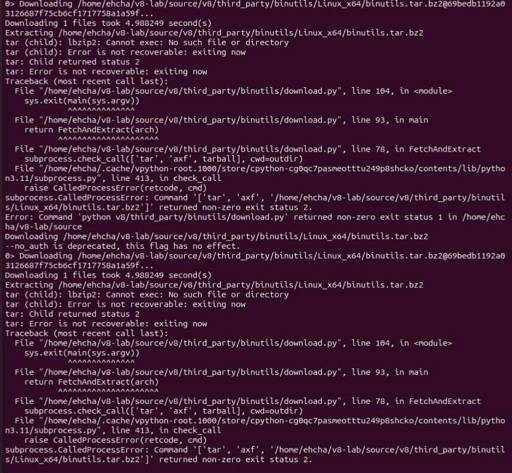
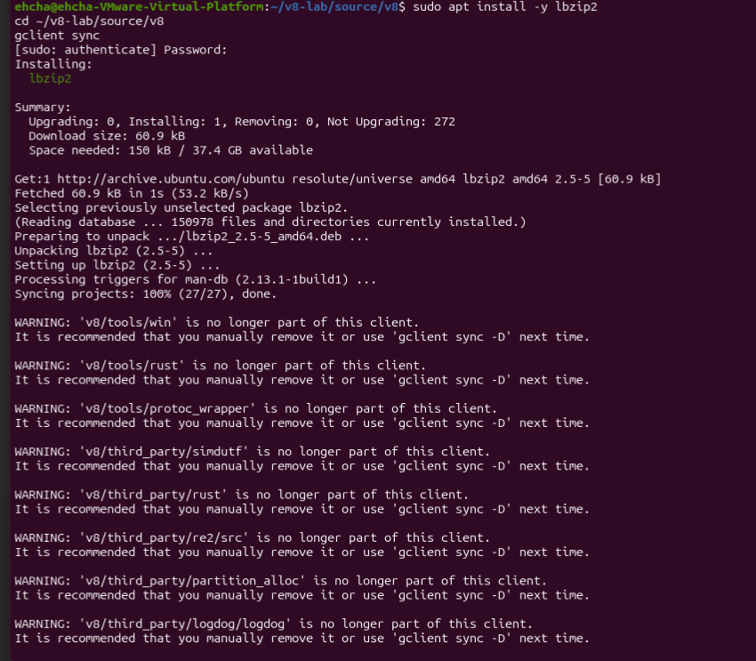
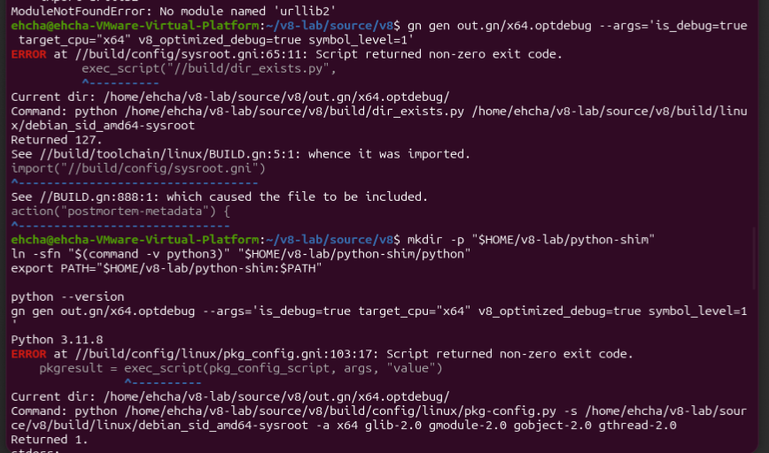
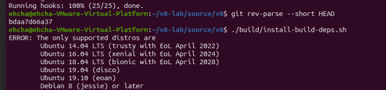
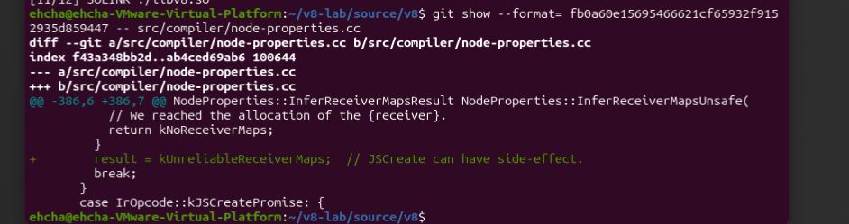
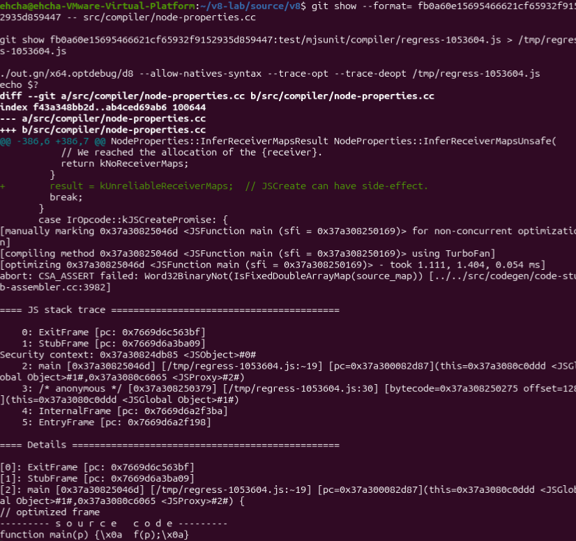
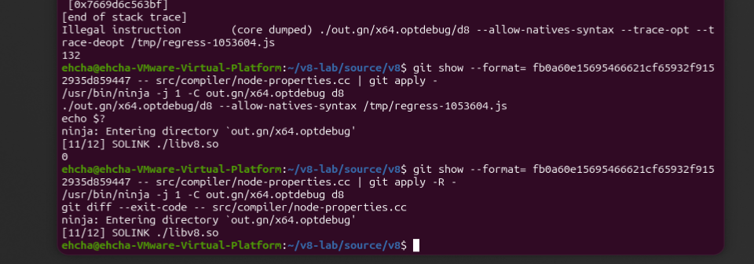

# CVE-2020-6418 Day 1 분석

> 실험일: 2026-11-01 · 환경: VMware Ubuntu, V8 `d8`  

## 1. 무엇을 확인했나

CVE-2020-6418은 V8의 최적화 엔진 TurboFan이 배열의 내부 형태가 바뀐 사실을 놓치는 문제다. 수정 전 버전에서 공개 회귀 테스트를 실행하자 내부 검사에 걸려 종료 코드 `132`가 나왔다. 수정 코드 한 줄을 적용해 같은 테스트를 실행하자 종료 코드가 `0`이었다. [수정 커밋](https://chromium.googlesource.com/v8/v8/+/fb0a60e15695466621cf65932f9152935d859447%5E%21/)

| 항목 | 실험 값 |
|---|---|
| 수정 전 커밋 | `bdaa7d66a37adcc1f1d81c9b0f834327a74ffe07` |
| 수정 커밋 | `fb0a60e15695466621cf65932f9152935d859447` |
| `d8` 버전 | `V8 version 8.2.0 (candidate)` |
| 빌드 | `x64.optdebug`, 병렬 작업 수 `-j 1` |
| 공개 테스트 | `regress-1053604.js` |

## 2. 환경 구축에서 겪은 시행착오

오래된 V8을 2026년 Ubuntu에서 빌드하면서 도구의 버전 차이로 여러 번 멈췄다. 오류가 날 때마다 원인을 확인하고 같은 소스에서 빌드를 이어 갔다.

| 순서 | 막힌 지점 | 확인한 원인과 해결 |
|---|---|---|
| 1 | `apt update`에 `Temporary failure resolving` | VM 인터넷이 연결되지 않았다. VMware NAT·DHCP 설정과 서비스를 확인했다. 게스트의 `ens33` 주소가 `169.254.95.53/16`이어서 정상적인 DHCP 주소도 받지 못한 상태였다. 이후 연결은 복구됐으나 정확한 변경 조치는 기록되지 않았다. |
| 2 | 호스트와 VM 사이 복사·붙여넣기 실패 | VMware Tools 설치를 시도했지만 당시 인터넷 오류로 패키지를 받지 못했다. 최종 해결 조치는 기록되지 않았다. VMware의 `Guest Operating System` 문구 자체는 오류가 아니었다. |
| 3 | `gclient`가 사용법만 출력하거나 나중에는 `command not found` | 처음에는 명령 없이 실행했고, 다른 셸에서는 `depot_tools`가 `PATH`에 없었다. 경로를 지정하고 `gclient sync`를 사용했다. |
| 4 | `gclient sync`의 hook 실패 | 압축 해제 도구 `lbzip2`가 없었다. `sudo apt install -y lbzip2` 후 재실행하자 `Running hooks: 100% (25/25), done.`이 나왔다. 오래된 의존성 경고는 있었지만 동기화는 완료됐다. |
| 5 | `install-build-deps.sh` 실행 거부 | 2020년 스크립트가 현재 Ubuntu `resolute`를 지원 목록에 넣지 않았다. 필요한 도구를 이후 오류에 맞춰 설치했다. |
| 6 | `v8gen.py`의 `pipes`, `urllib2` 오류 | 시스템 Python은 너무 새 버전이고, Python 3.11은 `pipes`를 통과해도 Python 2 전용 `urllib2`에서 멈췄다. `v8gen.py` 대신 GN을 직접 실행했다. |
| 7 | GN의 `python`, `pkg-config` 오류 | `python` 실행 명령을 작업 폴더에서 연결하고 `pkgconf` 패키지를 설치했다. GN이 `143 targets` 생성에 성공했다. |
| 8 | Ninja 실행 파일을 찾지 못함 | `ninja-build`를 설치하고 `/usr/bin/ninja`를 직접 실행했다. VM이 작업 중 잠긴 듯 보인 적이 있어 `-j 1`로 빌드했다. 잠김의 실제 원인은 측정하지 못했다. |
| 9 | 링커가 `libxml2.so.2`를 찾지 못함 | 오래된 `ld.lld`가 현재 Ubuntu 라이브러리와 맞지 않았다. GN 인수 `use_lld=false use_gold=false`로 시스템 링커를 사용했다. |
| 10 | Python 3 빌드 스크립트 오류 | `gcc_solink_wrapper.py`에서 bytes/str 오류, Jinja2에서 `collections.Mapping` 오류가 났다. 중간에 시도한 래퍼 수정은 `assert`가 실패해 적용되지 않았다. 빌드용 `python`을 Python 2.7로 전환했다. |
| 11 | Python 2.7 자체의 컴파일 실패 | GCC 15의 C23 기본값에서 `false`·`bool` 이름이 충돌했다. `CFLAGS='-std=gnu17'`로 다시 빌드해 Python 2.7.18을 설치했다. |

>
>
>
>
>
>


최종 빌드에 사용한 핵심 명령은 다음과 같다.

```bash
cd ~/v8-lab/source/v8
gn gen out.gn/x64.optdebug --args='is_debug=true target_cpu="x64" v8_optimized_debug=true symbol_level=1 use_lld=false use_gold=false'
/usr/bin/ninja -j 1 -C out.gn/x64.optdebug d8
git rev-parse --short HEAD
```

Ninja는 `[861/861] LINK ./d8`까지 완료됐고 커밋은 `bdaa7d66a37`이었다. 이 버전의 `d8`은 `--version`을 인식하지 않아 대화형 셸을 열며 버전 `8.2.0 (candidate)`을 표시했다. `d8> print(1 + 1)`의 결과는 `2`였다. 뒤의 `undefined`는 `print()`의 반환값이다.

> 

## 3. 취약점은 왜 생겼나

V8의 Map은 배열이나 객체의 내부 형태를 알려 주는 정보다. Proxy는 객체의 속성 조회를 가로챌 수 있는 JavaScript 기능이다. 테스트에서는 처음에 정수만 담긴 배열 `a`를 사용한다. 그런데 `Reflect.construct`가 Proxy의 `get`을 호출하면서 `a[0] = 1.1`을 실행한다. 배열에 실수가 들어가므로 내부 저장 방식이 바뀐다.

문제는 TurboFan이 객체 생성 과정의 내부 단계인 `JSCreate` 뒤에도 **이전 Map을 그대로 믿었다**는 점이다. 수정 커밋은 `src/compiler/node-properties.cc`에 다음 한 줄을 추가해, 중간에 배열 상태가 바뀌었을 수 있음을 표시한다.

```diff
+ result = kUnreliableReceiverMaps;
```

쉽게 말해 “배열은 아직 정수 배열일 것”이라고 기억한 상태에서 실제 배열은 실수 배열로 바뀐 것이다. 패치는 그 기억을 더 이상 확실한 정보로 취급하지 않게 한다. [취약한 코드](https://chromium.googlesource.com/v8/v8/+/bdaa7d66a37adcc1f1d81c9b0f834327a74ffe07/src/compiler/node-properties.cc), [Google Project Zero 분석](https://github.com/googleprojectzero/0days-in-the-wild/blob/main/0day-RCAs/2020/CVE-2020-6418.md)

> 

## 4. PoC 실행과 수정 전·후 비교

PoC(Proof of Concept)는 취약점이 실제로 발생함을 보여 주는 재현 코드다. 이 보고서에서는 V8 수정 커밋에 포함된 공개 회귀 테스트 `regress-1053604.js`를 PoC로 사용했다. 직접 만든 익스플로잇은 아니다. 아래는 전체 실행 코드가 아니라 핵심 두 줄을 발췌한 것이다.

```javascript
a.pop(Reflect.construct(empty, arguments, p));
get: () => (a[0] = 1.1, Object.prototype)
```

첫 줄의 객체 생성 과정에서 Proxy가 동작하고, 둘째 줄에서 배열에 실수를 넣는다. 전체 PoC는 아래 명령으로 수정 커밋에서 꺼낼 수 있다. 수정 전 `d8`에서 실행한 결과, `--trace-opt` 출력으로 `main` 함수가 TurboFan 최적화를 거친 것도 확인했다.

```bash
git show fb0a60e15695466621cf65932f9152935d859447:test/mjsunit/compiler/regress-1053604.js > /tmp/regress-1053604.js
./out.gn/x64.optdebug/d8 --allow-natives-syntax --trace-opt --trace-deopt /tmp/regress-1053604.js
echo $?
```

| PoC 실행 상태 | 실제 출력 | 의미 |
|---|---|---|
| 수정 전 | `CSA_ASSERT failed: Word32BinaryNot(IsFixedDoubleArrayMap(source_map))`, 종료 코드 `132` | 최적화된 코드가 예상한 배열 형태와 실제 형태가 달랐다. |
| 한 줄 패치 후 재빌드 | 테스트가 크래시 없이 끝나고 종료 코드 `0` | 같은 입력에서 내부 검사 실패가 없어졌다. |

> 
>
> 


*사진 7. 패치 후 테스트는 종료 코드 `0`으로 끝났다. 이어 패치를 되돌리고 `libv8.so`를 다시 빌드했다.*

사진 7에서 소스 패치를 되돌린 뒤 Ninja를 다시 실행하고 `git diff --exit-code -- src/compiler/node-properties.cc`가 차이를 출력하지 않은 것을 확인했다. 사진에 기록된 시점의 실험 환경은 수정 전 코드로 돌아왔다.

## 5. 결론

공개 PoC로 확인한 사실은 수정 전에는 내부 검사 실패(132), 한 줄 패치 후에는 정상 종료(0)다. 원인은 배열의 형태를 바꿀 수 있는 동작을 지나면서도 TurboFan이 이전 형태 정보를 믿은 것이다. 이 실험은 취약점의 원인과 패치 효과를 보여 준다. 임의 코드 실행은 확인하지 않았다.

### 발표할 때 30초 설명

> “V8이 배열을 정수 배열이라고 기억한 뒤, Proxy가 중간에 실수 1.1을 넣어 배열 형태를 바꿨습니다. 최적화된 코드는 이전 기억을 계속 믿고 실행하다 내부 검사에 걸렸습니다. 수정 코드는 그 중간 동작 뒤에는 이전 정보를 확실하다고 보지 않게 합니다. 실제로 수정 전 테스트는 132로 종료됐고, 패치 후에는 0으로 끝났습니다.”

## 참고 자료

- [CVE-2020-6418 기록](https://www.cve.org/CVERecord?id=CVE-2020-6418)
- [V8 수정 커밋과 회귀 테스트](https://chromium.googlesource.com/v8/v8/+/fb0a60e15695466621cf65932f9152935d859447%5E%21/)
- [Google Project Zero 원인 분석](https://github.com/googleprojectzero/0days-in-the-wild/blob/main/0day-RCAs/2020/CVE-2020-6418.md)
- [V8 GN 빌드 안내](https://v8.dev/docs/build-gn)
- [GCC 15의 C23 기본값](https://gcc.gnu.org/gcc-15/porting_to.html)
