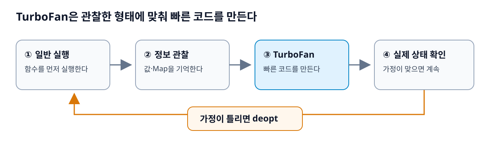
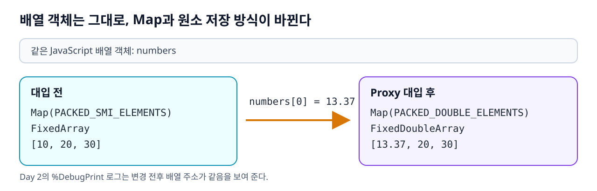
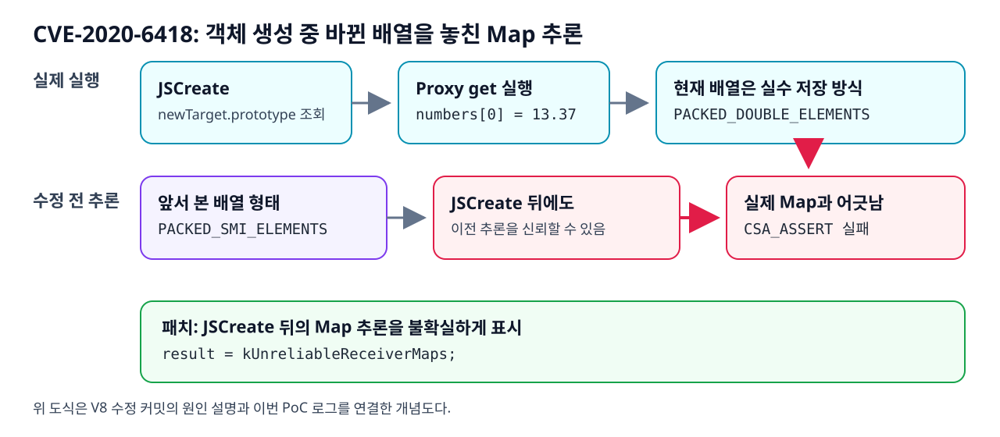

# CVE-2020-6418을 보기 전에

Day 1에서는 공개 테스트를 돌려 패치 전후를 비교했고, Day 2에서는 코드를 바꿔 가며 배열이 언제 바뀌는지 확인했다. 로그를 읽다 보면 `Map`, `elements`, `TurboFan`이 한꺼번에 나와서 흐름을 놓치기 쉽다. 이번에 사용한 V8 8.2 후보 버전을 기준으로 필요한 개념만 정리했다.

## 1. `d8`과 TurboFan

V8은 JavaScript를 실행하는 엔진이고, `d8`은 V8 코드를 브라우저 밖에서 실행할 수 있는 개발용 셸이다. 이번 PoC를 `d8`로 돌린 이유는 `--trace-opt`, `--trace-deopt`, `%DebugPrint`로 엔진 안에서 일어난 일을 볼 수 있기 때문이다. `%DebugPrint` 같은 문법은 `--allow-natives-syntax`를 켠 실험 환경에서 쓴다. [V8 `d8` 문서](https://v8.dev/docs/d8)

**TurboFan은 V8의 최적화 컴파일러**다. 함수가 실행되는 동안 관찰한 값과 객체 형태를 바탕으로 빠른 코드를 만든다. Day 2에서 `optimizedEntry`를 두 번 호출한 것은 같은 경로를 먼저 실행하기 위해서였고, `%OptimizeFunctionOnNextCall`로 다음 호출의 최적화를 요청했다. 실제로 최적화됐다는 근거는 호출 횟수가 아니라 로그의 `optimizing ... using TurboFan`이다. [V8 TurboFan 문서](https://v8.dev/docs/turbofan)

최적화 코드가 기대한 객체 형태가 실행 중 달라지면 **deopt**가 일어날 수 있다. 빠른 코드를 그만 쓰고 일반 실행 경로로 돌아가는 것이다. 분리형 PoC의 `wrong map` 뒤에 `[4] Returned...`와 종료 코드 `0`이 나온 것은 이 경우였다. [V8의 deopt 설명](https://v8.dev/blog/lazy-unlinking)



*그림 1. 관찰한 형태로 최적화한 뒤, 가정이 달라지면 deopt한다.*

## 2. Map과 elements

JavaScript에서는 `10`과 `13.37`이 둘 다 `number`다. V8은 배열을 저장할 때 둘을 더 세밀하게 구분한다. 작은 정수는 **Smi** 형태로 다룰 수 있고, 실수를 넣으면 배열의 **elements kind**가 실수를 담는 형태로 바뀐다. `elements`는 `numbers[0]`처럼 숫자 인덱스로 접근하는 원소를 뜻한다. [V8의 elements kind 설명](https://v8.dev/blog/elements-kinds)

| Day 2에서 본 시점 | Map | 원소 저장 공간 | 값 |
|---|---|---|---|
| Proxy 실행 전 | `PACKED_SMI_ELEMENTS` | `FixedArray[5]` | `[10, 20, 30]` |
| `numbers[0] = 13.37` 직후 | `PACKED_DOUBLE_ELEMENTS` | `FixedDoubleArray[5]` | `[13.37, 20, 30]` |

여기서 **Map은 `new Map()`으로 만드는 JavaScript 자료구조가 아니라 V8의 객체 형태 정보**다. 로그에서 배열 객체의 주소는 그대로인데 Map과 원소 저장 공간의 주소가 달라졌다. 즉 `numbers`가 다른 배열이 된 게 아니라 같은 배열의 내부 저장 방식이 바뀐 것이다. [V8의 Map 설명](https://v8.dev/docs/hidden-classes)

`FixedArray[5]`의 `5`는 확보된 공간 크기다. 앞선 두 번의 `pop()` 때문에 실제 배열 길이는 `3`이었다. 출력에 뒤쪽 빈 공간이 보여도 Map이 `PACKED`라고 표시됐다면 이 실험에서는 `PACKED` 배열로 읽는다.



*그림 2. 배열 객체는 그대로이고 Map과 elements 저장 방식이 바뀐다.*

## 3. `pop()` 안에서 Proxy가 실행되는 이유

PoC의 핵심 호출은 아래 한 줄이다.

```javascript
numbers.pop(Reflect.construct(AllocationTarget, arguments, newTarget));
```

`pop()`은 인수로 받은 객체를 사용하지 않는다. 하지만 `pop()`을 호출하려면 먼저 인수인 `Reflect.construct(...)`의 값을 계산해야 한다. `Reflect.construct`는 객체를 만들 때 세 번째 인수 `newTarget`을 사용한다. 마지막 호출에서 이 자리에 Proxy가 들어간다. [ECMAScript `Reflect.construct` 정의](https://tc39.es/ecma262/2024/multipage/reflection.html#sec-reflect.construct)

객체 생성 과정에서 `newTarget.prototype`을 조회하므로 Proxy의 `get`이 호출된다. Day 2의 `get` 함수는 이때 `numbers[0] = 13.37`을 실행한다. 객체를 만드는 도중 기존 배열도 바뀌는 **부작용**이 생긴 것이다. `get`이 `Reflect.get(...)`으로 `prototype` 값을 돌려주면 객체 생성은 이어진다. [ECMAScript Proxy 정의](https://tc39.es/ecma262/2024/multipage/ordinary-and-exotic-objects-behaviours.html#sec-proxy-object-internal-methods-and-internal-slots)

```text
pop()의 인수 계산
→ Reflect.construct로 객체 생성
→ newTarget.prototype 조회
→ Proxy의 get 실행
→ numbers[0] = 13.37
→ 배열 Map 변경
→ 객체 생성 후 pop() 실행 경로로 복귀
```

## 4. 이 흐름이 왜 취약점이 됐나

TurboFan은 배열의 Map을 보고 그 형태에 맞는 코드를 만들 수 있다. 문제는 위의 객체 생성 단계가 배열을 바꿀 수 있다는 점이다. V8 내부에서는 이 단계를 `JSCreate`로 다룬다. 수정 전 Map 추론은 `JSCreate`를 지난 뒤에도 이전에 알아낸 receiver Map을 신뢰할 수 있었다. 그런데 Proxy가 이미 정수 배열을 실수 배열로 바꿨다면 그 정보는 현재 배열과 맞지 않는다.

V8 수정 커밋은 `JSCreate`가 `prototype` 조회를 통해 부작용을 일으킬 수 있다고 설명하고, 그 뒤의 추론 결과를 `kUnreliableReceiverMaps`로 표시하는 한 줄을 추가했다. 배열을 원래 상태로 돌리는 코드가 아니라, **이전 Map을 확실한 정보로 쓰지 않게 하는 코드**다. [V8 수정 커밋](https://chromium.googlesource.com/v8/v8/+/fb0a60e15695466621cf65932f9152935d859447%5E%21/)



*그림 3. 실제 배열은 바뀌었는데 이전 Map 추론을 계속 믿을 수 있었던 지점.*

이 그림은 패치 설명을 풀어 그린 것이다. `%DebugPrint`로 직접 확인한 것은 배열의 형태 변화다. TurboFan 내부의 모든 노드가 어떤 순서로 배치됐는지까지 로그로 확인한 것은 아니다.

## 5. 내 실행 로그는 어떻게 읽었나

| 로그 | 이번 실험에서 확인한 것 |
|---|---|
| `optimizing ... using TurboFan` | 목표 함수가 최적화 경로에 들어갔다. |
| `PACKED_SMI_ELEMENTS` → `PACKED_DOUBLE_ELEMENTS` | Proxy의 대입으로 실제 배열의 저장 방식이 바뀌었다. |
| `deoptimize ... wrong map`, 종료 코드 `0` | 분리형 코드는 불일치를 감지하고 일반 경로로 돌아와 끝났다. |
| `CSA_ASSERT failed`, 종료 코드 `132` | `pop(Reflect.construct(...))` 형태는 수정 전 빌드에서 내부 검사 실패를 재현했다. |

`wrong map`과 `CSA_ASSERT`는 다른 결과다. 배열 형태가 바뀐 사실만으로 크래시를 재현했다고 볼 수는 없다. Day 2에서는 두 호출 형태를 각각 실행했기 때문에 그 차이를 확인할 수 있었다. 종료 코드 `132`도 내부 검사 실패의 증거이며 임의 코드 실행의 증거는 아니다.

## 참고 자료

- [V8 `d8` 문서](https://v8.dev/docs/d8)
- [V8 TurboFan 문서](https://v8.dev/docs/turbofan)
- [V8 elements kind 설명](https://v8.dev/blog/elements-kinds)
- [V8 Map 설명](https://v8.dev/docs/hidden-classes)
- [V8 deopt 설명](https://v8.dev/blog/lazy-unlinking)
- [ECMAScript `Reflect.construct`](https://tc39.es/ecma262/2024/multipage/reflection.html#sec-reflect.construct)
- [ECMAScript Proxy 정의](https://tc39.es/ecma262/2024/multipage/ordinary-and-exotic-objects-behaviours.html#sec-proxy-object-internal-methods-and-internal-slots)
- [CVE-2020-6418 V8 수정 커밋](https://chromium.googlesource.com/v8/v8/+/fb0a60e15695466621cf65932f9152935d859447%5E%21/)
