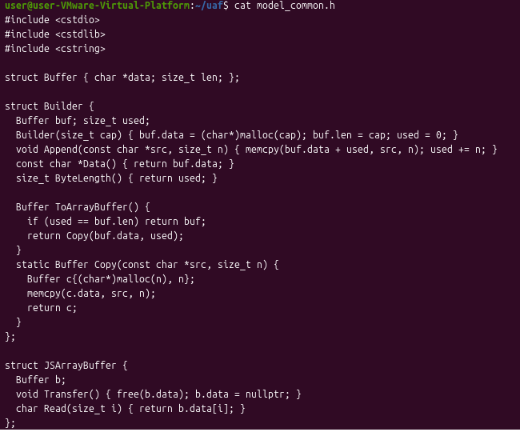
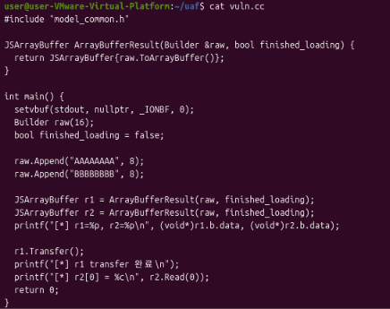
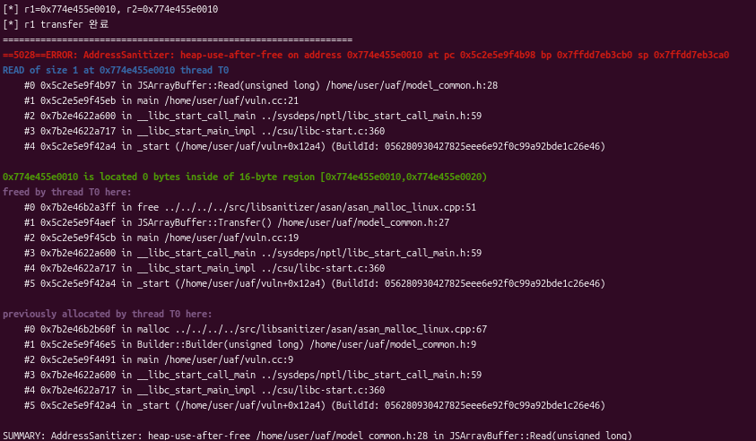
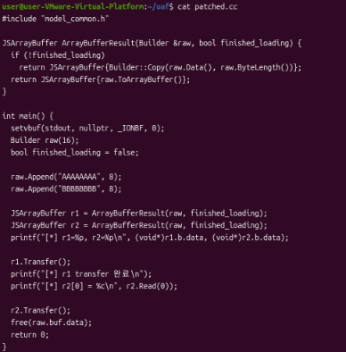
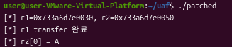
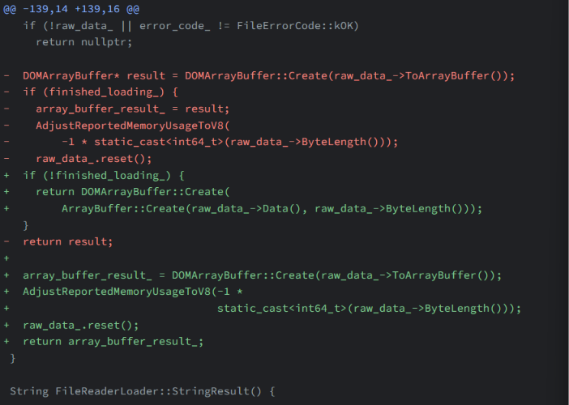

# UAF(Use-After-Free)
이미 free된 메모리를 다시 사용하는 취약점

char *p = malloc(32);   
free(p);                            # 메모리 반납
p[0] = 'A';                         # 반납한 메모리에 다시 접근 -> UAF

free 이후에도 포인터 p에는 주소가 그대로 남아 있다.
이런 포인터를 dangling pointer라고 한다.
문제는 free된 공간이 비어 있는 상태로 유지되는 것이 아니라 이후 다른 객체가 그 자리에 할당될 수 있다는 점이다.

1. 할당          [ 객체 A ]     ← p가 가리킴
2. free         [ (빈 공간) ]   ← p는 여전히 이 주소를 가리킴
3. 재할당        [ 객체 B ]     ← 공격자가 원하는 데이터로 채움
4. p로 접근      → A로 착각하고 B를 읽거나 씀

공격자가 3단계에서 원하는 데이터를 해당 위치에 채울 수 있으면 4단계에서 프로그램이 공격자의 데이터를 신뢰하고 사용하게 된다.
이를 통해 임의 메모리 읽기/쓰기, 코드 실행까지 이어지게 된다.

# OOB write와의 차이
OOB write는 할당된 범위 밖에 쓰는 공간의 문제이고,
UAF는 수명이 끝난 메모리를 사용하는 시간의 문제이다.

# 참조 카운트(ref-count)
Chrome은 메모리를 참조 카운트로 자동 관리하므로 UAF가 발생한 이유를 이해하려면 참조 카운트의 동작 방식과 한계를 먼저 알아야 하기 때문에 정리한다.
이번 취약점은 자동 관리되는 메모리도 소유권이 잘못되면 UAF가 발생할 수 있다는 사례이다.

Chrome의 C++코드는 메모리를 직접 free하지 않고 참조 카운트로 관리하는 객체가 많다.
ex) scoped_refptr<T>가 대표적

객체를 참조하면 카운트 + 1
참조를 해제하면 카운트 - 1
카운트가 0이 되면 자동으로 해제

원래는 아무도 사용하지 않을 때만 해제되므로 UAF가 발생하지 않아야하지만,
참조 카운트로 관리되는 객체 내부의 메모리를 다른 곳에서 별도로 가리키고 있으면 문제가 생기게 된다.

# FileReader API
취약점의 트리거 조건이 FileReader의 동작 방식과 직접 연결되어 있다.
로딩 도중 onprogress가 호출되고 그 안에서 result를 읽을 수 있다는 점을 알아야 뒤에 나오는 로딩이 끝나기 직전 result를 여러 번 읽는 트리거 흐름과 finished_loading_ 플래그의 의미를 이해할 수 있다.

웹 페이지에서 파일을 읽을 때 사용하는 API이다.

const reader = new FileReader();
reader.onprogress = (e) => { /* 읽는 도중 주기적으로 호출됨 */ };
reader.onload     = (e) => { console.log(reader.result); };
reader.readAsArrayBuffer(blob);

* readAsArrayBuffer(): 파일을 ArrayBuffer 형태로 읽음
* onprogress: 데이터가 들어오는 동안 약 50ms마다 호출
* reader.result: 지금까지 읽은 데이터를 반환함, 로딩 도중에도 접근 가능

로딩 중에도 result에 접근할 수 있으므로 브라우저 내부에 읽는 중인 데이터를 JS로 넘기는 별도 코드가 존재하게 되고 취약점은 이 코드에서 발생한다.

# 취약 코드
[관련 코드 위치]
third_party/blink/renderer/core/fileapi/file_reader_loader.cc → FileReaderLoader::ArrayBufferResult()
third_party/blink/renderer/platform/wtf/typed_arrays/array_buffer_builder.cc → ArrayBufferBuilder::ToArrayBuffer()

FileReaderLoader는 읽어 온 파일 데이터를 raw_data_(ArrayBufferBuilder)에 쌓아둠
JS에서 reader.result에 접근하면 ArrayBufferResult()가 호출되고, raw_data_를 DOMArrayBuffer로 감싸 반환함
패치로 수정된 함수는 ArrayBufferResult() 하나이며, ToArrayBuffer()는 원인 설명을 위해 함께 정리함

[패치 전 코드 - FileReaderLoader::ArrayBufferResult()]
DOMArrayBuffer* FileReaderLoader::ArrayBufferResult() {
  DCHECK_EQ(read_type_, kReadAsArrayBuffer);
  if (array_buffer_result_)
    return array_buffer_result_;                      # (1) 로딩 완료 후 캐시된 결과가 있으면 반환

  if (!raw_data_ || error_code_ != FileErrorCode::kOK)
    return nullptr;                                   # (2) 로딩 시작 전이거나 에러면 빈 결과

    # (3) 문제의 줄
  DOMArrayBuffer* result = DOMArrayBuffer::Create(raw_data_->ToArrayBuffer());

  if (finished_loading_) {                            # (4) 로딩이 끝났을 때만 캐시
    array_buffer_result_ = result;
    ...
    raw_data_.reset();
  }
  return result;
}

1. 로딩이 끝나 결과가 캐시되어 있으면 같은 객체를 반환한다, 이 경우는 안전함
2. 아직 읽은 데이터가 없거나 에러가 난 경우 nullptr를 반환한다.
3. raw_data_->ToArrayBuffer()의 반환값을 그대로 DOMArrayBuffer로 감싼다. (반환값이 원본인지 복사본인지 확인하지 않음)
4. finished_loading_이 true일 때만 결과를 캐시한다. 즉 로딩 중에는 result를 읽을 때마다 3번이 매번 새로 실행하게 된다.

[관련 코드 - ArrayBufferBuilder::ToArrayBuffer()]
이 함수는 패치에서 수정되지 않았지만 버퍼가 꽉 찼을 때 원본을 반환하는 동작이 이 함수에 있어 함께 정리한다.
scoped_refptr<ArrayBuffer> ArrayBufferBuilder::ToArrayBuffer() {
  // 버퍼가 꽉 찼으면 내부 버퍼를 그대로 반환
  if (buffer_->ByteLength() == bytes_used_)
    return buffer_;

  // 아니면 사용한 만큼 잘라서 복사본 반환
  return buffer_->Slice(0, bytes_used_);
}

* buffer_->ByteLength(): 미리 할당해 둔 버퍼의 전체 크기
* bytes_used_: 지금까지 실제로 채운 크기
두 값이 같으면(버퍼가 꽉 차면) 복사하지 않고 내부 버퍼 buffer_ 원본을 반환한다.
두 값이 다르면 Slice()로 채운 만큼만 잘라 새 복사본을 반환한다.

[취약 조건 정리]
ArrayBufferResult()는 로딩 중에 결과를 캐시하지 않아 result를 읽을 때마다 ToArrayBuffer()를 새로 호출한다.
ToArrayBuffer()는 버퍼가 꽉 차면 복사본이 아닌 원본을 반환한다.
따라서 버퍼는 꽉 찼지만 finished_loading_이 아직 false인 순간에 result를 여러 번 읽으면, 같은 원본 메모리를 감싼 DOMArrayBuffer가 여러개 만들어지게 된다.
이 상태가 어떻게 UAF로 이어지는지는 다음 메모리 그림에서 정리해보자.

# 메모리 그림
로딩 시작부터 UAF 발생까지의 상태 변화를 시간 순서로 정리
버퍼 크기(16바이트)와 데이터(A, B)는 설명을 위한 예시이다.

[T1] 로딩 중 - 버퍼가 덜 찬 상태
finished_loading_ = false

raw_data_ : [ AAAAAAAA | ........ ]    bytes_used_ = 8 / ByteLength = 16

result 읽기 → ToArrayBuffer() → Slice() 복사본 반환

result ──▶ [ AAAAAAAA ]   (복사본, 별도 메모리)

버퍼가 덜 차 있으므로 ToArrayBuffer()가 복사본을 반환한다.
result를 여러 번 읽어도 각각 다른 메모리를 가지므로 안전하다.

[T2] 데이터 모두 도착 - 버퍼가 꽉 찬 상태
finished_loading_ = false   ← 아직 false

raw_data_ : [ AAAAAAAA | BBBBBBBB ]    bytes_used_ = 16 / ByteLength = 16

데이터는 모두 들어와 버퍼가 꽉 찼지만, finished_loading_은 아직 false이다.
이 시점부터 취약 구간이 시작된다.

[T3] result를 두 번 읽음
result1 = reader.result   → ToArrayBuffer() → 원본 buffer_ 반환
result2 = reader.result   → ToArrayBuffer() → 원본 buffer_ 반환

result1 ──┐
          ├──▶ [ AAAAAAAA | BBBBBBBB ]   ← 같은 원본 메모리
result2 ──┘

finished_loading_이 false라 결과가 캐시되지 않으므로, 읽을 때마다 ToArrayBuffer()가 새로 호출된다.
버퍼가 꽉 찼으므로 두 번 모두 원본 buffer_가 반환된다.
서로 다른 두 ArrayBuffer 객체가 같은 메모리를 가리키게 된다.

[T4] result1을 transfer
result1 ──X   (detach)

result2 ─────▶ [ ####### freed ####### ]   ← 해제된 메모리를 가리킴

result1을 transfer하면 result1은 detach되고 메모리가 해제된다.
result2는 메모리가 해제된 사실을 모른 채 같은 주소를 계속 가리킨다. (dangling pointer)

[T5] result2로 접근
result2 ─────▶ [ freed ]  → 읽기 / 쓰기 발생

→ Use-After-Free

result2로 데이터를 읽거나 쓰면 해제된 메모리에 접근하게 되어 UAF가 발생하게 된다.

[그림 정리]

| 시점 | 버퍼 상태 | finished_loading_ | result 반환값 | 상태 |
|---|---|---|---|---|
| T1 | 덜 참 | false | 복사본 | 안전 |
| T2 | 꽉 참 | false | - | 취약 구간 시작 |
| T3 | 꽉 참 | false | 원본 (2개가 공유) | 메모리 공유 |
| T4 | 해제됨 | false | - | result2가 dangling |
| T5 | 해제됨 | false | - | UAF 발생 |

핵심은 T2 이후 finished_loading_이 true가 되기 전 구간이다.
이 구간에서는 원본이 반환되지만 캐시되지 않아, 같은 메모리를 공유하는 객체가 여러 개 생길 수 있다.

# 실습
이번 실습 코드는 실제 Chrome 코드가 아니라 CVE-2019-5786의 원인 구조만 옮겨 만든 단순화 모델이다.
실제 Chrome에서 재현하려면 취약 버전(72.0.3626.119) 빌드와 트리거 스크립트가 필요하다.
이번 글의 목적은 취약점의 원인과 패치를 이해하는 것이므로 원인이 되는 구조만 C++로 옮겨 모델을 만들어 실행한다.
모델을 AddressSanitizer(ASan)로 빌드하여 패치 전에는 UAF가 발생하고, 패치 후에는 발생하지 않는 것을 확인하는 것이 목표이다.
실습 환경: Ubuntu 26 VM (VMware Workstation), g++ + ASan (-fsanitize=address)

* model_common.h: 패치 전/후 모델이 함께 쓰는 공통 코드
* vuln.cc: 패치 전 ArrayBufferResult()를 옮긴 모델
* patched.cc: 패치 후 ArrayBufferResult()를 옮긴 모델

패치 전과 패치 후 모델에서 달라지는 부분은 ArrayBufferResult() 하나뿐이므로, 나머지 공통 부분을 이 파일로 분리했다.
실제 패치도 ArrayBufferResult()만 수정했기 때문에, 실습 코드도 같은 구조로 맞추었다.
버퍼(Builder), 원본/복사본을 반환하는 ToArrayBuffer(), JS의 ArrayBuffer(JSArrayBuffer)를 단순화한 코드가 들어 있다.

[패치 전]

ArrayBufferResult()는 패치 전 코드처럼 로딩 중인지 확인하지 않고 ToArrayBuffer()의 결과를 그대로 반환한다.
main()에서는 16바이트 버퍼를 만들고 데이터를 꽉 채워, 버퍼는 꽉 찼지만 finished_loading은 아직 false인 상황을 만든다.
이 상태에서 result를 두 번 읽는 것처럼 r1, r2를 만든 뒤, r1을 transfer하여 메모리를 해제하고 r2로 같은 메모리를 읽는다.
메모리 그림의 T2 ~ T5 흐름을 그대로 옮긴 코드이다.

[실행명령어]
g++ -g -fsanitize=address -o vuln vuln.cc
./vuln

[실행 결과]

r1, r2의 주소가 0x774e455e0010으로 같아 두 객체가 같은 메모리를 공유하고 있음을 확인할 수 있다.
r2로 값을 읽는 순간 ASan이 heap-use-after-free를 탐지하고 프로그램을 종료한다.
ASan 출력에 메모리가 할당된 위치(previously allocated by), 해제된 위치(freed by), 해제 후 접근한 위치(READ of size 1)가 함께 나타나 UAF의 흐름을 한 번에 확인할 수 있다.

[패치 후]

ArrayBufferResult()는 실제 패치 내용을 반영하여, finished_loading이 false일 때는 ToArrayBuffer()를 거치지 않고 항상 새 메모리에 복사본을 만들어 반환한다.
main()은 패치 전 모델과 같은 흐름으로 버퍼를 꽉 채운 뒤 r1, r2를 만들고 r1을 transfer한 다음 r2로 값을 읽는다.

[실행명령어]
g++ -g -fsanitize=address -o patched patched.cc
./patched

[실행 결과]

r1은 0x733a6d7e0030, r2는 0x733a6d7e0050으로 주소가 서로 달라 각자 별도의 복사본을 가지고 있음을 확인했다.
r1을 transfer해도 r2는 영향을 받지 않고 정상적으로 A를 읽는다.
ASan 에러 없이 정상 종료되었다.

# 패치 분석
패치 커밋: ba9748e78ec7e9c0d594e7edf7b2c07ea2a90449
수정된 함수: FileReaderLoader::ArrayBufferResult()

빨간 줄(-)은 삭제된 코드, 초록 줄(+)은 추가된 코드이다.
패치 전: 로딩 중이든 아니든 항상 ToArrayBuffer()의 결과를 반환하고, 로딩이 끝났을 때만 캐시했다.
패치 후: if (!finished_loading_) 분기가 추가되었다.
로딩 중이면 ArrayBuffer::Create(raw_data_->Data(), raw_data_->ByteLength())로 새 버퍼를 만들어 데이터를 복사한 뒤 바로 반환한다.
로딩이 끝난 뒤에만 ToArrayBuffer()를 호출하고, 결과를 array_buffer_result_에 캐시하여 반환한다.
로딩 중에는 ToArrayBuffer()를 거치지 않으므로, result를 여러 번 읽어도 매번 별도의 복사본이 반환되어 메모리 공유가 발생하지 않는다.
앞선 실습의 패치 후 모델은 이 수정 내용을 단순화하여 반영한 것이다.