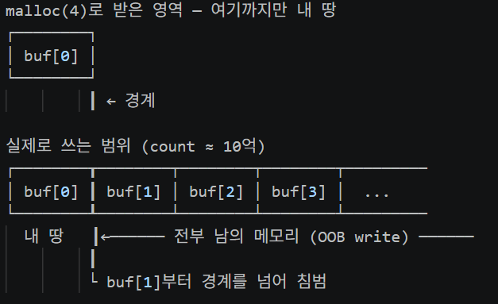
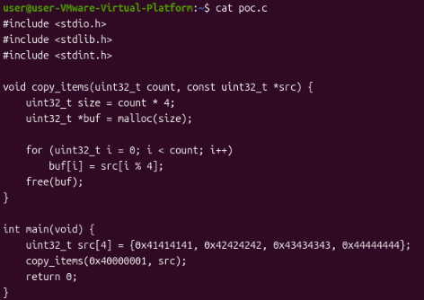
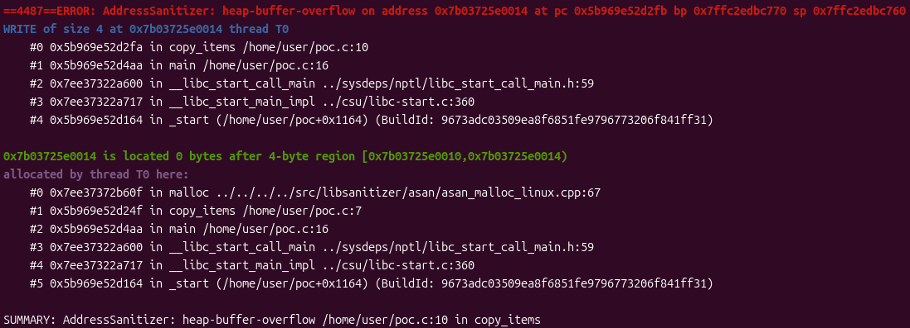
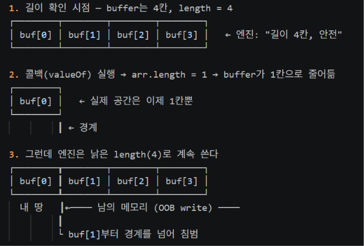
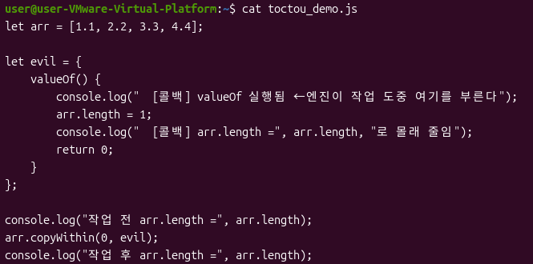
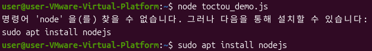
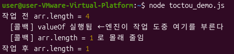

# 이 글은 OOB write로 이어지는 대표적인 원인 4가지를 다룬다
# 1. 정수 오버플로/언더플로
## 개념
정수에는 담을 수 있는 한계가 있다. 이 한계를 넘으면 값이 계속 늘어나는게 아니라 0쪽으로 다시 되돌아가게 된다. 만약 32비트 부호 없는 정수라면 담을 수 있는 최댓값이 0xFFFFFFFF인데 여기서 1을 더하면 9자리가 되어 맨 앞이 잘리게 되고 남은 값(0)으로 돌아가 버린다.

예시) 0xFFFFFFFF + 1 = 0x100000000 -> 맨 앞 1이 잘림, 0

그럼 이게 왜 메모리 할당에서 위험한가.
메모리 할당할 때 크기를 개수 x 원소 크기처럼 곱셈으로 계산하는 경우가 많다.
이때 원소 개수가 외부 입력(파일 헤더 값, 네트워크 패킷 값, 사용자 입력 등)에서 들어온다면 공격자가 이 개수를 한계를 넘어서는 큰 값으로 조작할 수 있다. 그러면 곱셈 결과가 한 바퀴 돌아 실제로는 아주 작은 버퍼가 할당되는데, 정작 데이터는 원래 개수만큼 쓰려 한다. 결국 할당받은 경계를 넘어 힙에 있는 다른 데이터, 힙 관리용 메타데이터, 인접 객체를 덮어쓰게 된다. 이렇게 경계 밖을 쓰는 것이 OOB write(Out-of-Bounds write)다.

예시) size = count x 4 = 0x40000001 x 4 = 0x100000004
-> 32비트에 담으면 맨 앞 1이 잘림, size는 4가 된다.
-> 반복문이라면 count(약 10억)번 쓰기 때문에 경계 밖으로 넘치게 된다.
*참고로 OOB read는 남의 데이터를 훔쳐보는데 그치지만, OOB write는 데이터를 바꿔버리기 때문에 훨씬 위험하다.

그럼 크기 검사를 하면 막을 수 있을까? 답은 아니다.
개수 값 자체를 상한으로 막았더라도 그 개수로 곱셈한 결과가 오버플로 나는 것을 따로 막지 않으면 여전히 뚫린다. 즉 값을 검사한 것과 그 값으로 계산한 결과가 안전한 것은 다른 얘기다.

예시) if (count > MAX) return error; -> 개수는 검사함
      uint32_t size = count * 4; -> 곱셈은 검사 안 함, 오버플로 가능

마지막으로 언더플로는 뺄셈에서 같은 원리로 발생한다. 길이를 빼는 계산에서 빼는 값이 더 크면 음수가 되어야 하는데, 부호 없는 정수는 음수를 담을 수 없어 거꾸로 엄청나게 큰 값으로 돌아간다. 프로그램은 이 값을 남은 길이로 믿고 그만큼 쓰다가 버퍼를 넘어서게 되어 위험해진다.

## 취약 코드
void copy_items(uint32_t count, const uint32_t *src) {
    uint32_t size = count * 4;         1. 곱셈 결과 → 오버플로 지점
    uint32_t *buf = malloc(size);

    for (uint32_t i = 0; i < count; i++)
        buf[i] = src[i % 4];           2. count만큼 쓴다 → 경계 밖으로 넘침
    free(buf);
}

실제 코드에는 보통 if (count > MAX) 같은 개수 검사가 있다. 하지만 그건 개수만 볼 뿐 count * 4의 결과는 보지 않기 때문에 상한을 아주 큰 값으로 잡아놓으면 검사를 통과하고도 오버플로가 난다. 검사가 있다고 안전한게 아니다.

## 메모리 그림

malloc(4)로 받은 건 buf[0] 하나 들어갈 4바이트 뿐이다. 그런데 반복문은 buf[1], buf[2]...계속 써 나가고 경계를 넘는 순간부터는 힙 메타데이터나 옆 객체 같은 남의 메모리를 덮어쓰게 된다.
그럼 정말 경계를 넘는지 직접 빌드해서 확인해보자.

## 실습
실습에 사용한 전체 코드는 다음과 같다.

코드를 저장하고 ASan을 켜서 컴파일한 뒤 실행한다.
gcc -g -fsanitize=address -o poc poc.c # 빌드
./poc                                  # 실행

실행하면 다음과 같이 heap-buffer-overflow가 잡혔다.

ASan이 poc.c의 10번째 줄, 즉 buf에 값을 쓰는 곳에서 경계를 넘은 것을 잡아냈다. 출력의 #0 ... copy_items poc.c:10을 보면 어느 줄에서 터졌는지 알 수 있다. 0 bytes after 4-byte region 부분에서 실제로 할당된 공간은 4바이트 뿐이고 그 뒤에 값을 썼다는 것을 확인할 수 있다.
이렇게 곱셈 오버플로로 작아진 버퍼의 경계 바깥에 값을 쓰는 것이 OOB write다.

# 2. Side-effect로 인한 길이 재검증 누락
## 개념
확인한 시점과 실제로 사용하는 시점 사이에 값이 바뀌어 발생하는 문제다.
예를 들어 은행 창구에서 잔고가 있으니 출금 가능하다고 확인하고 돈을 내주는 사이에 다른 창구에서 그 돈을 다 빼간다면 직원은 아까 확인한 정보를 믿고 그대로 돈을 내어주고 결국 문제가 발생하고 만다. 이렇게 확인 시점과 사용 시점 사이의 틈을 노리는 것을 TOCTOU(Time-Of-Check to Time-Of-Use)라고 한다.

JS 엔진에서 배열을 다루는 내장 함수에서도 이와 똑같은 일이 벌어진다. 먼저 배열의 길이를 확인하고 그 길이만큼 안전하게 작업하려 하는데 작업 중간에 사용자가 정의한 콜백을 호출하는 경우가 있다. 공격자가 이 콜백 안에 배열 길이를 줄이는 코드를 심어두면, 배열의 실제 저장 공간은 이미 작아졌는데 엔진은 처음에 확인한 길이를 믿고 계속 쓰게 된다. 그 결과 작아진 공간의 경계를 넘어 OOB write가 발생한다.

## 취약 코드
# 실제 V8코드는 훨씬 복잡하다. 아래는 핵심 흐름만 단순화한 의사코드다.
// JS 엔진 내부 builtin의 동작을 단순화한 모습
length = arr->length;                       # 1. 길이를 확인한다 (예: 4)

value  = call_user_callback();              # 2. 여기서 valueOf 등 사용자 콜백 실행
                                               → 이 안에서 arr.length = 1 로 줄어듦

for (i = 0; i < length; i++)                # 3. 낡은 length(4)로 계속 쓴다
    arr->buffer[i] = value;                    → 작아진 buffer의 경계를 넘음 → OOB write

## 메모리 그림

엔진은 1에서 길이를 4로 확인했지만 2의 콜백이 배열을 1칸으로 줄여버린다. 그러나 엔진은 여전히 낡은 길이 4를 믿고 쓰기 때문에 이미 사라진 buf[1]부터 남의 메모리를 덮어쓰게 된다.

## 실습
최신 엔진은 콜백 이후 길이를 다시 확인하도록 패치되어 있어 이 코드만으로는 OOB write가 터지지 않는다. 이 시연은 엔진이 작업 중간에 사용자 콜백을 부르고 그 안에서 배열을 바꿀 수 있다는 공격의 전제 조건을 보여주는 것이다. 실제 취약점은 이 재검증이 빠져 있던 과거 버전에서 발생했다.

toctou_demo.js에 실습 코드를 작성했다.

Node.js로 실행할 때 node를 찾을 수 없다는 명령어가 나오면 sudo apt install nodejs로 설치하자.

node toctou_demo.js로 실행한 결과이다. 중간에 [콜백] 줄이 찍힌 것을 보면 copyWithin 작업 도중에 valueOf가 실제로 불렸고 그 안에서 arr.length가 4에서 1로 줄어든 것을 확인할 수 있다.