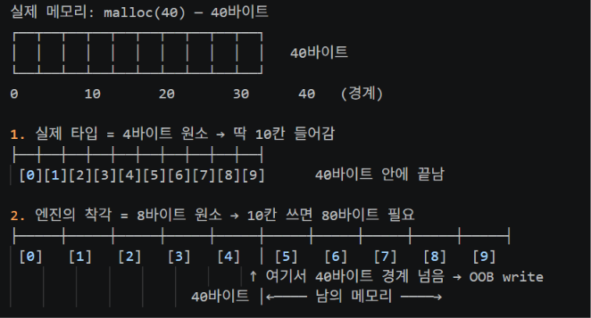
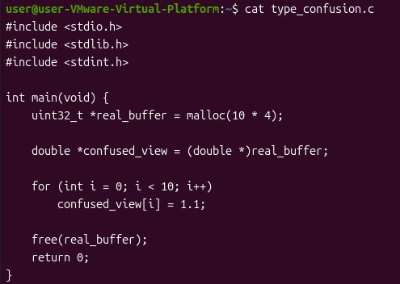
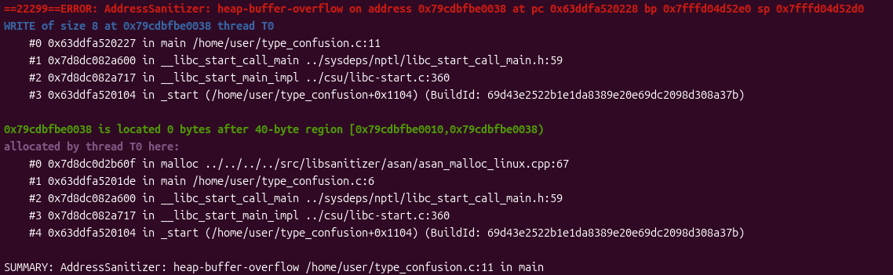
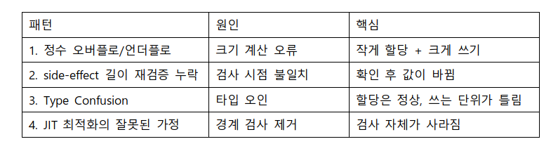

# 3. Type Confusion
## 개념
엔진이 객체의 타입을 착각해서 생기는 문제다. 실제와 다른 타입으로 알고 접근하기 때문에 크기나 구조를 잘못 보고 경계를 넘게 된다.

예를 들어 택배 기사가 작은 상자를 큰 상자로 착각했다고 가정했을 때 착각한 것 자체는 아직 사고가 아니다. 하지만 큰 상자인 줄 알고 물건을 꽉 채워 넣다 상자가 넘치는 순간 사고가 난다. 여기서 착각한 것이 Type Confusion(원인)이고 그로 인해 경계 밖에 쓰는 것이 OOB write(결과)다.

JS 엔진은 속도를 이 객체는 이런 타입이다 가정하고 최정화한다. 그 가정이 맞으면 빠르지만 공격자가 가정을 깨뜨리면 문제가 생긴다. 대표적인 것이 원소 크기 착각이다. V8은 배열을 종류에 따라 다르게 저장한다. 실수 배열은 원소 하나가 8바이트지만 압축 포인터 배열은 4바이트다. 만약 엔진이 4바이트짜리 배열을 8바이트짜리로 착각하면 실제보다 두 배 큰 범위를 안전하다고 믿고 쓰게 된다.

예시) 실제 배열: 원소 10개 x 4바이트 = 40바이트
     엔진의 착각: 원소 10개 x 8바이트 = 80바이트

사실 앞에서 썼던 패턴 1인 정수 오버플로/언더플로와 똑같은 개념 아니냐고 착각할 수도 있다. 패턴 1은 할당 크기 자체가 오버플로로 작아진 것이고 패턴 3은 할당은 정상(40바이트)인데 원소 크기를 착각해 쓴다는 부분에서 차이점이 있다.

## 취약 코드
# 실제 V8은 타입 정보를 Map으로 관리하며 훨씬 복잡하다. 아래는 같은 메모리를 다른 타입으로 본다는 핵심만 단순화한 의사코드다

// 실제 배열: 원소 하나가 4바이트 (압축 포인터 배열)
uint32_t *real_buffer = malloc(10 * 4);           # 실제로는 40바이트

// 그런데 엔진이 이 배열의 타입을 "8바이트 원소(double 배열)"로 착각
double *confused_view = (double *)real_buffer;    # 1. 같은 메모리를 8바이트로 봄

for (int i = 0; i < 10; i++)                      # 2. 10개가 안전하다고 믿고
    confused_view[i] = 1.1;                       # 8바이트씩 쓴다 → 80바이트 사용
                                                  # 40바이트 경계를 넘음 → OOB write

## 메모리 그림

메모리는 40바이트 그대로다. 하지만 엔진이 8바이트로 착각하면 10칸을 쓰는데 80바이트가 필요하다고 계산한다. 그래서 [5]부터는 이미 40바이트 경계를 넘어 남의 메모리를 덮어쓰게 된다.

그럼 이제 직접 빌드해서 확인해보자.

## 실습
실습에 사용한 전체 코드는 다음과 같다.

코드를 저장하고 ASan을 켜서 컴파일한 뒤 실행한다.
gcc -g -fsanitize=address -o type_confusion type_confusion.c  # 빌드
./type_confusion                                              # 실행

ASan이 type_confusion.c의 13번째 줄에서 경계를 넘은 것을 잡아냈다. 주목할 점은 WRITE of size 8이다. 실제 버퍼는 4바이트 원소용으로 만들어 졌는데 8바이트 단위로 쓰고 있다는 뜻이다. 할당된 공간은 40-byte region으로 정상이지만 원소를 8바이트로 착각했기 때문에 10개를 쓰면 80바이트가 되어 40바이트 경계를 넘는 것을 확인 할 수 있다.

앞에서 패턴 1과 3의 차이점을 짚었다. 실습에서도 짚어보자면 ASan 출력에서 패턴 1은 4-byte region으로 할당 자체가 작아진게 보이고, 패턴 3은 40-byte region으로 할당은 정상인데 WRITE of size 8로 쓰는 단위가 커지는 걸 확인할 수 있다.

# 4. JIT 최적화의 잘못된 가정
## 개념
앞의 세 패턴이 크기 계산이나 타입처럼 값을 잘못 다뤄서 생기는 문제였다면, 패턴 4는 엔진의 최적화가 경계 검사를 잘못 제거해서 생기는 문제다.

JS 엔진은 같은 코드가 반복 실행되면 그것을 더 빠른 기계어로 미리 컴파일해둔다. 이것을 JIT(Just-In-Time) 컴파일이라고 한다. 이때 속도를 높이기 위해 이 값은 늘 이 범위다, 이 배열 길이는 변하지 않는다 같은 가정을 세우고 불필요해 보이는 검사를 제거한다.

평소에는 이 가정이 맞기 때문에 문제가 없고 오히려 검사를 건너뛰어 더 빠르다. 하지만 공격자가 그 가정이 틀리는 상황을 만들면, 이미 검사가 제거된 코드가 그대로 실행된다. 경계를 막아줄 검사가 없으니 결국 OOB write가 발생한다는 것이다.

앞의 패턴들이 검사는 있지만 우회되거나 착각으로 뚫리는 경우였다면, 패턴 4는 검사 자체가 사라진 경우라는 점에서 차이가 있다.

## 취약 코드
# 실제 JIT 최적화는 훨씬 복잡한 조건으로 동작한다. 아래는 경계 검사가 제거된다는 핵심만 단순화한 의사코드다.

// [최적화 전] 배열에 쓸 때마다 경계를 검사한다
if (index < array->length)                     # 1. 경계 검사 — index가 범위 안인지 확인
    array->buffer[index] = value;              #    안전할 때만 쓴다

// [최적화 후] JIT이 index는 늘 안전하다고 가정하고 1을 제거한다
array->buffer[index] = value;                  # 2. 검사 없음! 가정이 틀리면 그대로 OOB write

## 실습
패턴 4는 앞의 패턴들과 달리 간단한 코드로 재현할 수 없다. JIT 최적화는 엔진이 같은 코드를 반복 실행하며 동작하기 때문에 실제로 재현하려면 취약한 버전의 V8 엔진 전체가 필요하다. 그래서 이 글에서는 이정도만 다루고 실제 재현과 분석은 CVE-2024-0517 분석 글에서 이어서 다룬다.

# 정리

네 패턴 모두 결과는 OOB write로 같지만, 거기에 이르는 원인은 서로 다르다. 원인을 알아야 구분하고 막을 수 있다.