> 스스로 공부하면서 다시 보기 위해 개인적으로 정리한 글이며, 틀린 부분이 존재할 수 있습니다. ai와 함께 학습한 내용이고, 트러블 슈팅 과정이 들어가 있기 때문에 성공담만 보고 싶으신 분이라면 적절하지 않은 글일 수 있습니다.

환경 세팅 전, 미리 준비해둔 환경은 다음과 같다.

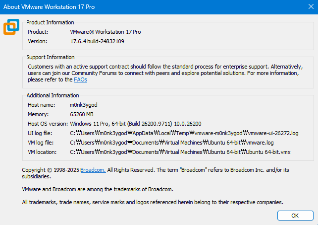

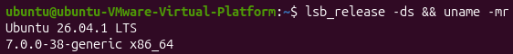

ubuntu의 경우 설치 후 아무런 설정도 하지 않은 상태이다.

# 1. 도구 설치

```bash
sudo apt update && sudo apt upgrade -y

sudo apt install -y \
  open-vm-tools open-vm-tools-desktop \
  linux-headers-$(uname -r) \
  build-essential git curl wget ca-certificates pkg-config \
  cmake ninja-build clang lld llvm gdb gdbserver \
  python3 python3-venv python3-dev python3-pip \
  file lsb-release unzip zip xz-utils zstd jq ripgrep rsync \
  libssl-dev libffi-dev \
  binutils patchelf strace ltrace nasm ccache \
  tmux hto checksec libc6-dbg
```

설치한 도구들의 역할은 다음과 같다.

| 도구 | 역할 |
| --- | --- |
| open-vm-tools | VMware 게스트 서비스 |
| clang, lld, llvm | V8 컴파일러와 LLVM 도구 |
| gdb, gdbserver | 네이티브 디버깅 |
| gn | Ninja 빌드 설정 생성 |
| ninja, autoninja | 실제 컴파일 |
| d8 | V8 JavaScript 셸 |
| rg | V8 소스 검색 |
| strace, ltrace | 시스템·라이브러리 호출 추적 |
| readelf, objdump, nm | ELF 구조와 심볼 분석 |
| checksec | PIE, NX, RELRO, Canary 확인 |
| pwntools | PoC 자동화와 바이트·주소 처리 |

gdb의 사용성을 강화하기 위해 pwndbg 플러그인도 설치해주었다.

```bash
cd ~
git clone https://github.com/pwndbg/pwndbg
cd ~/pwndbg
./setup.sh
```

디버거 사용 방법이나, 분석과정에서 등장하는 개념들은 나올 때 마다 정리하고,
추가적으로 상세한 문서 기록이 필요하다는 생각이 들면 link 처리하여 문서화 시킬 예정이다.

# 2. CVE-2020-6507 분석 환경 구축

디렉터리 구조는 다음과 같이 둘 것이다.

```
/home/ubuntu/security-lab/cve/CVE-2020-6507/
├── workspace/
│   ├── .gclient
│   └── v8/
│       └── out/
│           ├── vuln-asan/
│           ├── vuln-debug/
│           ├── fixed-asan/
│           └── fixed-debug/
├── poc/
├── notes/
├── logs/
├── scripts/
└── artifacts/
```

생성해주자.

```bash
mkdir -p /home/ubuntu/security-lab/cve/CVE-2020-6507/workspace
mkdir -p /home/ubuntu/security-lab/cve/CVE-2020-6507/poc
mkdir -p /home/ubuntu/security-lab/cve/CVE-2020-6507/notes
mkdir -p /home/ubuntu/security-lab/cve/CVE-2020-6507/logs
mkdir -p /home/ubuntu/security-lab/cve/CVE-2020-6507/scripts
mkdir -p /home/ubuntu/security-lab/cve/CVE-2020-6507/artifacts
```

다운로드량을 줄이기 위해, fetch v8를 사용하지 않고 진행하기로 했다.

기존 V8 저장소를 참고, `--dissociate`로 기존 저장소와 독립된 복제본을 만든다.

### 이렇게 하는 이유...?

여기서 저장소(Repository)는 git 저장소를 이야기하는데, V8 History는 커밋이 수심만개여서 클론 한번 하면 수 GB가 오고간다...

CVE 하나당 한 번씩 새로 받으면 디스크랑 네트워크가 남아나지를 않기 때문에, 이미 받아둔 것을 재활용하는 것이다.

## fetch v8

`fetch`는 depot_tools에 들어 있는 명령으로, V8/Chromium 체크 아웃을 처음부터 통째로 만들어주는 역할을 한다. 내부적으로는 2개의 단계를 수행한다.

1. `.gclient` 설정 파일 생성 (solution 이름 `v8`, URL은 공식 V8 git)
2. `gclient sync` 실행 - V8 본체를 클론하고, `DEPS` 파일을 읽어 의존 저장소들(build, buildtools, ICU, zlib, googletest, jinja2 등 수십 개)을 전부 내려받음

편하긴한데, 1단계를 사용자가 손댈 수 없다는게 문제이다.

클론 방식을 지정할 수 없어서 기존 저장소를 참조하지 못하고, 매번 전체를 네트워크로 새로 받게 된다.

그리고 기본이 managed 모드라 `gclient sync`가 V8 본체의 리비전까지 관리하려고 하기 때문에, 여기서는 `fetch v8`을 하지 않고 두 단계를 나눠서 진행한다.

##  gclient settings

1단계이다. 

```bash
cd /home/ubuntu/security-lab/cve/CVE-2020-6507/workspace

/home/ubuntu/depot_tools/gclient config --unmanaged \
  https://chromium.googlesource.com/v8/v8.git
```

실행하면 `.gclient`라는 텍스트 파일 하나가 생긴다.

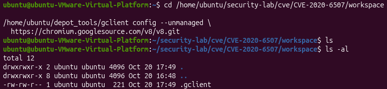

내용은 다음과 같다.

```bash
ubuntu@ubuntu-VMware-Virtual-Platform:~/security-lab/cve/CVE-2020-6507/workspace$ cat .gclient
solutions = [
  { "name"        : 'v8',
    "url"         : 'https://chromium.googlesource.com/v8/v8.git',
    "deps_file"   : 'DEPS',
    "managed"     : False,
    "custom_deps" : {
    },
    "custom_vars": {},
  },
]
```

이 파일의 의미는 "이 디렉터리가 체크아웃의 루트이고, 최상위 저장소(solution)는 `v8`이라는 하위 디렉터리이다" 라는 의미를 가진다.

나중에 `gclient sync`를 돌리면 해당 파일을 찾아 읽고, `v8/DEPS`에 적힌 의존성들을 그 리버전에 맞춰 가져오게 된다.

명령을 수행할 때 `--unmanaged` 옵션을 이용했는데, 이게 중요하다.

### --unmanaged

managed 모드이면, `gclient sync`가 V8 본체를 자기가 아는 리비전(보통 최신 버전)으로 되돌려버릴 수 있다.

1-day를 분석하는 입장에서는 취약한 커밋 환경을 고정해두고 연구를 진행해야하기 때문에, 본체의 체크아웃 위치는 사용자가 직접 git checkout으로 정하고 의존성만 맞추는 형태인 `--unmanaged`를 붙여준 것이다.

## V8 저장소 복제

2단계를 진행하기 위해 V8 저장소를 클론 해오자.

```bash
cd /home/ubuntu/security-lab/cve/CVE-2020-6507/workspace

git clone \
  --reference /home/ubuntu/security-lab/v8/v8 \
  --dissociate \
  https://chromium.googlesource.com/v8/v8.git \
  v8
```

여기서 붙은 옵션들은 다음과 같다.

- `--reference`: 기존 V8 저장소의 Git 객체를 복제 과정에서 활용
- `--dissociate`: 복제가 끝나면 기존 저장소 의존성을 제거

이렇게 하면, /home/ubuntu/security-lab/v8/v8을 수정하지 않는 별도 저장소가 만들어진다. (둘이 거의 세트로 사용한다)

`.gclient`는 체크아웃 최상위 설정이고, solution 이름에 따라 v8 디렉터리를 관리하게 된다.

## CVE 분석에 사용할 Revision 받기

```bash
cd /home/ubuntu/security-lab/cve/CVE-2020-6507/workspace/v8

git fetch origin main

git fetch origin \
  refs/branch-heads/8.3:refs/remotes/origin/branch-heads/8.3
```

분석에서 구분할 주요 리비전은 다음과 같다.

| 용도 | V8 커밋 |
|---|---|
| 취약 Chrome 83 릴리스 | 3b627511511f00c552ced504c1f182bdcc3480af |
| 수정 Chrome 83 릴리스 | 90904eb48b16b32f7edbf1f8a92ece561d05e738 |
| 핵심 패치 직전 | c6c0090532f08a09146f958865f8027c44bce020 |
| 핵심 수정 패치 | b8883649d08c758d5ba729078b1f747d21faa582 |

Chrome 83.0.4103.106에서 CVE-2020-6507 수정이 배포되었니 참고하자.

(https://chromereleases.googleblog.com/2020/06/stable-channel-update-for-desktop_15.html)

## gclient sync

sync 하기 전, 취약 버전을 체크아웃 해주자.

```bash
cd /home/ubuntu/security-lab/cve/CVE-2020-6507/workspace/v8

git switch --detach \
  3b627511511f00c552ced504c1f182bdcc3480af
```

여기서 `--detach` 옵션은 특정 커밋을 정확하게 체크아웃 할 때 사용하는 옵션이며, 별도의 연구용 브랜치를 만들지 않고 리비전 자체를 고정하는 방식이다.

이제 `gclient sync`를 실행해주자.

```bash
/home/ubuntu/depot_tools/gclient sync
```

gclient sync는 해당 V8 리비전의 DEPS에 기록된 빌드 도구와 하위 의존성을 맞춰준다.

- DEPS(dependencies): 특정 버전의 V8을 빌드하기 위한 의존성 목록으로, Python 문법으로 쓰여있다.

### 리비전 기록

동기화 후 리비전을 기록한다. (추후에 다시 재현할 때 용이)

```bash
git rev-parse HEAD | tee \
  /home/ubuntu/security-lab/cve/CVE-2020-6507/logs/vuln-v8-revision.txt

git show -s --format=fuller HEAD | tee \
  /home/ubuntu/security-lab/cve/CVE-2020-6507/logs/vuln-v8-commit.txt
```

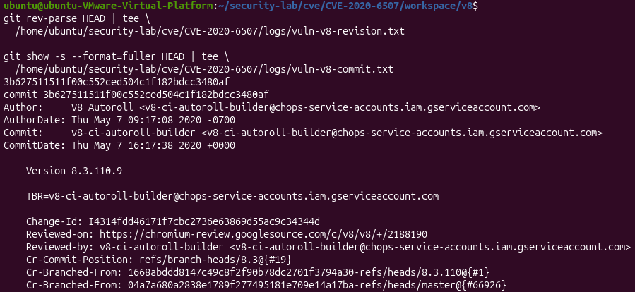

## 취약 버전 ASan 빌드

ASan(AddressSanitizer)는 컴파일러(clang/gcc)에 내장된 **메모리 오류 탐지기**이다.

이 녀석이 이용하는 핵심 아이디어는 2가지이다.

1. Shadow memory
프로그램 메모리 1바이트마다 접근해도 괜찮은지를 기록하는 별도의 맵을 둔다.

실제로는 8바이트당 1바이트 비율로 압축해서 관리하며, 모든 load/store 직전에 해당 맵을 조회한다.

2. Redzone
할당된 모든 메모리 블록 앞뒤에 독이 칠해진(poisoned) 완충 구역을 끼워 넣는다.
배열 밖으로 한칸만 넘어가도 레드존을 밟아 트리거 되는 형태이다.

해제된 메모리도 바로 재사용하지 않고 격리(quarantine) 큐에 넣어 독을 칠해둔다. 때문에 use-after-free도 잡아낼 수 있다.

다음 명령으로 빌드해주자.

```bash
cd /home/ubuntu/security-lab/cve/CVE-2020-6507/workspace/v8

/home/ubuntu/depot_tools/gn gen out/vuln-asan \
  --args='is_debug=false is_asan=true is_component_build=false target_cpu="x64" symbol_level=2 v8_enable_backtrace=true v8_enable_disassembler=true v8_enable_object_print=true'

/home/ubuntu/depot_tools/autoninja \
  -C out/vuln-asan d8
```

### Trouble shooting 1 (error 127)

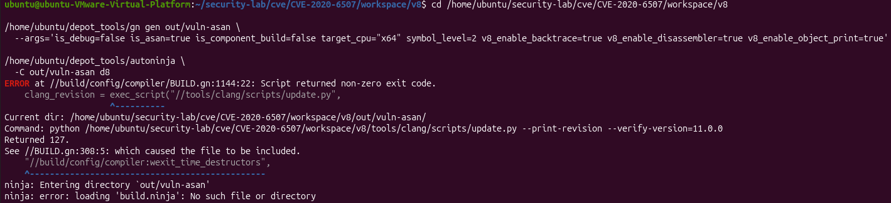

근데 오류가 떴다.

종료 코드 127은 명령을 찾지 못했다는 뜻으로, 그 뒤의 Ninja 오류는 gn gen 실패로 build.ninja가 생성되지 않았음을 의미한다.

```bash
sudo apt install -y python-is-python3
```

python 명령이 없어서 그런 것이니 다음과 같이 설치해주자.

해당 패키지는 별도의 가상환경을 만드는 것이 아니라 `/usr/bin/python`이 python3를 가리키게 한다.

### Trouble shooting 2 (error 255)

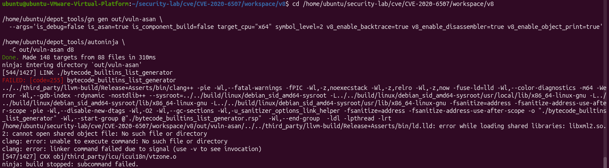

다시 실행해보니 다른 오류가 떴다.

이번에는 GN 설정은 성공했고, 컴파일도 544단계까지 진행이 되었다.

막힌 지점은 V8에 포함된 2020년 `ld.lld`가 호스트에서 `libxml2.so.2`를 찾지 못해서 발생한 것으로 보인다.

Ubuntu 26.04 버전을 이용중이기에 `libxml.so.2`가 없다. 그래서 강제로 링크 시키면 안되고, 2020년판 `ld.lld` 대신에 Ubuntu의 기본 GNU 링커가 찾도록 만들어주면 된다. (고 내 AI가 그랬음)

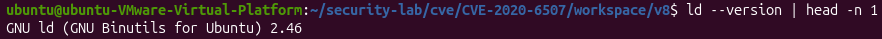

시스템 링커가 있는건 확인했고, 이제 ASan 설정에서 구형 LLD를 비활성화 해주자.

```bash
cd /home/ubuntu/security-lab/cve/CVE-2020-6507/workspace/v8

/home/ubuntu/depot_tools/gn gen out/vuln-asan \
  --args='is_debug=false is_asan=true is_component_build=false target_cpu="x64" symbol_level=2 use_lld=false use_gold=false v8_enable_backtrace=true v8_enable_disassembler=true v8_enable_object_print=true'
```

그리고 잘 설정되었는지 확인까지 해주자.

```bash
/home/ubuntu/depot_tools/gn args \
  out/vuln-asan \
  --list=use_lld

/home/ubuntu/depot_tools/gn args \
  out/vuln-asan \
  --list=use_gold
```

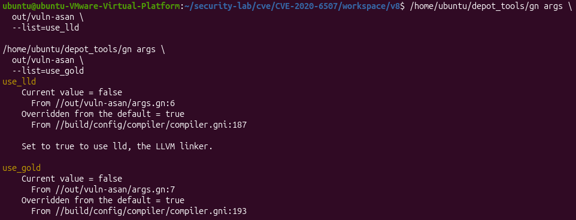

두 설정 모두 Current value가 false인 것을 보니 잘 적용된 것 같다.

### Trouble shooting 3 (error 1)

이번에도 오류가 떴다.

2020년 V8 체크아웃 안에 Jinja2(Python Template Engine)가 `third_party/jinja2`로 딸려 들어왔는데, 이게 V8 빌드 과정에서 코드 생성에 쓰인다. (토치 파일이나 바인딩 코드를 템프릿에서 찍어내는 용도)

근데 이 시절 Jinja2 코드에는 `from collections import Mapping` 이라는 코드가 들어있었는데, 이게 Python 3.3에서 `Mapping` 같은 추상 베이스 클래스들이 `collections.abc`로 옮겨 갔다.

하위 호환을 위해서 `collections`에서도 계속 import되게 별칭을 남겨줬는데, 그게 3.10에서 제거되어서 에러가 난 것이다...

Jinja2를 재설치하는건 조금 과하니, 파일 수정만 해주자.

일단 원본을 백업해주자.

```bash
cd /home/ubuntu/security-lab/cve/CVE-2020-6507/workspace/v8

cp third_party/jinja2/tests.py \
  third_party/jinja2/tests.py.cve-2020-6507.bak
```

이후 Python 3.14 호환 패치를 진행해주자.

```bash
sed -i \
  's/^from collections import Mapping$/from collections.abc import Mapping/' \
  third_party/jinja2/tests.py
```

수정 되었는지 확인

```bash
rg -n \
  '^from collections(\.abc)? import Mapping$' \
  third_party/jinja2/tests.py
```

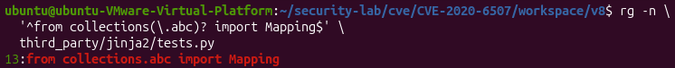

해당 변경은 Chromium에 포함된 구형 Jinja2의 실제 `from collections import Mapping` 구문만 수정한다.

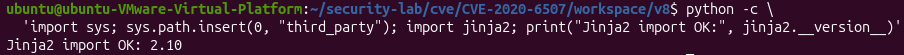

Jinja2 단독 로딩으로 잘 적용되었음도 확인했으니, 호환 패치한 내용을 기록해두자.

```bash
git -C third_party/jinja2 diff -- tests.py \
  | tee /home/ubuntu/security-lab/cve/CVE-2020-6507/artifacts/python314-jinja2-mapping.patch
```

이 패치는 나중에 취약/수정 환경을 재구성할 때 사용할 수 있다. (안 쓰더라도 뭐 하면 좋으니...)

### Trouble shooting 4 (error 139)

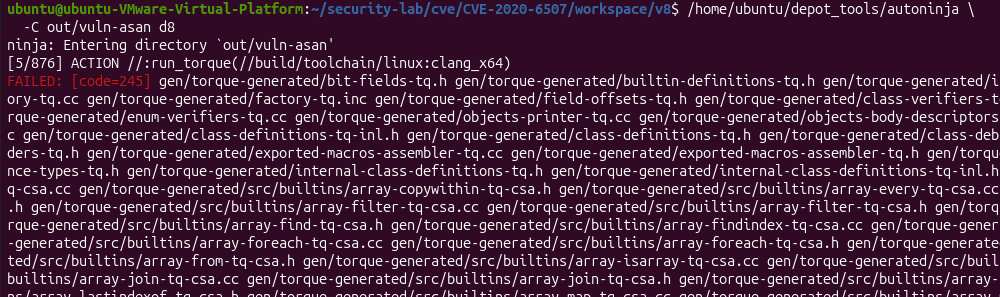

이번에도 오류가 떴다...

또 Python 문제는 아닌거 같고, torque 실행 파일 자체가 비정상 종료한 것으로 보인다.

나온 김에 시그널 역연산에 대해 다뤄보자.

#### shell의 종료 코드 규칙

프로세스는 두 가지 방식으로 끝난다.

- 스스로 종료: `exit(0)`, `exit(1)` 같은 값을 반환
- 시그널에 맞아 죽음: SIGSEGV, SIGABRT 등

shell은 이 둘을 한 바이트짜리 `$?`에 욱여넣어야 해서, 시그널로 죽은 경우 **128 + 시그널 번호**로 표시하는 관례를 쓴다.

```
139 = 128 + 11   → SIGSEGV
134 = 128 + 6    → SIGABRT
130 = 128 + 2    → SIGINT (Ctrl+C)
```

이제 오류 코드를 다시보자.

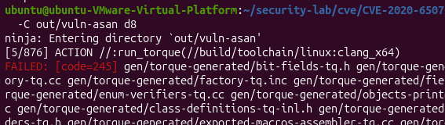

여기서는 245가 떴다. 어떻게 245가 나온걸까?

파이썬의 `subprocess`는 시그널 사망을 음수로 돌려준다.

- ex. SIGSEGV: `returncode == -11`

`tools/run.py`는 자식을 실행하고 그 값을 그대로 `sys.exit()`에 넘긴다. 근데 종료 코드는 0~255 범위의 한 바이트라, 음수를 넘기면 256으로 감싸진다. (모듈러 연산)

```
-11 mode 256 = 245
```

그래서 역연산을 하면?

```
245 -> 256 - 245 = 11 -> SIGSEGV
```

가 되는 것이다.

다시 트러블 슈팅으로 돌아와서...

현재 ASan Torque 상태를 보면, 

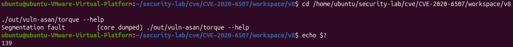

SIGSEGV를 확인할 수 있다.

일단 현재 바이너리를 보관해주자.

```bash
cp out/vuln-asan/torque \
  /home/ubuntu/security-lab/cve/CVE-2020-6507/artifacts/torque-asan-crashing

sha256sum \
  /home/ubuntu/security-lab/cve/CVE-2020-6507/artifacts/torque-asan-crashing \
  | tee /home/ubuntu/security-lab/cve/CVE-2020-6507/logs/torque-asan-crashing.sha256
```

그리고 ASan만 끈 동일 리비전의 torque를 만들고 컴파일해준다.

```bash
/home/ubuntu/depot_tools/gn gen out/host-tools \
  --args='is_debug=false is_asan=false is_component_build=false target_cpu="x64" symbol_level=0 use_lld=false use_gold=false v8_enable_backtrace=true v8_enable_disassembler=true v8_enable_object_print=true'

/home/ubuntu/depot_tools/autoninja \
  -C out/host-tools torque
```

그리고 단독 실행 시켜서 잘 돌아가는지 확인해보자.

```bash
./out/host-tools/torque --help
```

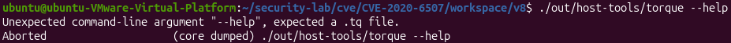

139나 Segmentation fault만 안뜨면 된다.

잘 나오는거 같으니 도구를 교체해주자.

```bash
install -m 0755 \
  out/host-tools/torque \
  out/vuln-asan/torque
```

`install`은 실행 권한을 유지하면서 파일을 복사하고 수정 시간을 갱신한다.

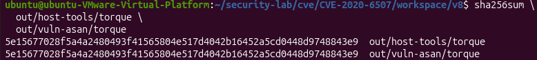

해시 검증까지 ㅎㅎ

다시 중단되었던 빌드를 이어서 진행해보자.

```bash
/home/ubuntu/depot_tools/autoninja \
  -C out/vuln-asan d8
```

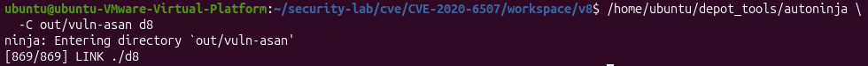

성공 ㅎㅎ

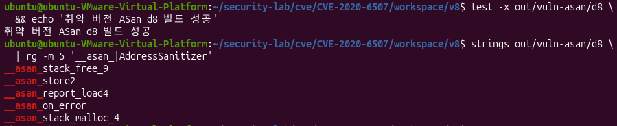

잘 적용된 거 같으니 실행까지 해보자.

### Trouble shooting 5

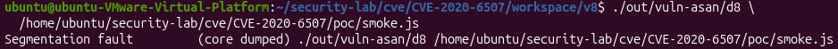

이번에도 Segmentation fault가 뜬다.

ai한테 물어보니 ASan 런타입 시작 단계에서 죽는 것 같다고 하니 조치를 해보자.

```bash
ls -l \
  build/linux/debian_sid_amd64-sysroot/lib64/ld-linux-x86-64.so.2
```

로더의 위치를 확인해서 만약 존재하면,

```bash
/home/ubuntu/security-lab/cve/CVE-2020-6507/workspace/v8/build/linux/debian_sid_amd64-sysroot/lib64/ld-linux-x86-64.so.2 \
  --inhibit-cache \
  --library-path /home/ubuntu/security-lab/cve/CVE-2020-6507/workspace/v8/build/linux/debian_sid_amd64-sysroot/lib/x86_64-linux-gnu:/home/ubuntu/security-lab/cve/CVE-2020-6507/workspace/v8/build/linux/debian_sid_amd64-sysroot/usr/lib/x86_64-linux-gnu:/home/ubuntu/security-lab/cve/CVE-2020-6507/workspace/v8/build/linux/debian_sid_amd64-sysroot/usr/local/lib/x86_64-linux-gnu \
  /home/ubuntu/security-lab/cve/CVE-2020-6507/workspace/v8/out/vuln-asan/d8 \
  --version
```

다음과 같이 실행해본다.

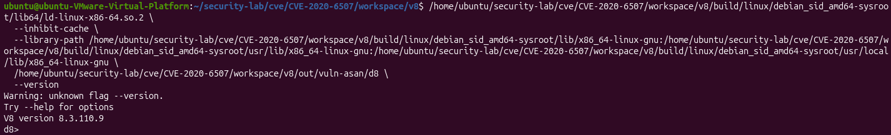

근데 버전도 뜨고, `d8>` 프롬프트도 뜨는 것으로 봐서는 glibc 2.29 sysroot 로더로 ASan d8이 정상 실행된 것으로 보인다.

일단 `quit();`(또는 Ctrl+D)로 프롬프트를 나와서 smoke test를 해보자.

- smoke test: 가장 기초적인 동작만 빠르게 확인. (일단 켜지는지 봄)

실행할 파일을 간단하게 만들어주자.

```bash
mkdir -p \
  /home/ubuntu/security-lab/cve/CVE-2020-6507/poc

printf '%s\n' 'print(1 + 1);' \
  > /home/ubuntu/security-lab/cve/CVE-2020-6507/poc/smoke.js
```

그리고 한 번 실행해보면?

```bash
/home/ubuntu/security-lab/cve/CVE-2020-6507/workspace/v8/build/linux/debian_sid_amd64-sysroot/lib64/ld-linux-x86-64.so.2 \
  --inhibit-cache \
  --library-path /home/ubuntu/security-lab/cve/CVE-2020-6507/workspace/v8/build/linux/debian_sid_amd64-sysroot/lib/x86_64-linux-gnu:/home/ubuntu/security-lab/cve/CVE-2020-6507/workspace/v8/build/linux/debian_sid_amd64-sysroot/usr/lib/x86_64-linux-gnu:/home/ubuntu/security-lab/cve/CVE-2020-6507/workspace/v8/build/linux/debian_sid_amd64-sysroot/usr/local/lib/x86_64-linux-gnu \
  /home/ubuntu/security-lab/cve/CVE-2020-6507/workspace/v8/out/vuln-asan/d8 \
  /home/ubuntu/security-lab/cve/CVE-2020-6507/poc/smoke.js
```

오? 잘 실행이 된다.

이렇게 ASan d8의 빌드와 실행을 전부 확인해봤다.

단, Ubuntu 26.04의 호스트 로더로 직접 실행하면 계속 충돌하게 될테니, 앞으로는 sysroot 실행 스크립트를 사용해야될 것 같다. (지금 한 것처럼)

## ASan 전용 실행 스크립트 생성

```bash
mkdir -p \
  /home/ubuntu/security-lab/cve/CVE-2020-6507/scripts

tee /home/ubuntu/security-lab/cve/CVE-2020-6507/scripts/vuln-asan-d8 >/dev/null <<'EOF'
#!/usr/bin/env bash
set -euo pipefail

exec /home/ubuntu/security-lab/cve/CVE-2020-6507/workspace/v8/build/linux/debian_sid_amd64-sysroot/lib64/ld-linux-x86-64.so.2 \
  --inhibit-cache \
  --library-path /home/ubuntu/security-lab/cve/CVE-2020-6507/workspace/v8/build/linux/debian_sid_amd64-sysroot/lib/x86_64-linux-gnu:/home/ubuntu/security-lab/cve/CVE-2020-6507/workspace/v8/build/linux/debian_sid_amd64-sysroot/usr/lib/x86_64-linux-gnu:/home/ubuntu/security-lab/cve/CVE-2020-6507/workspace/v8/build/linux/debian_sid_amd64-sysroot/usr/local/lib/x86_64-linux-gnu \
  /home/ubuntu/security-lab/cve/CVE-2020-6507/workspace/v8/out/vuln-asan/d8 \
  "$@"
EOF

chmod +x \
  /home/ubuntu/security-lab/cve/CVE-2020-6507/scripts/vuln-asan-d8
```

스크립트가 잘 돌아가는지 확인해보자.

```bash
/home/ubuntu/security-lab/cve/CVE-2020-6507/scripts/vuln-asan-d8 \
  -e 'print(version())'

/home/ubuntu/security-lab/cve/CVE-2020-6507/scripts/vuln-asan-d8 \
  /home/ubuntu/security-lab/cve/CVE-2020-6507/poc/smoke.js
```

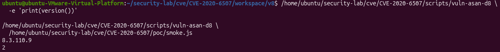

버전과 결과값이 잘 나오는 것을 보니 잘 동작하는 것 같다.

## 빌드 정보 기록

```bash
git rev-parse HEAD \
  | tee /home/ubuntu/security-lab/cve/CVE-2020-6507/logs/vuln-v8-revision.txt

sha256sum out/vuln-asan/d8 \
  | tee /home/ubuntu/security-lab/cve/CVE-2020-6507/logs/vuln-asan-d8.sha256

cp out/vuln-asan/args.gn \
  /home/ubuntu/security-lab/cve/CVE-2020-6507/artifacts/vuln-asan-args.gn
```

## 취약 버전 Debug 빌드

ASan에 이어 취약 버전 Debug도 진행해준다.

```bash
cd /home/ubuntu/security-lab/cve/CVE-2020-6507/workspace/v8

/home/ubuntu/depot_tools/gn gen out/vuln-debug \
  --args='is_debug=true is_component_build=false target_cpu="x64" symbol_level=2 dcheck_always_on=true use_lld=false use_gold=false v8_enable_backtrace=true v8_enable_disassembler=true v8_enable_object_print=true'

/home/ubuntu/depot_tools/autoninja \
  -C out/vuln-debug d8
```

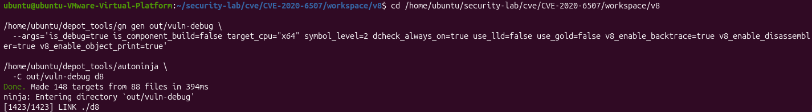

오? 된거 같다.

test랑 sysroot 로더로 검증해보자.

```bash
test -x out/vuln-debug/d8 \
  && echo '취약 버전 Debug d8 빌드 성공'


/home/ubuntu/security-lab/cve/CVE-2020-6507/workspace/v8/build/linux/debian_sid_amd64-sysroot/lib64/ld-linux-x86-64.so.2 \
  --inhibit-cache \
  --library-path /home/ubuntu/security-lab/cve/CVE-2020-6507/workspace/v8/build/linux/debian_sid_amd64-sysroot/lib/x86_64-linux-gnu:/home/ubuntu/security-lab/cve/CVE-2020-6507/workspace/v8/build/linux/debian_sid_amd64-sysroot/usr/lib/x86_64-linux-gnu:/home/ubuntu/security-lab/cve/CVE-2020-6507/workspace/v8/build/linux/debian_sid_amd64-sysroot/usr/local/lib/x86_64-linux-gnu \
  /home/ubuntu/security-lab/cve/CVE-2020-6507/workspace/v8/out/vuln-debug/d8 \
  /home/ubuntu/security-lab/cve/CVE-2020-6507/poc/smoke.js
```

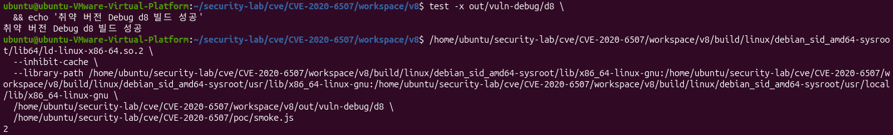

일단은 이렇게 환경 구축을 완료했다.

처음하는거라 AI가 하라는대로 진행해서 사실 이해가 잘 되지는 않았다. 하지만 앞으로 분석하거나 다른 CVE를 2개 정도 더 분석할건데, 이 과정에서 구축을 왜 이런식으로 했는지를 이해해 나가보려고 한다.