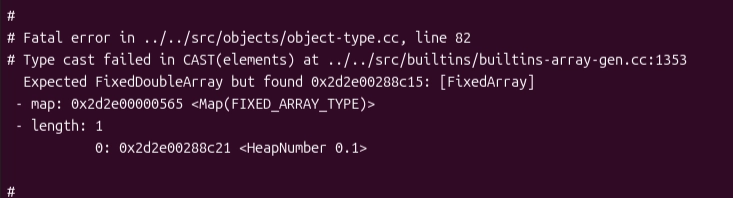
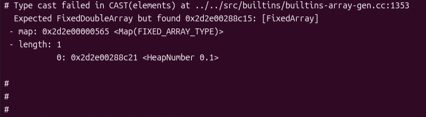
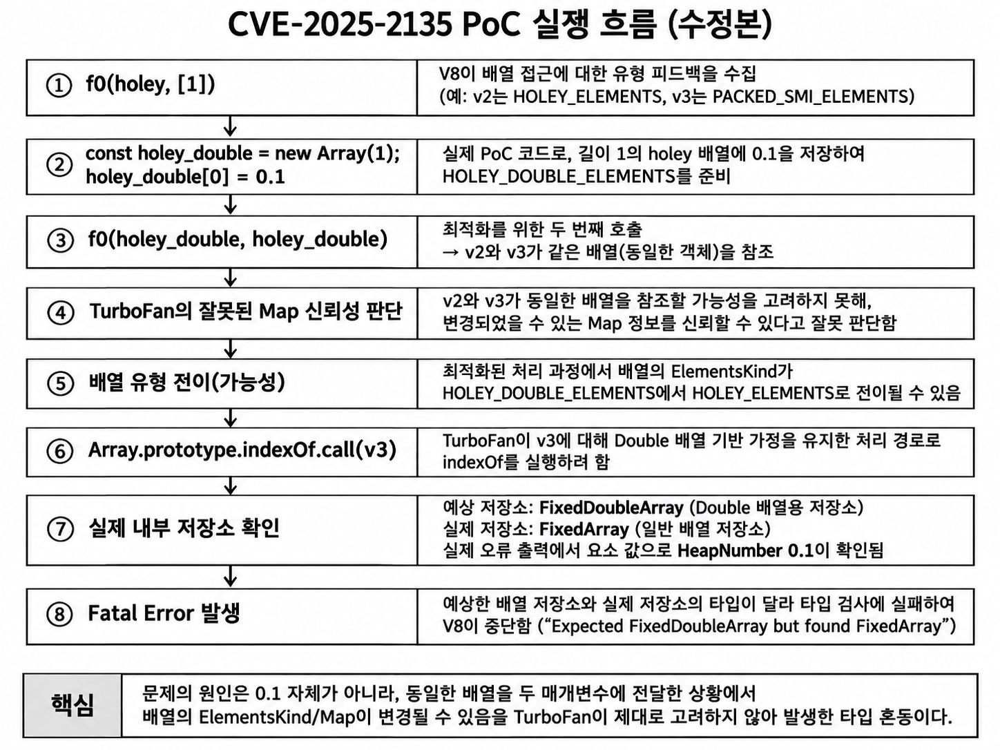

# CVE-2025-2135 / Type Confusion

# 1. CVE-2025-2135는 어떤 취약점 일까?

| **항목** | **내용** |
| --- | --- |
| 취약점 식별번호 | CVE-2025-2135 |
| 대상 | Google Chrome에서 사용하는 V8 JavaScript 엔진 |
| 유형 | **Type Confusion**, CWE-843 |
| 중요 관련 컴파일러 | TurboFan |
| 직접 관련 소스 | `src/compiler/node-properties.cc` |
| 관련 함수 | `NodeProperties::InferMapsUnsafe()` |
| 관련 내부 연산 | `TransitionElementsKindOrCheckMap` |
| Chromium 이슈 | 400052777 |
| 보안 심각도 | High |
| 수정된 Chrome 데스크톱 버전 | 134.0.6998.88 이상에 포함된 보안 수정 |
| 공식 패치 커밋 | `8b490a9690b859346a68a3d2a7008b4e1852c3ea` |
| 공식 패치의 부모 커밋 | `8f51e033902da9b786358e6e82f0dc57b46464dc` |

## 1-1.  Type Confusion이란?

Type Confusion은 프로그램이 실제 데이터의 유형을 잘못 판단하여, 해당 데이터를 다른 유형으로 해석하거나 처리하는 문제를 의미함.

예를 들어 V8이 배열의 내부 저장소를 Double 배열이라고 판단했지만, 실제로는 일반 객체를 저장하는 배열이라면 예상한 데이터 구조와 실제 데이터 구조가 일치하지 않게 됨.

JavaScript에서는 다음과 같은 배열을 만들 수 있음.

```jsx
let arr1 = [1, 2, 3];
let arr2 = [1.1, 2.2, 3.3];
let arr3 = ["A", "B", "C"];
let arr4 = [1, "A", 3.14, true];
```

JavaScript 입장에서는 모두 배열이지만, V8 내부에서는 배열의 원소 유형에 따라 서로 다른 방식으로 데이터를 저장할 수 있음.

| JavaScript 배열 | 배열에 들어 있는 값 | V8 내부 배열 표현 방식 |
| --- | --- | --- |
| `[1, 2, 3]` | 정수 | `PACKED_SMI_ELEMENTS` |
| `[1.1, 2.2, 3.3]` | 소수 | `PACKED_DOUBLE_ELEMENTS` |
| `["A", "B", "C"]` | 문자열 | `PACKED_ELEMENTS` |
| `[1, "A", 3.14, true]` | 정수, 문자열, 소수, 불리언 | `PACKED_ELEMENTS` |
- **JavaScript 관점**: 네 가지 모두 `Array`이며, 배열에 저장된 값의 유형을 확인할 수 있음.
- **V8 관점**: 배열에 어떤 값이 들어 있는지에 따라 `PACKED_SMI_ELEMENTS`, `PACKED_DOUBLE_ELEMENTS`, `PACKED_ELEMENTS` 등으로 내부 저장 방식을 구분.

## 1-2. V8엔진이란?

V8은 Google에서 개발한 JavaScript 엔진.

JavaScript 코드를 실행하는 역할을 하며 Chrome 브라우저나 Node.js 등에서 사용.

예를 들어 다음 코드가 있다고 가정함.

```jsx
let arr = [1, 2, 3];
```

JavaScript 코드에서는 단순히 숫자 3개를 배열에 저장한 것처럼 보이지만 V8은 이 배열을 내부적으로 어떻게 관리할지 결정해야 함.

이때 고려하는 사항 중 하나가 **배열에 어떤 종류의 데이터가 들어 있는가**인데, 이처럼 데이터의 유형을 구분하는 이유는 **메모리를 효율적으로 사용하고 코드를 빠르게 실행하기 위해서**임.

## **1-3. V8 내부의 배열 표현 방식**

V8에서는 배열 요소의 저장 형태를 구분하기 위해 `ElementsKind`라는 개념을 사용함

### **① PACKED_SMI_ELEMENTS**

```jsx
let arr1 = [1, 2, 3];
```


먼저 이름을 나눠보자.

- `PACKED` : 배열의 인덱스 사이에 빈 공간(hole)이 없는 상태
- `SMI` : Small Integer의 약자로, V8에서 작은 정수를 효율적으로 표현하는 방식
- `ELEMENTS` : 배열에 저장된 요소

따라서 `PACKED_SMI_ELEMENTS`는 **빈 공간 없이 SMI 정수로 구성된 배열**을 의미.

여기서 SMI는 모든 정수를 의미하지 않아. V8의 내부 표현 범위에 들어가는 정수를 말함.

### **② PACKED_DOUBLE_ELEMENTS**

```jsx
let arr2 = [1.1, 2.2, 3.3];
```


여기서 `DOUBLE`은 배정밀도 부동소수점 숫자 표현을 의미하며, 일반적으로 64비트 IEEE 754 형식을 사용함.

V8은 `1.1`, `2.2`, `3.3`처럼 SMI로 표현할 수 없는 숫자가 들어 있는 배열을 `PACKED_DOUBLE_ELEMENTS`로 관리할 수 있음.

중요한 점은 JavaScript 자체에서는 정수와 소수를 별도의 Number 타입으로 구분하지 않는다는 것임.

```
typeof 1;   // "number"
typeof 1.1; // "number"
```

두 값 모두 `number`지만, **V8 내부에서 사용하는 표현 방식은 달라질 수 있음.**

### **③ PACKED_ELEMENTS**

```jsx
let arr3 = ["A", "B", "C"];
```


`PACKED_ELEMENTS`는 SMI 전용이나 Double 전용 배열과 달리 일반적인 JavaScript 값들을 저장하는 방식.

예를 들어 문자열, 객체 등을 저장할 수 있음.

```jsx
let arr = ["A", "B", "C"];
let arr2 = [{id: 1}, {id: 2}];
let arr3 = [1, "A", 3.14];
```

다만 문자열 자체의 내용이 배열 요소 슬롯 안에 직접 저장된다는 뜻은 아님. 일반적으로 배열 슬롯에는 문자열을 비롯한 힙 객체를 가리키는 참조 형태의 값이 저장.

## **1-4. PACKED는 정확히 무슨 뜻일까?**

`PACKED`는 배열의 인덱스에 빈 공간이 없다는 뜻임.

```jsx
let arr1 = [1, 2, 3];
let arr2 = [1, , 3];
```


V8은 이런 빈 공간이 있는 배열을 `HOLEY` 계열로 구분.

| 배열 | V8 내부 표현의 예 |
| --- | --- |
| `[1, 2, 3]` | `PACKED_SMI_ELEMENTS` |
| `[1, , 3]` | `HOLEY_SMI_ELEMENTS` |
| `[1.1, 2.2, 3.3]` | `PACKED_DOUBLE_ELEMENTS` |
| `[1.1, , 3.3]` | `HOLEY_DOUBLE_ELEMENTS` |
| `["A", "B", "C"]` | `PACKED_ELEMENTS` |
| `["A", , "C"]` | `HOLEY_ELEMENTS` |

여기서 주의할 점은 **빈 공간(hole)과** `undefined`**는 다르다**는 것.

```
let a = [1, , 3];
let b = [1, undefined, 3];
```

`a`에는 실제로 존재하지 않는 요소가 있지만 `b`에는 `undefined`라는 값이 저장된 요소 있음.

## **1-5. 배열의 요소 유형이 바뀌면 어떻게 될까?**

처음에는 정수만 들어 있던 배열에 소수를 추가하면 어떻게 될까?

```jsx
let arr = [1, 2, 3];
// PACKED_SMI_ELEMENTS

arr.push(4.5);
// PACKED_DOUBLE_ELEMENTS
```

V8은 배열에 새로운 데이터가 추가되면서 기존 표현 방식이 적합하지 않게 되면 요소 유형을 변경할 수 있음.

문자열을 추가한다면 다음과 같음

```jsx
arr.push("Hello");
// PACKED_ELEMENTS
```


이러한 변화를 `ElementsKind Transition`라고함.

배열의 요소 유형이 변경되면 V8이 내부 저장 방식을 바꾸거나 기존 데이터를 변환해야 할 수 있음.

일반적인 경우 `PACKED_ELEMENTS`로 변경된 배열이 다시 정수만 남았다고 해서 자동으로 `PACKED_SMI_ELEMENTS`로 돌아가는 것은 아님.

`ElementsKind Transition`은 V8에서 정상적으로 발생하는 동작이며, 그 자체가 Type Confusion을 의미하지는 않음.

하지만 배열의 내부 요소 유형이 변경되었음에도 최적화된 코드가 이전 유형을 계속 신뢰한다면, 실제 데이터의 유형과 코드가 예상하는 유형이 달라질 수 있음.

이러한 불일치로 인해 데이터를 잘못된 유형으로 해석하거나 처리하면 Type Confusion이 발생할 수 있음.

## **1-6. V8은 왜 이렇게 복잡하게 구분할까?**

가장 큰 이유는 **성능 최적화**라고 할 수 있음.

예를 들어 다음 두 배열을 비교해 보았을 때,

```jsx
let arr1 = [1, 2, 3, 4, 5];

let arr2 = [1, "A", 3.5, {}, true];
```

`arr1`은 모든 요소가 작은 정수이므로 V8이 일관된 방식으로 처리하기 쉬움.

반면 `arr2`는 여러 종류의 값이 섞여 있어서 각 데이터를 처리할 때 어떤 종류의 값인지 고려해야 할 수 있음.

정리하면,

- `PACKED_SMI_ELEMENTS` → V8이 배열 요소가 SMI 정수라는 사실을 알고 있으므로 정수에 맞춰 효율적으로 처리할 수 있음
- `PACKED_ELEMENTS` → 숫자, 문자열, 객체 등 여러 종류의 값이 들어갈 수 있으므로 실제 값의 타입에 따라 처리 방법을 결정해야 할 수 있음.

다만 `PACKED_SMI_ELEMENTS`가 모든 상황에서 반드시 가장 빠르다는 의미는 아니고 실제 성능은 수행하는 연산, V8 버전, 최적화 상태 등에 따라서도 달라짐.

## **1-7. 핵심 정리**

| 구분 | 의미 | 예제 |
| --- | --- | --- |
| `PACKED_SMI_ELEMENTS` | 빈 공간 없이 작은 정수 저장 | `[1, 2, 3]` |
| `PACKED_DOUBLE_ELEMENTS` | 빈 공간 없이 Double 숫자 저장 | `[1.1, 2.2, 3.3]` |
| `PACKED_ELEMENTS` | 빈 공간 없이 일반 JavaScript 값 저장 | `["A", "B", "C"]` |
| `HOLEY_SMI_ELEMENTS` | 빈 공간이 있는 SMI 배열 | `[1, , 3]` |
| `HOLEY_DOUBLE_ELEMENTS` | 빈 공간이 있는 Double 배열 | `[1.1, , 3.3]` |
| `HOLEY_ELEMENTS` | 빈 공간이 있는 일반 값 배열 | `["A", , "C"]` |

**결론적으로, 
JavaScript의 배열은 겉으로 보면 모두 동일한 Array이지만, V8은 배열에 저장된 값의 종류와 빈 공간의 존재 여부에 따라 내부 요소 저장 방식을 구분함.**

**V8이 어떤 배열을 Double 배열이라고 가정한 상태에서 실제 내부 요소 유형과 맞지 않게 처리하면 타입 혼동(Type Confusion)이나 잘못된 메모리 접근과 관련된 취약점으로 이어질 수 있음.**

---

# 2. 분석 환경 구축

## 2-1. 분석 폴더 생성 및 공식  PoC 다운로드


## **2-2.  depot_tools 설치**

`depot_tools`는 Chromium/V8 프로젝트가 제공하는 소스 동기화 및 빌드 보조 도구 모음이다. V8 소스코드를 가져오기 위해 `fetch`, `gclient`를 사용.


 *`fetch` 명령어가 PATH에 등록되어 있음을 확인.*

## **2-3. V8 소스 다운로드**


*V8 소스 저장소가 로컬에 생성*

## **2-4. 취약한 커밋 선택 및 의존성 동기화**

V8 최신 개발 버전에는 이미 해당 취약점이 수정되어 공식 수정 커밋의 부모(패치 바로 직전) 커밋 선택.

```bash
git checkout 8f51e033902da9b786358e6e82f0dc57b46464dc
git rev-parse HEAD
gclient sync
```

- `git checkout <커밋>`: 지정된 시점의 소스코드로 작업 트리 이동.
- `git rev-parse HEAD`: 현재 선택된 정확한 커밋 식별.
- `gclient sync`: 선택된 커밋의 의존성 파일과 외부 프로젝트 동기화.


*패치 직전 커밋 체크아웃과 `gclient sync` 진행 결과*

## **2-5. 빌드 의존성 설치**

처음에는 V8의 패키지 설치 스크립트를 사용했었음.


*V8 빌드 의존성 스크립트에서 지원 OS 경고 출력.*

그러나 공식 지원 Ubuntu 버전 목록에 **Ubuntu 26.04.1 LTS**가 포함되어 있지 않아 `--unsupported` 옵션을 사용함.


오류오류


## **2-6. GN 빌드 설정과 Ninja 컴파일**

지금까지 준비된 건 V8의 **C++ 소스코드**임.

하지만 소스코드만으로는 JavaScript를 실행할 수 없기 때문에, 컴파일해서 `d8`이라는 실행 프로그램을 만들어야함.

이때 , 아래 두가지 작업이 필요함

**① 빌드 설정 생성 (GN) :** 어떤 방식으로 V8을 만들지 결정

**② 실제 컴파일 (Ninja) :** C++ 소스코드로 d8 실행 파일 생성


### V8 Debug 빌드 설정


*GN 빌드 설정 생성 완료.*

| **옵션** | **뜻** |
| --- | --- |
| `out/vuln-debug` | 취약 버전 빌드 결과 저장 위치 |
| `is_debug=true` | Debug 빌드(내부 검사와 디버깅용 설정) |
| `is_component_build=false` | 구성 요소를 개별 공유 라이브러리로 분리하지 않는 빌드 |
| `target_cpu="x64"` | x86-64 실행 환경 대상 |
| `symbol_level=1` | 일부 디버깅 정보만 포함, 빌드 크기 절감 |

### d8 실행 파일 만들기


| 부분 | 설명 |
| --- | --- |
| `ninja` | 소스코드를 컴파일하는 빌드 도구 |
| `-C out/vuln-debug` | 앞에서 생성한 빌드 설정 사용 |
| `-j 2` | 동시에 최대 2개의 빌드 작업 실행 |
| `d8` | 만들 프로그램의 이름 |


# **3. 공식 PoC 확보와 취약점 재현**

## 3-1. PoC의 목적과 출처

PoC(Proof of Concept)는 해당 취약점이 실제로 발생함을 검증하기 위한 최소 테스트 코드임. 이번에는 공식 V8 수정 커밋에 추가된 회귀 테스트 파일을 사용함.

- 파일명: `regress-400052777.js`
- 위치: `poc/regress-400052777.js`
- 공식 원본: [https://chromium.googlesource.com/v8/v8/+/8b490a9690b859346a68a3d2a7008b4e1852c3ea/test/mjsunit/compiler/regress-400052777.js](https://chromium.googlesource.com/v8/v8/+/8b490a9690b859346a68a3d2a7008b4e1852c3ea/test/mjsunit/compiler/regress-400052777.js)

```bash
# 방법 A: Gitiles에서 BASE64 형태를 내려받아 디코딩
mkdir -p ~/CVE-2025-2135/poc
cd ~/CVE-2025-2135
curl -fsSL \  
	'https://chromium.googlesource.com/v8/v8/+/8b490a9690b859346a68a3d2a7008b4e1852c3ea/test/mjsunit/compiler/regress-400052777.js?format=TEXT' \  
	| base64 -d > poc/regress-400052777.js
	
# 방법 B: Git 저장소에서 패치 커밋의 해당 파일만 추출
cd ~/CVE-2025-2135/v8
git show 8b490a9690b859346a68a3d2a7008b4e1852c3ea:test/mjsunit/compiler/regress-400052777.js \  > ../poc/regress-400052777.js

# 확인
nl -ba ../poc/regress-400052777.js
```

**중요:** `git show`는 패치된 테스트 파일의 내용을 출력할 뿐 취약 버전 V8의 C++ 코드를 자동으로 패치하지 않음.

## **3-2. 공식 PoC 전체 코드**


*분석 대상 공식 PoC 전체 코드. 파일 하단의 `main(); main();`까지 확인.*

## **3-3. PoC 실행 옵션**


| 명령어 / 옵션 | 의미 |
| --- | --- |
| `./out/vuln-debug/d8` | 직접 빌드한 취약한 V8 엔진 실행 |
| `--allow-natives-syntax` | `%PrepareFunctionForOptimization()` 등의 V8 내부 함수 사용 허용 |
| `--turbofan` | TurboFan 최적화 컴파일러 활성화 |
| `--no-always-turbofan` | 모든 함수를 무조건 TurboFan으로 컴파일하지 않도록 설정 |
| `../poc/regress-400052777.js` | 취약점 재현용 JavaScript 파일 실행 |

## **3-4. 취약 버전에서 관찰된 결과**



- V8의 예상: 이 배열의 내부 저장소는 `FixedDoubleArray`일 것이다.
- 실제 저장소: `FixedArray`였다.
- 결과: 예상한 자료구조와 실제 자료구조가 달라 V8의 내부 검사에서 오류가 발생했다.

즉,  **V8은 실수(Double)를 저장하는 배열 구조가 있을 것이라고 예상했는데, 실제로 확인해 보니 일반적인 JavaScript 값을 저장하는 배열 구조가 있었다는 것.**


| 구분 | FixedDoubleArray | FixedArray |
| --- | --- | --- |
| 역할 | Double 값 저장 | 태그된 JavaScript 값 저장 |
| 주요 배열 유형 | DOUBLE_ELEMENTS 계열 | SMI_ELEMENTS 및 ELEMENTS 계열 |
| PoC에서의 관계 | V8이 예상한 구조 | 실제 확인된 구조 |

## 3-5. PoC코드로 이해

```jsx
function main() {
  function f0(v2, v3) {
    var v4 = v3[0];   // ①
    var v5 = v2[0];   // ②
    Array.prototype.indexOf.call(v3); // ③
  }

  %PrepareFunctionForOptimization(f0);

  const holey = new Array(1);
  holey[0] = 'tagged';

  f0(holey, [1]); // ④ 첫 번째 호출

  const holey_double = new Array(1);
  holey_double[0] = 0.1;

  %OptimizeFunctionOnNextCall(f0);

  f0(holey_double, holey_double); // ⑤ 최적화 호출
}

main();
main();
```

1. **V8이 배열 유형 정보 수집**
    
    ```jsx
    const holey = new Array(1);
    holey[0] = 'tagged';
    
    f0(holey, [1]);
    ```
    
    `new Array(1)`은 길이가 1이지만 인덱스 0에 요소가 없는 배열을 생성함.
    
    이후 문자열을 넣었으므로 `holey`는 `HOLEY_ELEMENTS`,`[1]`은 `PACKED_SMI_ELEMENTS`.
    
    | 매개변수 | 실제 배열 | V8 내부 유형 |
    | --- | --- | --- |
    | `v2` | `["tagged"]` | `HOLEY_ELEMENTS` |
    | `v3` | `[1]` | `PACKED_SMI_ELEMENTS` |
    
    이때 `f0()` 내부에서는 다음 코드가 실행되어, 
    
    ```jsx
    var v4 = v3[0];
    var v5 = v2[0];
    ```
    
    `v4`에는 숫자 `1`이, `v5`에는 문자열 `"tagged"`가 들어가게 됨.
    
    그런데 V8 입장에서는 단순히 값을 읽는 것뿐만 아니라, **각 배열 접근에서 어떤 유형의 배열이 사용되었는지에 대한 피드백을 수집** 하여 이 정보는 나중에 TurboFan이 `f0()`를 최적화할 때 활용.
    
    ** **TurboFan이란?**
    TurboFan은 V8 JavaScript 엔진에서 코드를 최적화하는 컴파일러임.
    프로그램 실행 중 수집한 유형 정보 등을 활용하여 코드를 더 효율적으로 실행할 수 있도록 최적화함.
    
2. **두 번째 호출 준비**
    
    ```jsx
    const holey_double = new Array(1);
    holey_double[0] = 0.1;
    ```
    
    실수 `0.1`을 저장하는 배열을 생성. V8의 배열 유형으로는 `HOLEY_DOUBLE_ELEMENTS`.
    
    ```jsx
    %OptimizeFunctionOnNextCall(f0);
    f0(holey_double, holey_double);
    ```
    
    첫 번째 줄은 V8에 `f0()`의 다음 호출에서 최적화를 시도하도록 요청 하고 있음.
    
    다음 두 번째 줄에서는 **동일한 배열을 두 번 전달.**
    
    즉, 실제로는 다음과 같은 상황.
    
    
    
    이런 현상을 **Aliasing(별칭 관계)**하고 하며, `v2`의 배열 유형이 바뀌면 `v3`가 가리키는 배열의 유형도 함께 바뀜.
    
3. `f0()` **내부**
    
    여기가 실제 취약점과 직접 연결되는 부분임.
    
    ```jsx
    function f0(v2, v3) {
      // TransitionElementsKindOrCheckMap: PACKED_SMI -> HOLEY_DOUBLE_ELEMENTS
      var v4 = v3[0];
    
      // TransitionElementsKindOrCheckMap: HOLEY_DOUBLE_ELEMENTS -> HOLEY_ELEMENTS
      var v5 = v2[0];
    
      // If v2 == v3, v3 doesn't have HOLEY_DOUBLE_ELEMENTS anymore.
      Array.prototype.indexOf.call(v3);
    }
    
    ```
    
    여기서 주석의 `TransitionElementsKindOrCheckMap`은 JavaScript 코드가 직접 실행하는 명령어가 아님. **TurboFan이 최적화 과정에서 생성하는 내부 연산을 설명하는 주석**임.
    
    **첫 번째 배열 접근**
    
    ```jsx
    var v4 = v3[0];
    ```
    
    최적화 과정에서 주석에 표시된 전이는`PACKED_SMI_ELEMENTS → HOLEY_DOUBLE_ELEMENTS`
    
    처음 수집한 피드백에는 `v3`가 정수 배열이었지만, 최적화 호출에서는 `HOLEY_DOUBLE_ELEMENTS` 배열이 전달.
    
    **두 번째 배열 접근**
    
    ```jsx
    var v5 = v2[0];
    ```
    
    `HOLEY_DOUBLE_ELEMENTS → HOLEY_ELEMENTS`
    
    그런데 앞에서 확인했듯이 `v2`와 `v3`는 같은 배열이기 때문에 `v2`를 통한 처리로 실제 배열이 `HOLEY_ELEMENTS`로 전이되면, `v3`도 더 이상 `HOLEY_DOUBLE_ELEMENTS` 배열이 아님.
    
    
    
    여기서 배열의 값 자체는 여전히 `0.1`이지만, 내부 저장소는 `FixedDoubleArray`에서 `FixedArray`로 바뀔 수 있음. 따라서 `0.1`은 `HeapNumber` 객체로 표현될 수 있음.
    
4. **TurboFan이 무엇을 잘못한 걸까?**
    
    핵심은 **두 매개변수가 같은 배열을 참조할 가능성을 제대로 고려하지 못한 것**임.
    
    TurboFan 내부에서는 `v2`와 `v3`가 서로 다른 IR 노드로 표현됨.
    
    IR 노드는 컴파일러가 프로그램의 연산이나 값을 표현하기 위해 사용하는 내부 구조임.
    
    따라서 실제 실행 시 두 매개변수가 같은 배열을 참조하더라도, 컴파일러 내부에서 두 노드가 동일하다고 판단되는 것은 아님.
    
    **그렇다면 이것이 왜 문제가 될까?**
    
    이를 이해하려면 먼저 V8의 Map 개념을 알아야 함.
    
    **Map이란?**
    
    V8에서 Map은 객체의 내부 구조를 나타내는 정보를 관리하는 객체임.
    
    JavaScript의 `Map` 자료구조와는 다른 개념이며, 객체의 속성 구조나 배열의 ElementsKind 등의 정보를 포함함.
    
    TurboFan은 이러한 Map 정보를 활용하여 객체의 유형과 구조를 추론하고 코드를 최적화함.
    
    하지만 배열에 새로운 유형의 값이 추가되는 등의 이유로 ElementsKind가 변경되면, 해당 배열의 Map도 변경될 수 있음.
    
    따라서 TurboFan은 기존에 추론한 Map 정보를 계속 신뢰해도 되는지 판단해야 함.
    
    **이 과정과 관련된 함수가 `InferMapsUnsafe()`임.**
    
    `InferMapsUnsafe()`는 객체의 Map을 추론하는 과정에서 다른 연산으로 인해 Map이 변경되었을 가능성을 고려함.
    
    이때 `IsSame()`을 사용하여 내부 연산의 대상과 분석 중인 배열이 동일한 IR 노드인지 비교함.
    
    문제는 **서로 다른 IR 노드가 실제로는 같은 배열을 참조할 수 있다는 점**임.
    
    `v2`와 `v3`가 서로 다른 IR 노드로 표현되어 있으면 `IsSame()`은 두 노드가 동일하지 않다고 판단할 수 있음.
    
    하지만 이것이 두 매개변수가 실제로 서로 다른 배열을 참조한다는 의미는 아님.
    
    따라서 두 노드가 같지 않더라도 **같은 객체를 참조할 가능성을 배제할 수 없다면, 기존 Map 정보의 신뢰성을 낮춰야 함.**
    
    그러나 취약한 코드에서는 이러한 가능성을 충분히 고려하지 않아 Map 정보를 신뢰할 수 없는 상태로 처리하는 과정이 누락됨.
    
    그 결과 TurboFan은 실제로 변경되었을 수 있는 배열의 Map 정보를 계속 신뢰하고, 잘못된 유형을 가정한 최적화를 수행하게 됨.
    
    즉, **실제 배열의 내부 유형과 TurboFan이 예상한 유형 사이에 불일치가 발생할 수 있게 된 것임.**
    
5. **그래서 마지막** `indexOf()`**에서 오류 발생**
    
    ```jsx
    Array.prototype.indexOf.call(v3);
    ```
    
    이 코드는 `v3` 배열에 대해 `indexOf()`를 호출하는 코드임.
    
    검색할 값을 인수로 전달하지 않았으므로 JavaScript 의미상 `undefined`를 찾는 호출이 됨.
    
    `indexOf()`**가 실제 배열의 내부 유형과 맞지 않는 최적화된 처리 경로로 들어갔다는 것**.
    
    오류 메시지와  연결해 보면
    
    
    
    | 오류 메시지 | PoC 코드와의 연결 |
    | --- | --- |
    | `Expected FixedDoubleArray` | TurboFan이 `v3`를 Double 배열로 가정한 처리 경로 |
    | `found [FixedArray]` | 실제 배열은 `HOLEY_ELEMENTS` 저장소로 변경됨 |
    | `length: 1` | `new Array(1)`로 생성된 배열의 저장소 길이 |
    | `HeapNumber 0.1` | `holey_double[0] = 0.1`에서 지정한 값 |
    | `Type cast failed` | 예상 저장소와 실제 저장소가 달라 내부 타입 검사 실패 |
    
    여기서 `HeapNumber 0.1`이 바로 PoC코드에서 넣은 `0.1`이라는 점이 중요한데,
    
    V8이 발견한 `FixedArray` 내부에 `0.1`이라는 값을 가진 `HeapNumber` 객체가 들어 있었다는 뜻임.
    
    즉, **PoC에서 사용한 값** `0.1`**이 오류 메시지에서도 확인된다는 의미.**
    
    결과적으로, **PoC에서 같은 배열을 두 매개변수에 전달한 것이 배열의 내부 유형 변화와 잘못된 타입 추론을 연결하는 핵심 조건**이라고 할 수 있음.
    
6. **전체 과정**
    
    